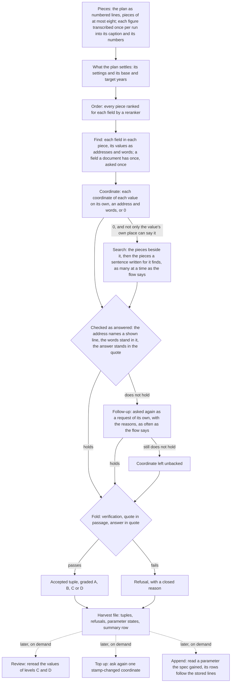
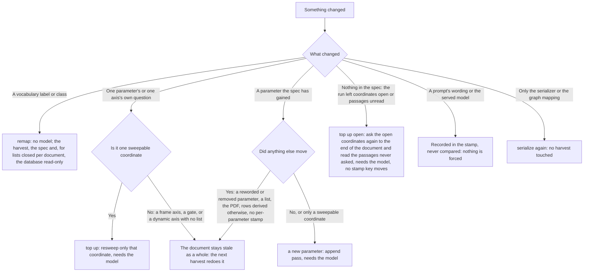

## Purpose

`docpipe/extraction/` is the stage where a retrievable passage becomes a
typed value a knowledge graph can hold. Stages 1 through 6 turn a PDF into
sections, tables and figures a search can find; this stage reads those
passages against a profile's ontology contract and writes out value
tuples, a number, a class from a closed vocabulary, or a plain text
string, with its unit or vocabulary entry where the parameter has one,
and a handful of axes (which carrier, which sector, which year, which
scenario) that place it in the ontology's own terms.
`docpipe/extraction/__init__.py` names this ontology-based information
extraction, OBIE.

Nothing here is written on a model's word alone: every claim is checked
against the profile's closed vocabularies and the literal text of its
passage, and what survives carries that evidence, down to each
coordinate's own quote and source. A value the
run cannot back is refused rather than written with a gap where its
evidence should be. That is what separates this stage from a plain text
search: the question it answers is not only what the document says but
whether this run can support it with evidence, and the answer is recorded
next to the value, in a form later stages and the six passes that act on
a harvest already written can use without starting a document over.

## Position in the pipeline

| | |
|---|---|
| **In** | The corpus [chunking](chunking.md) built: the SQLite database's `Sections`, `Tables`, `Images`, `Embeddings`, `Documents` and `DocumentMeta` rows, and the FAISS index. No file under `results/` is read directly. Also a profile's validated `extraction_spec.json` (`spec.load`). |
| **Out** | One `<document>.jsonl` harvest and one `<document>.stamp.json` resume stamp per document, a per-document trace file under `trace/`, a `survey/<document id>.json` per document, the order its pieces are read in, a `transcripts/<document id>.json` per document with figures, the caption and numbers its figures were transcribed into, `query_cache.db` once per run, a `stats/<pass>-<run start>.json` and, for every file the run replaced, the copy it found under `archive/` (see Archive and stats). A `--serialize` call reads the harvest back and writes one Turtle file (a profile whose drawing asks for a strict graph, kwp, writes a second, `.strict.ttl`), feeding [the knowledge graph](graph.md) stage. |
| **Resumes on** | `<document>.stamp.json`, compared against what today's spec would produce, one key per parameter, value list, axis and slot; the whole-file spec sha stands in only for a stamp that carries none of those. The sha256 of the PDF the harvest was read from is compared too, where the stamp and the database both carry one. The model, the anchors key and every prompt are written into the stamp for a reader and are never compared. A document with no stamp is read as fully stale, never as finished, and a document one of whose requests ended on a 429 or a 5xx, timed out, was refused to the end or failed in our own code is not stamped, which the run counts as a failure and answers with exit code 1. |
| **Needs** | A served LLM reached over the network, the query embedder, the FAISS index, the corpus database, and, unless `EXTRACT_LOCATE=0`, the source PDF (`--pdf-root`) to place a quote's highlight rectangles. Unless `EXTRACT_ATTACH_IMAGES=0`, also the `images/` directory (`--image-root`) with the table and figure crops that ride along with every request. |

Extraction is the seventh of the pipeline's eight stages. [Chunking,
embedding, database](chunking.md) precedes it and is the last stage to
write anything under `results/`; from here on, a document's state lives
in the database and its stamp. [The knowledge graph](graph.md) follows,
reading only the tuples this stage accepted, never a refusal or the
spec itself.

One document, from its order to its summary row:



## Method

### Loading and validating the spec

`spec.load` parses a profile's `extraction_spec.json` into a `Spec` of
`Parameter` and `Axis` objects, refusing anything wrong: too short a
parameter description, a numeric parameter missing a unit factor, two
vocabulary labels folding to one spelling under two different classes,
or an axis naming more than one of vocabulary, enum, type or dynamic.
`SpecError` names the offending field, failing at load time rather than
partway through a batch. A
parameter carries one of four value types, `spec.VALUE_TYPES`: `float`
and `int` take a unit, `category` a closed vocabulary, and `text` a
plain string compared verbatim rather than mapped to a class; `text` is
the majority type in the scenarios profile, 11 of its 18 parameters
(`profiles/scenarios/extraction_spec.json`). Vocabulary labels are
compared after `fold_label`, not as raw strings. A unit is never
folded: it is read as its own coordinate, against the literal entries
of `units_accepted` (`fields.unit_slot`), and `Parameter.unit_factor`
is an exact lookup of the entry chosen, not a spelling match
(`spec.py`). A spelling table stood in for that reading once;
measured on 641 plans of corpus_m5, it let 3,324 tuples carry an entry
their wording contradicts. A unit is never refused (owner decision
2026-11-07): the model copies the printed unit into `unit_raw` and chooses the
entry it means, or `""` where none fits. A number without an entry stays read
with its printed unit and without `value_target`, flagged
`unmapped:unit:<print>`; it is no input of the compute step and not in the
graph until the list grows and a top-up asks the unit again (key `slot/unit`).
Each harvest file's summary line counts them as `unlisted_units`. An entry of
`units_accepted` is a factor onto
`unit_target` or an object, `{"factor": 1.0, "names_period": true}`, which may add
a `"target"`, the unit its factor converts onto where that is not `unit_target`
(`Parameter.target_of`); only an entry onto `unit_target` derives coordinates
from the unit (`fields.derived_by_unit`). A
parameter that is an amount over a span (`integrated`, the default) has to
say it for every entry, whether the unit names a period ("MWh/a" does,
"MWh" does not): `spec.load` refuses an entry without a true or false
statement, a bare factor or a text among them, and an entry that is a rate
(`integrated: false`) may stay a bare factor. The statement is the spec's own
word on the entry and no pattern reads a spelling any more. It reaches no
request and no fingerprint, so changing one moves no stamp key and costs no
re-read. An axis that still sets
an evidence rule is refused at load time (`spec.py`): a
coordinate is checked for its quote and its answer, wherever the
passage stands.

A spec names `groups`: the coordinates a plan prints together, each group
with the step that reads it (`read_in`, which can only be `reading`) and a sentence
on where a plan prints it (`where`; no request of the flow shows it any more).
kwp has three: `frame` (scenario and year, the pair that dates a value), `number`
(unit, `what`, the number's own name in the plan's words, `subject` and
`qualifier`) and `context` (the other axes). A value's coordinates are asked in the
order of the groups and of each group's coordinates, each for this value alone:
nothing is taken over for a whole table or section (owner decision 2026-11-07; see
Asking a coordinate of a value). scenarios has three, `work` (whether the value is
this publication's or another work's), `year_kind` (what kind of year a year is) and
`scenario` (the scenario a value refers to). `spec.load` refuses a coordinate in no
group or in two, a name that is no coordinate, and a step other than `reading`. A
spec without groups stops the run (see The run harvests from the survey). A group
may say `"definition": "full"`, which `spec.load` reads into `Group.full_definition`
and no request of the flow consults any more: a request shows a field by its `brief`
where the spec writes one, else by its description, and only a field asked once of
a document is shown in full. A group may name a
`pair`, which only says that those coordinates are the plan's frame, the ones its
base and target years date a value by (`Group.paired`; kwp's `frame` does). A group
may also say which coordinates the search does not ask (owner decision
2026-11-06): `own_passage` names those only the place of the value can state, asked
at the value's place and never searched, and `own_value` those printed with the
number itself, whatever else answers (`Group.own_passage`, `Group.own_value`); a
coordinate is in one of them or neither. kwp: `unit`, `what`, `subject`,
`aggregation` and `role` are `own_passage`, `qualifier` is `own_value`.

A parameter may say `"once_per_document": true`, which has it asked once per
document and not in every piece (see A field a document has once), and
`"takes_group": false`, which has a value stated for a group of scenarios taken
as one name and not as its members (see Words for a group). An entry of a list,
of an axis or of a parameter's value, may carry a `"group"`, which a long list is
asked by first (see Entries of a list). A coordinate's question is one line in the
spec's own words (`Axis.question`).

### Pieces and addresses

The first step of a document's harvest (`units.py`, owner decisions 2026-11-08,
both profiles). The code numbers what the model reads, and the model answers
with a number and never with a copied quote: what an address names is the
code's to look up.

A section is cut first at its line ends and then at its sentence ends, a
heading a line of its own (`units.sentences_of`). An abbreviation ("z. B.",
"S. 12", "et al.", the rule `abbreviations`) and an ordinal ("3. Oktober") end no
sentence, and a number such as "1.155 MWh" never breaks, since a sentence ends
only where a mark is followed by a space. A table is its title lines, its head
lines and its body rows, numbered in that order from 1 (the rule under the
head counts not), each body row one line whose cells are numbered from 1; the
lines under a table are lines as well (`units.table_lines`). Every line that
"|" divides has cells, wherever it stands and not only a table row
(`units.line_cells`): "26 2019 | Erdgas | 11" is addressed 26.1 to 26.3. A figure
is the lines a model wrote it into once, its caption first and then its
numbers (see Transcribing the figures), else the sentences of its description. A table the layout cut at a
page break is cut alone: `lookup.continued` still marks the table it may
continue, but no request of this flow shows that table's title or head.

An address is a line, `19`, a cell of a table row, `19.5` (line 19, cell 5), or
a stretch of lines, `12-14` (`units.address_of`). A request shows its own
passage under its own numbers and every other block of lines under a letter of
its own, so that no two lines of a request share an address: the title page
`T`, the headings up to the value's place `H`, the plan's settings `F`, and
any other passage `A`, `B`, ... (`units.Shown`). The title page is the first
`title_page_lines` lines of the plan's first page, else of its second, and `H`
holds the last `headings` headings up to the place, its own last (numbers of the
flow, see The flow file).
`H`, `T` and `F` are numbered from 1 in the block; every line of a passage keeps
one number in every request that shows it.

A piece (`units.Chunk`) is at most `piece_lines` lines of its passage, a number
of the flow (a profile that wants another number writes it into its own
`flow.json`; owner decision 2026-11-08: eight lines, and twelve only where a
probe loses values against the runs before). A table's title and head lines are shown with every piece of it under
the same numbers, the caption lines of a figure with numbers likewise, and a passage
that holds fixed lines only is one piece. A figure with numbers is first the
piece of its caption, then the pieces of its numbers, each shown with the caption
(`units.chunks_of`); a field whose values are not numbers reads the figure in the
piece of its caption alone, a numeric field in the pieces of its numbers
(`units.pieces_for`, `Plan.pieces`). What an address a model gave names is code's
(`addressed.resolve`): the lines it names, which have to be lines the request
showed, are the quote; the passage and the page are the passage's own; the
head of a cell's column is the words over it in the table's head lines
(`units.Passage.head_of`). The model's words are checked against those lines
and are never used in place of them (see Finding a field's values in a piece).

### Transcribing the figures

A figure goes through the model once per run, before the document is read
(the preset `transcribe`, target `figure_lines`: `Engine.writes_figures` and
`targets.figure_lines` write it out, `addressed.Transcripts` keeps it, and
`runner.transcript_fingerprint` names the prompt, model, inputs and answer form it
was written with; prompt `extraction/transcribe`, owner decision
2026-11-08): its crop and its description go out, and the reply is
`{"caption": [...], "numbers": [...]}` (owner decision 2026-11-09). The caption is
the title, a line for each axis with its unit and the names on it, and a line for
each legend entry; the numbers are a line for each number with what it stands for,
as the image prints them; a number the image only draws is written with the mark
that it was read off. The lines are kept under the harvest in
`transcripts/<document id>.json`, per figure with the hash of the image and a
fingerprint of the prompt and the model that wrote them; a figure whose image
and fingerprint are those of the kept lines is not asked again, and a
transcription kept in the older one-list form is transcribed again
(`units.figure_lines` reads such a list as all caption). A figure
without an image (`EXTRACT_ATTACH_IMAGES=0`, or none stored) is not asked, and
its description stands in its place. Its image goes to no other request of the
harvest: from then on a figure is read as a table or a section is, from its
lines (its caption lines shown with every piece of its numbers, as a table's
title and head are), and what a value is checked against is that text. A value read from a
figure, whether from its lines or from its description, carries `drawn`, which
sets the flag `read_off` (`verify.verify_tuple`) and makes the value a level C
(see Trust levels). A transcription that came to nothing, or a reply that did
not parse, is kept nowhere and leaves the description in its place. The
requests are counted as `transcribe` (`transcribe_ask`).

### The order of a whole plan

The next step of the harvest (`addressed.Orders`, `survey.py`). Every piece of
a plan is read for every field of the spec, the pieces of a figure by what the
field takes (`units.pieces_for`; owner decisions 2026-11-08 and 2026-11-09). No
request asks which fields stand in a piece: the survey that did left about 120
values of the probe of one plan never asked, because it named no field for 34 of
207 passages, and a field it did not name was not read there. What this step
decides is the order. For each field the run's reranker scores every piece of the
plan with the field's search sentences and each piece keeps its best score
(`addressed.make_order`); the pieces are read in that order, best first, and
nothing is left out for its rank. Without a reranker (no `RERANK_BASE_URL`) the
pieces of the passages the vector search finds best come first and the pieces
of the other passages follow, and without the search the plan's order stands (see Reranking a search). A reranker, an embedding or a search that
fails is asked again until it answers or the run halts (`runner.persistently`,
`runner.Persistent`) and is never replaced by the plan's order or by an empty
result: `addressed.make_order` has no fallback for a failure. One the server
refuses (a 4xx other than 429) is asked `replies` times at most (a number of
the flow, three by default) and then fails
its document, which stays unfinished for a later run (owner decision
2026-11-09).

The sentences are HyDE sentences, as a document would print the value (owner
decision 2026-11-05, `runner.make_seek_probes`). Every field gets one written for
this document by the model, from its label, description and the names of its
list and from what the document says of itself (`phrase_payload`,
`document_context`: a plan's municipality, a publication's title; owner decision
2026-11-09), and its label only where no sentence could be written. Each sentence
is traced as `seek_probe` and asked in its document's turn (see The adaptive
request limit). An order kept from sentences another phrase prompt wrote is made
again (`addressed.order_key`).

The order of a document is kept in `<harvest>/survey/<document id>.json` (keys
`key`, `complete`, `answers` and `order`), the order a list of piece keys per
field (owner kind, owner id and index of the piece in its passage). It is kept
under a key over the fields with their label and description and the size of the
pieces, and a kept order is read again only where its key is today's and it holds
exactly the pieces of the plan for exactly the fields asked
(`addressed.Orders`). `answers` says which fields each passage was read for, which
the passes over a stored harvest read (`surveyed.surveyed_owners`). The trace
event is `order` (`scope`, `passages`, `parameters` and `first`, the first five
pieces of each field). The statistics count it under `order`: documents, passages
and `readings_planned`, the passages times the fields. `scripts/probe_rows.py
--documents ... --survey` builds it for whole plans, and with `--read` reads them
as the run does.

### What the plan settles: its settings and its years

What a plan says once for all its values (that it dates its figures by one
base year, that its "CO2 emissions" include the equivalents, the unit of the
consumptions in a table) and the plan's own years are asked once per plan,
before its fields (`addressed.Reader.settled`, owner decision 2026-11-08). The
spec names them in its block `plan_fields` (owner decision 2026-11-10; before, the
profile's Python held them), each `{name, means, sentence}`:
`settings`, `base_year` and `target_year` (kwp names all three, scenarios the
settings only). Each is asked as a field a document has once is (see A field a
document has once): the title page and the pieces a search with the field's
sentence finds best.

The settings are the lines the answers address. They are shown to every
request about a value's coordinates under the letter `F` and to the list
requests as `settings`, so that an answer may quote one and an entry may depend
on one (emissions given in CO2 equivalents). No setting is checked beyond what
every answer is checked against, and none names the coordinate it serves.

The years are every year the words of the base-year or the target-year answer
print, each with the line as its quote and its state (`base` or `target`,
`plan.bases`; a year both asked states give stays under each). They are shown to two requests only, the list request for a year whose words
print none and the last question of a year nothing found (see Asking a coordinate
of a value). The key `of` of the plan field of a year names which frame pairs are
the plan's own state and its target (owner decision 2026-11-10; until then the
profile's Python said it): kwp's `base_year` has `{"scenario": "status_quo"}` and
its `target_year` `{"scenario": "target"}`; scenarios has none, and a plan field
without `of` has no years of that state. `of` is allowed only at the two year
fields (`spec.YEAR_FIELDS`) and is checked strictly (`spec._validate_of`): each
coordinate has to be one of a group's pair, and each entry a key of its list in
every field that carries it. It is in no fingerprint and reaches no request. Only
the passes over a stored harvest (`--top-up`, `--top-up-open`) read it, through
`runner.year_states_of` and `topup.named_years_of`; a run that reads a document
asks the document its base and target years (the step "settled") and does not
read the rule. The trace event is `settled` (`settings`, the
number of lines, and `base` and `target`, the years).

A value's table sometimes names no year at all, only the plan's word for its own
state ("Basisjahr", "Ist-Zustand", "Bilanzjahr") or for its target ("Zieljahr").
A year answer whose quote carries the plan's word but not the number reads when
the number is one of the plan's years (`pipeline.named_year`, owner decisions
2026-09-22, 2026-10-06 and 2026-11-07): the model chooses among them, which state
the word means and which of several target years is its reading and is not
checked, and a year that both states hold is cited from the base state.
`merge_field` cites the line of the years request for the number, window
`["base_year", <index>]` or `["target_year", <index>]`, and keeps the row's own
line as `<axis>_link_quote` and `<axis>_link_source`.

A number carries `subject` (kwp spec): what tells it from its neighbours beyond
the other coordinates, in the plan's words, such as a building age class, a zone
or a network. It is read from the value's own place alone and names no node by
itself: only where different numbers meet on one identity does it split them
(`wording_key`, `profiles/kwp/kg.py`). A share carries `whole`, what it is a share
of. A number of a table row carries `head`, the words over its column
(`units.Passage.head_of`, put on the value by code when its cell is known): it
stays on the tuple and tells two numbers of one row apart in the graph
(`wording_key`). What still disagrees after the wording, rounding and trust stays
in the full graph as a node of its own, marked as contested, and stays out of the
strict graph (owner decision 2026-11-02).

### Finding a field's values in a piece

The reading proper (the preset `find` of "Ask the model", target `values` with
`keep: now`: `targets.values`, `targets.at_once`; prompt `extraction/find`, owner
decisions 2026-11-08). Every field is asked of every piece, best first
(see The order of a whole plan), one request per field and piece. The request
shows the field, what a value of it is (its `brief` where the spec writes one,
else its description), the headings up to the piece (`H`) and the piece's lines
with their addresses, and nothing else; a field with a list shows the list too
(see below). The reply is
`{"found": [{"at": ..., "words": ...}]}`: one entry for each value, its address
(the cell where the value stands in a cell line, else the line, a stretch where
it runs over several) and its words as the line prints them; an empty list says
the piece holds none. Every request that finds values (the presets find, docfield, works) shows
two example replies in its prompt: one with a find at the request's own first line
(a cell where that line has cells) and one with no finds
(`addressed.find_example`; the prompt places `{{example}}` and `{{nothing}}`,
`runner.system_text`).

A field with a list (value type `category`: a scenario's type, a study's
descriptor, sector division, sector, technology) is asked with its list in the find
and the docfield request, and the reply names the entry's number beside the
address and the words: `{"found": [{"entry": n, "at": ..., "words": ...}]}`
(`addressed.listing`, `Reader.listed`; owner decision 2026-11-09). A list of more
than `list_meanings` entries (a number of the flow, shown by `Reader.list_of`)
whose entries name more than one group is shown by its groups, a list of up to
that many entries with what each means ("(means: ...)"). A number that is no
number of the list is `not_an_option` and is asked again in the follow-up. A find with its number needs no list request; a
find that names a group asks the member in a list request that shows only that
group's entries (see Entries of a list). No code reads a number by its place, and a table is read
like a section (owner decisions 2026-11-04 and 2026-11-05).

What the answer names is looked up and checked (`addressed.resolve`). An
address that names no line or cell the request showed is `not_an_address`;
words that do not stand in the line or cell they name, compared with the
whitespace, ligature and quotation-mark fold of `verify.flat` and without case,
are `words_not_in_line`; words left empty are the cell's, or the lines' of a
stretch, and a single line without a cell needs words. Where the address names
a row and only one of its cells holds the words, the cell is that one. A number
is its words' one number, with its printed sign (`addressed.number_of`: "750.940
kWh" is 750940, "-1.155" is -1155, "800 / 750" and "2019 bis 2021" are none), so
a cell the model gave for two numbers is refused as `words_not_in_line` and
asked again. What does not hold goes back as often as the flow says (`follow_ups`,
once by default), each time in one request of its own, with its reasons (see
Asking again: follow-ups); what holds after that is
taken, what still does not is left, and both are counted per reason.

A value that holds becomes a claim (`Reader.claim`): the number or the words,
`value_raw`, its quote, its address `at` (the passage, the line, the cell,
the last line of a stretch) and, where it stands in a table cell, `head`. Its
quote is the line itself, the lines before it as well where one line is shorter
than the rule `quote_min_chars` (`verify.min_quote_chars()`), so that a quote names a place
(`units.short_quote`); a table row's quote is the row. A free-text value is its
own wording (`verify.wording_of`) and is not asked twice. A value of a list
field is the entry its find named, or `""` where it named none; a find that named a
group, or no number, asks the entry in a list request of its own (see Entries of a
list), and the fold keeps such a wording without an
entry (`unmapped:value`) as it does everywhere. A value is what its field asks
for and never a coordinate's answer: the year of a number is a coordinate, not a
value.

The check of a value is the harvest's own and comes afterwards, in the fold: its
quote stands in the passage the request showed, and its number stands in its
quote. Several finds of one line are several values, each its own claim; the
same value named again (same line, cell and words) is no new value. A value
that stands in the transcription of a figure is checked against that
transcription (`Passage.source`). The claim joins the batch of its field and
passage, so that the fold checks it there (`pipeline.route_claims`); a value read
twice from two pieces is one node in the kwp graph, which merges repeats.

A piece whose answer did not fit its room is asked again in halves of its own
lines, each with the lines every piece of its passage shows, until a single line
is a hole of its own (`targets.at_once`, halves by `Reader.halves`; owner decision 2026-09-12: a request is
split, never its answer rescued). A request that came to no reply leaves a hole
for its field and passage, `cut_off` where it did not fit and `no_answer`
otherwise, and the other pieces are read (`reading.Read.lost`,
`surveyed.taken_of`). A field with no value
in a passage and a piece of it that came to no reply is `unread` there, with the
first reason, and is not a plan that seems silent (`trust.parameter_states`).

A parameter with the axis `qualifier` in kwp (approximate, at most, at least,
range low or high) reads it with the value (owner decision 2026-11-06). The two
ends of a range are linked by code, not by the model (`reading.link_ranges`,
tuple key `range`), and the compute step gives a number it works out the qualifier
of the rows it used (`profiles/kwp/compute.qualified`).

### A field a document has once

A field the spec marks `once_per_document` (a publication's title, its authors,
its organisation; kwp: the planning organisation) is asked once per document,
never per piece (the preset `docfield`, target `values` with `keep: gathered`:
`targets.gathered`, prompt `extraction/docfield`, owner decisions
2026-11-08 and 2026-11-09): the first request shows the field in full (its whole
description) and the title page (`T`); the pieces are those the search finds best
for the field's sentence, the run's budget of them (`search_pieces`, by kind as in
the search below: the box `order`, `Reader.shown_order`), `search_per_request`
to a request, and every find that holds is kept. A field with a list reads
`listed_field_factor` times the budget and shows its list, whose entry a find
names (see Finding a field's values in a piece). The reply is a list of finds, as
in the find request, and an answer that does not hold goes back as often as the
flow says (`follow_ups`). The three numbers are the flow's; where a setting names
one of them, the setting wins (see The flow file). In the scenarios profile the four study fields (`study_descriptor`,
`study_sector_division`, `study_sector`, `study_technology`) are `once_per_document`
as well. Each value found is a claim and is asked
its coordinates, like any other. A field nothing came of is a read without values,
`unread` with its reason where a request came to nothing. The trace event is
`docfield` (`parameter`, `values`, and `why` where a request came to nothing); the
statistics count `asked_once`. Asked among forty other rows, the same were left out:
in one probe the title in 17 documents, the abstract in 132 of 164.

### Asking a coordinate of a value

Every found value is then asked its coordinates (the frame of each coordinate and its step, the preset `coord`, target `dimension`
with `where: own`: `targets.at_own_place`, prompt
`extraction/coord`, owner decisions 2026-11-05, 2026-11-07 and 2026-11-08): each
on its own, one request for each, in the order of the spec's groups and of
each group's coordinates, side by side with every other value. A request has no
history. Every coordinate is asked, scenario and year included, each for this
value alone: nothing is taken over from its table or its section, no coordinate is
read once for a whole table, and no request shows a pair (owner decision
2026-11-07). A coordinate the parameter lacks is skipped (`reading.groups_of`,
`reading.in_group_order`). The unit comes first for a number: the model copies
the printed unit into the words and the unit's list request chooses the entry of
the parameter's list, or `""` where none fits, and it is never refused. A
coordinate the spec derives from a unit (a `derive` block; kwp's `aggregation`) is
asked like the others, and is derived from the unit only where no request read it
(`fields.derives`, `fields.apply_derived`): the run does that once the reading is
done (`surveyed.derive_left`), `--top-up` after its sweep.

**What the request shows** (`addressed.show_value`): the value, its words and its
address; its own place, which in a table is its row with the table's title and
head and in a section the sentences before and after its line; the headings up to
it (`H`, the 10 last, its own last: `lookup.sections_up_to`; the work
coordinate is shown none); the title page (`T`); the plan's settings (`F`); the
field with what it means; the question of the coordinate (the spec's one
sentence); and `known`, what the value has read so far in the plan's words
(`runner.row_context`, the unit left out). Nothing else: a value or a coordinate
can only come from what the request shows, and whatever it shows may be quoted
(owner decision 2026-11-05).

**The answer** is `{"at": ..., "words": ...}`: the address of the line that says
the answer and its words, or `0`. A coordinate that may name several things (`several` on a list
axis, or a `merged` axis of names) answers `{"found": [...]}` and gives one row per
entry, each with its own address, checked on its own. The line the address names is the quote of the coordinate, the words are its
answer; `merge_field` checks them as it checks every answer: the quote stands in
what the request showed, long enough, and the answer stands in the quote; a
closed list's answer is one of its entries, found by the entries' list request
(see Entries of a list). An answer that does not hold goes back once, with its
reasons (see Asking again: follow-ups), and then ends `unbacked`.

**What a `0` leads to.** A coordinate whose own place does not state it goes on
to the search (see Searching for what a value's place does not say), which goes
with a sentence a request of its own writes (the preset `phrase`, target `sentence`), unless only
the place of the value can say it: the coordinates a group names under
`own_passage` or `own_value` (owner decision 2026-11-06; kwp: `unit`, `what`,
`subject`, `aggregation` and `role` are `own_passage`, `qualifier` is `own_value`)
are never searched and end `unstated` where their place does not state them. A
number's year still open after the search is asked last with the plan's years:
the line of the value's place that names the plan's word for its state, and the
entry of the years the plan's settings gave (kwp's preset `last_year`, target
`plan_year_of_value`, `profiles/kwp/blocks.py`; its reply is
`{"at", "words", "entry"}`).

**A year.** The model looks for a year first, and the plan's years are shown only to the
last question of a year and to the list request below (owner decision 2026-11-07); a year is read where its number stands in its
quote. A year is a number in the rule `year_range` (see Numbers, years and
per-document lists). A year whose words print none, the plan's word for a state
alone, is asked among the plan's years (`Reader.plan_year`, a list request, the
preset `plan_year_words`, target `plan_year`). A year the plan states for a span ("im Mittel der Jahre 2019
bis 2021") is answered with its first year, and `until`, its last
(the words and dashes of a span are the rules `span_words` and `span_dashes`, built into `addressed`). The run makes one row per distinct year of the span (owner
decision 2026-11-07: "als ca. für jedes distinkte Jahr erfassen"): the first and
the last year are READ, each with the quote that prints it, the years between are
DERIVED from the span, and every row takes the marks the profile names where it
read nothing of its own (the rule `span_marks`, kwp `{"qualifier": "out:approximate"}`,
"ca."; `reading.span_rows`).

**A value read as no value of its field.** An axis with a list may name the entry
a value must have to be a value of its parameter at all, under the spec key
`"keep"` (`spec.Axis.keep`, owner decisions 2026-11-07); the spec refuses one that
is no entry of the list. The scenarios profile has two: the kind of a scenario
year, "scenario year" (OEO_00020097) or "other year", and the work of each of its
thirteen publication and study fields, "this publication" or "another work". Their
groups come first, so each is its value's first coordinate. A value read with
another entry (`fields.kept` False) is asked nothing after it, its other
coordinates `out_of_slice` (the way `closed` of the default drawing, a state box set to `out_of_slice`); a value whose entry stays open
asks the coordinates after it. A pass over a stored harvest asks a coordinate
knowing those asked before it, as the run does, so a condition on them holds there
as well (owner decision 2026-11-13). The graph takes a value only where every such entry
is read as the one to keep (`fields.in_parameter`; the graph's document condition `kept_coordinates`); the others stay
in the harvest and are counted among what is not in the graph by choice. Nothing
asks the field's values again after such a value.

**The quantity.** The coordinate `quantity`, where the spec's list is closed, is
chosen from the words the value was read with: its own designation (`what`, where it
was read), the head of its column and its unit go to the list request
(kwp's preset `quantity`, target `quantity`, `Reader.quantity`; owner decision 2026-11-08), and the line that holds the
designation, else the value's own, is its quote.

A coordinate's `value_raw` is asked only where the coordinate is a closed list or
a number (`fields.wording_asked`); a free-text answer is its own wording, and the
row keeps it beside the answer as `<coordinate>_raw` (`pipeline.merge_field`, owner
decision 2026-11-06). The parameter is shown by its `brief`, a paragraph on what a
value of it is, where the spec writes one, else by its description; a field asked
once of a document is shown in full (`addressed.field_shown`). `spec.load` still asks each
group for its `read_in` (only `reading`) and a `where`, a sentence on where a plan
prints it; no request of this flow shows that sentence.

A free-text coordinate or value the spec marks `merged` (`"merged": "<kind>"`,
owner decisions 2026-11-06; scenarios marks the `scenario` axis and the value of
`scenario_label` `"merged": "scenario"`) is read as the document prints it, the
name with its line as its quote, as any free-text coordinate, and then asked
against the document's list of names (see The document's lists of names). The
spec refuses `merged` on anything but a free-text axis or a free-text value. A
value stated for several names is one row per name, each checked on its own;
asked for one name only, a value of several scenarios was left without one: on
one paper the scenario of a year was read 48 times instead of 129.

An axis with a list may say `"several": true` (`spec.Axis.several`,
`fields.Slot.several`, owner decision 2026-11-07; the spec refuses it on an axis
without a vocabulary): a place that names several entries of the list for one value
("Fernwärme + Gas-NT") gives one row per entry, each with its own address and
checked on its own, like a name of a `merged` coordinate. kwp marks `carrier`,
`sector` and `technology` of the five parameters that have them; scenarios marks
none.

An axis of names may list entries beside them under the spec key `"beside"`
(`spec.Axis.beside`, owner decision 2026-11-07), written uri to labels like a
vocabulary, with a definition; only a `merged` axis may, and only with keys starting
`out:`. The names request shows each entry with its meaning ahead of the names
(`fields.beside_names`). An answer naming the entry is stored as the `out:` key
(`pipeline.merge_field`, `pipeline.answer_in_quote`), with its wording in
`<axis>_raw`. A name stays a name: its own line must print it. The scenarios
profile lists two: `out:status_quo`, the way kwp's closed list has "Bestand", and
`out:several`, for a value stated for several scenarios that the text shown does
not name one by one (see Words for a group).

The reasons an answer does not hold are those of `schema.DROP_REASONS`: the
harvest's own and the two of an address, `not_an_address` and `words_not_in_line`.
A coordinate whose own request came to no reply, like one that has no state after
every request, ends `unanswered` (`pipeline.mark_unanswered`) and is not searched
for.

### Entries of a list

A wording that has to be one entry of a closed list is asked in a request of its
own (the preset `list`, target `entry`, a question asked inside the answer of
another: `Reader.entry`, prompt `extraction/list`, owner decisions 2026-11-08), once
per document, field, coordinate and wording, whichever value it stands with
(`Plan.lists`): the words, the question of the coordinate, the lines the words
stand in (and the title of their table), the plan's settings, and the list, each
entry under a number with what it means (`means`: the spec's `gloss` where it has
one, one line in the profile's language, else its English definition,
`fields._options`). The list is shown as it is, each entry by its name and what it
means and never with how the document named it before (owner decision 2026-11-09).
A value of a field with a list does not come to this request where its find named
the entry (see Finding a field's values in a piece). The reply is `{"entry": n}`, the number of the entry, 0 for
none, or a list of numbers where several may be meant (`several`). A list of more
than `list_meanings` entries (a number of the flow) shows its names only, and one whose
entries carry a `group` in the spec (an entry object may say `"group"`;
`fields.Option.group`) and name more than one group is asked group first
(`addressed.listing`): a first request chooses among the groups, a second among
the entries of the group chosen, with what each means (the step `group`); a find
that names a group asks the second only. A number that is no number of the list is asked again with the
reason `not_an_option` and then leaves the coordinate without an entry, which the
check ends as it ends any answer off its list. The unit is such a list, so is the
value of a category parameter and the quantity; so is the choice among the plan's
years of a year whose words print none. The prompts of kwp are German, those of
scenarios English. The axis fingerprint holds the gloss and the parameter's the
brief, so changing either moves the key of that question only.

### The document's lists of names

A coordinate or value the spec marks `merged` is read under the name the document
prints (an `out:` entry beside the names is no name and is not joined), and one
thing has several names: "the Zero Carbon scenario" in a sentence, "LCEO Zero
Carbon" in a table; one name can also stand for several things ("the EC LTS
scenarios"). The scenarios profile keeps a list of the document's scenarios and a
list of its works, built piece by piece while the document is read (`addressed.Names`,
`Reader.name_of`, the preset `name`, target `name`, a question asked inside the answer
of another; the scenarios preset `names`, target `value_name`, asks it for each value;
prompt `extraction/names`, owner decisions 2026-11-08). The
steps of the older flow, the request over all names, the embedding of every name
with its neighbours and the request that put the names together after the compute
step, are gone, and so is the matching of two wordings by their spelling.

A name is asked against the list so far: the request shows the name, the lines it
stands in, the work the value belongs to, and the list, each entry under its number
(the entries of a work under that work, "work: name"), with the entries beside the
names first, each with what it means. The reply is the number of the entry, or
`"new"` where the list holds none for it, which makes a new entry of that name and
work (`{"entry": n}`; a list of numbers where the field takes a group, see Words
for a group), or `0`: the words name no such thing (a source note, a year, a number,
a sentence). Then no entry is made, the value stays read with an empty note
(`value_means: []`, `scenario_means: []`) and the graph makes no scenario of it
(`profiles/scenarios/kg.py` `scenario_names`; owner decision 2026-11-09); a name
never asked keeps its own scenario. A new name whose work stayed open becomes an
entry of no work (work 0), not of this publication. A name is an entry where both name the same thing, a short and a long
form of one scenario, the same work cited twice; the same name in another work is
another entry, and two equal names of two works are two entries (nothing is merged
by its spelling); words such as "this report" or "we" name this publication. A name
is asked once per document, work, wording and kind (`Names.asked`). A number that
is none of the list is asked again (`name_not_listed`). An entry belongs to the
work its value was read for (`Reader.work_of`): the list shows each entry under its
work, and the same name in another work is another entry.

The values of a field that is a name (a `merged` value, a scenario's own name) have
their coordinates asked before those of every other field of the document
(`Reader.__call__`), so the list is there when the other values need it. A row keeps its name and gets the entries it means under
`<coordinate>_means` (`scenario_means`), `value_means` for a merged value. The
harvest schema declares `_means` for merged slots only, and the key travels with its
coordinate wherever one is carried: the evidence keys of a row (`runner._EVIDENCE`),
the slot keys a top-up replaces (`topup.SLOT_KEYS`), and the keys `verify` drops
with an unbacked coordinate. A top-up pass does not run the names again, as it does
not run the compute step again; the graph reads a row without `_means` as the thing
of its own name. The trace writes `names_ask` per answered request (`kind`, the
number of entries shown).

### Searching for what a value's place does not say

A coordinate the value's own place left open (a `0` answer), and not one only the
place can say, is searched for in the rest of the plan (the box `order` and the preset `search` in a round, target `dimension` with
`where: hits`: `targets.over_hits`, prompt
`extraction/search`, owner decisions 2026-11-04 to 2026-11-08). Every search runs
with a sentence in the form of the plan, never with a question (HyDE). The `coord`
answer writes none: a request of its own, `phrase` (prompt `extraction/phrase`,
with the parts `with: question` and `with: headings`; target `sentence`:
`targets.sentence`, `targets.search_sentence`), writes
it from the field, the question, the value's words and lines, the headings up to
the value and what the document says of itself, once per document, field,
coordinate and wording of the value (kept in `plan.lists`); the trace writes it as
`phrase_ask` with the parameter and the coordinate. Without a sentence the search
goes with the field's sentence, and where no sentence can be had at all a question
may be searched, which the run counts (`question_queries`; owner decision
2026-11-08: a question may be searched where no sentence can be had).

The pieces are shown in this order, `search_per_request` to a request (the flow's
number, see The flow file), each request showing the value and its own place (as in the coordinate's request) and the
pieces under a letter of their own, with their kind, page and title:

1. the pieces right before and after the value's piece, one request (window
   `near`; `Plan.beside`);
2. the run's budget of pieces (`search_pieces`): the pieces of
   the passages the vector search finds best for the sentence, the best of each
   kind first up to its share (`search_tables`, `search_figures` and `search_text`:
   tables, figures, text, scaled to the budget), then the best of any kind up to the budget
   (`addressed.budgeted`), ordered once by the reranker with the same sentence
   (`Reader.shown_order`); window `found`.

The reply is the coordinate's reply, an address under one of the letters and its
words, or `0`, and may ask to fetch itself (`more`): the piece before or after the
last shown, a table or figure by its placeholder, the pieces a pattern stands in,
the pieces closest to a sentence of its own, which the next request shows first
(`addressed.GETS`, `Reader.fetch`; at most `search_per_request` pieces for a pattern or a sentence).
Pieces a reply fetches itself do not count against the budget, and no piece is
shown twice. The trace notes with each search request which pieces it shows
(`shows`): `near` for the pieces beside the value, `found` for pieces of the
budget, `fetched` for pieces the model fetched itself. The search ends when a find
holds (`read`), when an answer does not hold after its follow-ups (`unbacked`), or when nothing of the budget is left:
`exhausted` where pieces of the plan stay unshown (the finding is about the run),
`unstated` where every piece was shown (the finding is about the plan).
`--top-up-open` sets the budget to every piece (`runner.read_to_end`), so a
coordinate ends `read` or `unstated` there.

The box beside (`beside`) takes as many pieces on each side of the value's as the
rule `beside_pieces` says, 0 for none; switched to `own_piece`, it takes the
value's own piece whole between them, since the request at the value's place shows
only its line and the lines around it, unless a request of the coordinate already
showed that piece whole (`Plan.beside`, owner decision 2026-11-13). Where a step
writes a new search sentence from round 2 on (rule `phrase_anew` or the step's own
switch), the pieces of the search not yet shown are ordered again with the new
sentence before the next request, once for each new sentence (`SearchSupply`,
`Reader.rerank_left`).

### Fetching what a line points to

Where the document says a missing detail at another place or points to it ("see
figure 12", "(Prognos 2021)", a chapter named in a sentence), the model may fetch
that place itself (owner decision 2026-11-12). Besides the search, four requests
offer `more` with the same ways of fetching, each by its own value of the rule
`fetches` at its step (empty: the step fetches nothing):

- the request at the value's own place (`coord`, `targets.at_own_place`) and its
  follow-up: what it asks for comes first in the search after it, before the pieces
  beside the value (`CoordItem.fetched`, `SearchSupply.fetched`);
- the request of a field the document has once (`docfield`, `targets.gathered`):
  what it asks for comes first in the field's next request, beyond the field's budget
  and not counted in it (`ListSupply.fetched`);
- the request of a name (`names`, `Reader.name_of`) and of a cited work's detail
  (the preset `work_detail`, target `work_detail`): the same request is asked again with
  the fetched pieces under `passages`, each under a letter of its own, as often as
  the rule `fetch_rounds` says (`Reader.asked_with_fetched`), so that a short
  scenario name meets the sentence that explains it and a short citation the entry
  of the list of references; an answer may name a line of them, checked as always.

Where the rule `fetch_rounds` is 0, none of these requests may ask to see more
(`general.Ask.fetch`, owner decision 2026-11-13).

A question about a dimension (`coord` at the value's own place, `search`) that shows
a figure whose picture the run attaches (`attach_images`) may also ask for that
picture, `{"get": "image"}` for the figure the value stands in, `{"get": "image",
"id": "B"}` for the figure under letter B (`addressed.IMAGE`, a way of the rule
`fetches`). The same request is then asked again with the picture beside its
message (`Reader.with_picture`; the runner sends it as an image part,
`addressed.PICTURE`) and with `image` under the figure's letter, and it may ask for
no picture: one picture a request, each picture once a coordinate
(`CoordItem.pictures`). The answer is still a shown line of the figure's
transcription, such as the legend line of a colour, and both checks apply as
always; the picture only helps to read what the transcription does not say. A
prompt tells a request about fetching only where its reply may fetch: the parts
`<!-- with: more -->` and `<!-- with: get_image -->` follow the reply's form, not
its payload (`runner.reply_offers`), and `<!-- with: image -->` the request that
carries a picture.

A find from another passage than the value's own is asked whether that place speaks
about this value (the preset `about`, target `keep_find`, prompt `extraction/check`, answer `yes` or `no`,
owner decision 2026-11-07), and a `no` drops it. The check is the profile's
choice: a profile that writes no `check` prompt does without it
(`addressed.OPTIONAL`). A find in the value's own passage needs none.

### Asking again: follow-ups

An answer that did not hold, whether a find, a coordinate, a list entry or a name,
is asked again as a request of its own, not as a message in a conversation, as
often as the flow says (`follow_ups`, once by default; 0 asks none;
`Reader._follow`, prompt `extraction/follow`, owner decision 2026-11-08: follow-ups
are requests of their own). The request is the request that went out, with the
instruction of its own kind, plus the answer that did not hold under `answer` and
what did not hold under `what`: for each refused entry its address, its words and
the reason in the profile's words (`wording.say`: `not_an_address`,
`words_not_in_line`, `quote_not_in_source`, `answer_not_in_quote`,
`not_an_option`, `name_not_listed`, ...); where the rule `answer_with` has an
answer name its line by its words, `not_an_address_quote` and
`words_not_in_line_quote` say the same and ask for the line under `quote`, so a
follow-up asks for what its request asked (owner decision 2026-11-12). The words
of the follow-up prompt follow the payload. Each further follow-up carries the answer before it and why it did
not hold. What holds after one is taken. What does not hold after the last ends
`unbacked` for a coordinate and is left for a find, and no further request
follows. The number counts the places that ask again: finds, document fields,
list entries, names, coordinates and searches, the work of a piece and the work
of a value. A request whose
reply is no object, an object without its key or cut off is asked again as every
request of the stage is (`runner.ask_in_grammar`, `_reply_fault`), the cause named,
and no JSON is repaired; the limits of that are in The adaptive request limit and
Requests the server did not serve. The follow-ups are traced as `follow_ask` with the
request they follow (`asked`) and counted under `follow`.

### Works beside the publication

A scenarios publication presents, compares, reviews or cites works beside itself,
and its values may be about any of them (the KWP profile has no works). The profile
names the field and the details of a work (the spec's `works` block; owner decisions
2026-11-08, h, and 2026-11-09, and 2026-11-10 for the move into the spec). Before any value is read, a step `works` (request `work`, target `works`, `profiles/scenarios/blocks.py`; prompt
`extraction/work`, optional like `names`) asks every piece once
which shown lines name another work whose results the lines of the piece state
(`found`: a cell, a line or a stretch and the work's name) and which line shows
that the rest of the piece is this publication's own (`own`: an address, or `0`).
Each name is asked against the document's list of works, whose first entry is the
publication itself (`Reader.name_of`), and the details of each new work (title,
organisation, year, short name: `works.fields`) are asked side by side, one
`work_detail` step per detail (request `coord`, target `work_detail`), the question the profile wrote, the answer an address
and words. Those values are values of that work: their `work` coordinate is the
entry "another work" with the work's name under `work_means`. The harvest keeps
them, the graph does not, since `work` keeps this publication only (the document
condition `kept_coordinates`).

The work of a value (the preset `work_coordinate`, target `work_of_value`): a find whose lines cover the
value's line gives that work, read and quoted with the find's line, window
`["piece", 1]`; a find in a heading, or in a table's title or head or a figure's
caption, covers the whole piece. Else the `own` line gives this publication. Else
the value asks its own work as a choice from the document's list of works, a
`coord` request (preset `work_coordinate`) with `list` whose reply is `{"entry", "at", "words"}`
(`addressed.work_choice_format`); `0`, or an entry without a line, leaves it
`unstated`, and a work is never searched. A scenario name that is an existing
entry of the scenario list takes the work its entry was read with when its own
work stayed open (window `["entry", 1]`). Only the 13 publication and study fields
and the scenario name have a `work` coordinate. The trace writes `work_ask` per
request and the event `works` (the entries of the list, the new ones).

### Words for a group

A value stated for a group of scenarios ("all scenarios", "the 2 °C scenarios") is
one row for each member the document names, not one row for the words (owner
decision 2026-11-08, i). The names request asks, where the field takes groups, for
the numbers of every entry the words mean; each member gets a row holding the
words under the entry beside the names for several scenarios (`out:several`) with
its own name under `<coordinate>_means`; where the spec lists no such entry the
row holds the words. Words that name an entry beside the names alone
(`out:status_quo`) give no member. A field takes groups unless its spec entry says `"takes_group": false`;
the rule `default_takes_group` is the default of an entry that says neither
(`Parameter.takes_group`; the scenarios profile: `scenario_abstract`, a description
of a scenario, which a group's words do not stand for): its words are then asked
for one name only.

### What a request shows

One request is an instruction and one user message (owner decisions 2026-11-07 and
2026-11-08, `thread.py`, `runner.make_asks`): the instruction is the prompt of the
request's kind, the message is its payload as JSON, and what a request is told is
exactly what its own task needs (each request gets the prompt that describes what it
is to do). A prompt file holds what every request of its
kind is told, then marked parts: `<!-- with: KEY ... -->`, what a field means that
only some requests carry, such as `headings`, `title_page`, `settings`, `known`,
`work` or `value`; it is part of the instruction of a request whose payload carries
one of those keys and of no other (`thread.Parts.system`). A prompt of the compute
step may also hold `<!-- follow-up: KEY ... -->` parts, the words of a message
following an answer; the run checks at its start that the compute prompt has words
for every field its follow-ups carry (`compute.FOLLOWS`) and stops with a
`LookupError` otherwise. A prompt may also hold groups of ways, words between which
a rule with choices chooses: `<!-- way: RULE=CHOICE -->` before the words of each
way and `<!-- /way -->` after the last, each marker on a line of its own
(`thread.chosen`). A request is told the way its rule has in the request's step, and
no marker; a group that lacks a way for a choice of its rule, names a choice the rule
does not have or a rule that is none, or is not closed, is an error when the prompt
is cut, before anything is sent (`thread.check_ways`). The prompts of the reading
(find, coord, docfield, search and list, and work in scenarios) ask for a line's
address in the way `answer_with=address` and for the line itself, character for
character, under `quote` in the way `answer_with=quote` (owner decision
2026-11-12: the prompts get a second wording of that sentence, the rule chooses
which is sent, and in the standard every request is asked word for word as
before). The room a request's instruction takes is measured with its longest way
(`thread.widest`). The prompt shows the reply of its request (the
`{{example}}`) where it has the place for it, written for this request with
exactly the keys its own grammar asks, an address shown by the first line of the
request's own passage (`runner.system_text`); a request that finds values (find,
docfield, work) shows two, `{{example}}` with a find and `{{nothing}}` with none
(`addressed.find_example`); a place without an example, or an example without a
place, is an error before anything is sent.

The prompts are one for each kind of request, `extraction/<kind>`: `transcribe`,
`find`, `docfield`, `coord`, `list`, `search`, `follow` and, where a profile
writes them, `check`, `phrase` (the sentence a search goes with; without it the
search goes with the field's sentence), and `names` and `work` for a run that builds
lists of names and works (`addressed.KINDS`, `addressed.OPTIONAL`). A profile whose spec names groups and
lacks one of the required ones is broken, and the run stops at the start and names
the prompt, as `spec.load` stops at a broken group (owner decision 2026-11-04;
`runner.surveyed_flow`). The prompts are compact, the result first, and none shows a backtick in its
example, which the prompt says (owner decision 2026-11-06); no test reads a
prompt (owner decision 2026-11-05).

A request of the harvest carries no tools: what a search fetches (`more`) is a
reply key and no tool. The compute step is the one request with the tools of
`reading.Gathered` (see The compute step). Every request of the pipeline says
`tool_choice` none (`LLM_TOOL_CHOICE`, `llm_preflight.request_extras`; owner
decision 2026-11-08): an agent endpoint that carries a tool of its own was handed
figures by it, streamed more than 64 KB of tool-call arguments and ended on its
guard or the run's timeout.

### The run harvests from the survey

A run harvests each plan piece by piece (`runner.surveyed_flow`: its spec must
name groups), and then the profile must write the prompts `extraction/transcribe`,
`find`, `docfield`, `coord`, `list`, `search` and `follow`
(`runner.SURVEY_PROMPT_IDS`), `extraction/names` where its spec merges names or
its spec keeps a list of works (`runner.names_asked`, which reads the spec only), and may write
`extraction/check`, `extraction/phrase` and `extraction/work`
(`runner.survey_prompt_ids` lists the ones a profile has).
kwp and scenarios do, scenarios with `names`. A profile whose spec names groups
and lacks a required one is broken, and the run stops at the start and names
the prompt, for every run and every probe, as `spec.load` stops at a broken group
(owner decision 2026-11-04). A spec without groups stops the run with an error,
and `docpipe doctor`'s extract line fails on it as well (owner decision
2026-11-08: the field-by-field flow is gone).

Per document the run (`surveyed.SurveyedHarvest`, `addressed.Reader`):

1. cuts the plan into numbered lines and pieces and has its figures transcribed,
   once per run (see Pieces and addresses, Transcribing the figures);
2. asks what the plan settles and its own years, where the profile names them
   (see What the plan settles);
3. orders the pieces for each field (see The order of a whole plan);
4. finds the works beside the publication, where the profile keeps a list of them
   (see Works beside the publication), and each field a document has once (see A
   field a document has once);
5. asks every other field of every piece, best first, and each value found its
   coordinates, one request each, searching where its own place does not say
   them (see Finding a field's values in a piece to Searching);
6. derives what the spec derives from the unit and counts what its requests came
   to (`asked`);

then folds the answers, runs the compute step and writes the file with its stamp,
as for any harvest. This flow writes no anchors, sends no frame request, builds no
map of places and has no slice gate (owner decisions 2026-11-04 and 2026-11-08): a
number is asked for its coordinates one request at a time, each for the value
alone. Every request goes through the one queue, served oldest document first
(`scheduler.py`). A profile with lists per document gets its own spec per
document, and the reading's batch carries it, so the fold checks against those
lists.

What a request could not read is a hole with its reason, not a plan that
seems silent. A reading that came to no readable reply goes as a
sentinel with `_why` cut_off or no_answer and `_parameter`, so a later pass
knows what to read again. A parameter without a row whose passages were holes
ends `exhausted` and not `unstated` (`trust.parameter_states`, with every passage the parameter was read in as
`sources_of`): `unstated` stays a finding about the plan. A field asked once for the
whole document that found nothing while pieces of the document were never shown to
it ends as the state rule `parameter_uncombed` says (`exhausted`), not `unstated`
(`Read.uncombed`, owner decision 2026-11-13). A request of this flow whose last attempt
ended on a 429, a 5xx or a timeout notes its document (`UNSERVED`,
`runner.Failures`), which is then not stamped, so a resume redoes it. A
request that timed out is asked again with the time of a repeat
(`EXTRACT_RETRY_TIMEOUT`, `scheduler.Repeats`), as every request of the
stage is: the eight-plan probe asked three times within the same 180 s and
lost the replies that take longer.

The stamp records the prompts of the flow the run harvested with (the optional
`extraction/work` and `extraction/phrase` where the profile writes them), and every
producer entry carries `flow` ("survey"; the stamps of older harvests say
"fieldwise"); it is recorded and
never compared (owner rule of 2026-09-10), so a stamp of the other flow does
not make a document stale. An order of part of a plan is kept beside the whole
one's as `survey/<document>.<scope>.json`, the scopes being `found`,
`parameters` and `rest`. A kept order is taken again only for the same pieces
and fields (`addressed.Orders`).

The passes over a stored harvest run the same drawing. `--start-at` reads the
passages earlier harvests found something in (scope `found`) and, for a
parameter none of them was asked, the whole plan beside them; the
stamp says the document was read in part, as before. `--top-up` and the first
half of `--top-up-open` ask a coordinate again as the harvest asks it
(`SurveyedHarvest.sweep` under `topup._sweep_one`): each stored value is put at
the line its quote stands in (`surveyed.locate_value`, the cell where one cell
alone holds its number or words; a value read with its address keeps it), and the
coordinates named are asked from there, own place first and then the search, with
the document's plan, its settings and years included. The pass's restore rules are
unchanged. The second half of `--top-up-open` (`surveyed.append_unread`)
reads the passages no stored order covers plus the passages the file holds as
holes (scope `rest`), a reading's hole again for its own parameter alone; for a
harvest of the old flow, what its rows requests were shown counts as read.
`--top-up-parameters` (`surveyed.append_parameters`) reads the whole plan for
the gained parameters (scope `parameters`).

The server's window is measured over the prompts of this flow
(`runner.request_budget`, `runner.survey_prompt_ids`, see Configuration). The
trace names each request by its kind, `<kind>_ask` for `transcribe`, `find`,
`docfield`, `coord`, `list`, `names`, `search`, `check`, `follow` and `work`, each
with what its kind names: the field (`parameter`), the passage (`kind`, `owner`) and
the piece (`chunk`) of a `find` or a `work` (`parameter` "work"), the coordinate and the value of a `coord`, the
step (`group` or `plan_years`) of a `list`, the kind of names and how many were
shown of a `names`, the number of pieces a `docfield` or a `search` showed, and
the request a `follow` follows (`asked`). The harvest's events of a document are
`order`, `settled`, `works`, `docfield` (per field asked once), `read` (per field
and passage: `values`, `asked`, `failed` per reason, `unanswered`, and `unread`
with its `why`) and `asked` (once per reading: `requests` per kind, `refused` per
reason, `question_queries`, `chunks`, `scope`). The requests for a search sentence
(`phrase_ask`, with the parameter and the coordinate it is written for), the review
and the compute step write `phrase_ask`, `review_ask` and `compute_ask`
(`runner._asked`, one per reply, with its tokens). The events of the
field-by-field flow, `plan`, `anchor`, `frame`, `rows`, `field`, `sweep`, `drop`
and `places`, are written no more and stay in the schema for older traces, as do
the `comb`, `years`, `settings`, `naming` events and their requests of the flow
before 2026-11-08. `scripts/chat_view.py` renders a trace's requests as small chats
for reading; the code that reads the requests out of a trace, chains them and
filters them is `docpipe/editor/requests.py`, which the script and `docpipe edit` share. `stats.py` writes per run the requests per kind, every
`<stage>_ask` kind under its stage and the known stages (`schema.ASK_STAGES`) even
when they asked nothing, and the order, reading, piece, once-asked and works counts
(`stats.from_traces`, see Archive and stats). The cost estimate counts the
requests of every `<stage>_ask` kind and, in a trace written before 2026-11-08,
those of the `frame`, `rows` and `field` events (`estimate.TRACED`; a frame request
once, by its `frame` event, owner decision 2026-11-05).

### Numbers, years and per-document lists

A year is a number in the rule `year_range` (kwp: 1900 to 2100): a
coordinate answer outside it is a `wrong_type` drop. A profile whose rules leave it unset takes every whole number.

A printed sign is part of a number: `-1.155` backs -1155, and -1155 is not
backed by a quote that prints `1.155`. A dash after a letter, a digit or a
separator is no sign. The magnitude stays readable, so a positive answer still
stands in a quote that prints the number with a minus.

A number is compared in one spelling (`canonical_number`), read in the
convention of whoever wrote it. A plan writes the profile's decimal mark, the
sandbox writes as Python prints: the point is its decimal mark and it never
groups, so the `0.974` that `round(x, 3)` prints is no 974 (`numbers_in` with
`decimal="."`). Read as the plan, it refused 17 of 26 computed shares on one
plan. A number the model answers is spelled with the fifteen significant digits
a double holds: ten fixed places showed the binary noise of a large one, and
52678423.38 was never in its quote.

A profile may close a choice list per document (`document_axes`; the scenarios
profile closes its regions). `runner.fill_dynamic_axes` copies the spec with
those lists filled in, parameter and unit questions kept, and the document's
requests and its fold read the copy (`runner.spec_of`,
`runner.make_document_spec`). Stamps, fingerprints and the context budget stay on
the run's own spec.

### Searching: one embedding call for all searches

The searches of every document in flight ask for probe vectors at the same time.
`make_retrieve` embeds all probes of a search together (`embed_many`: the query
cache first, the misses in one call), and `runner.Coalescer` (`COALESCED`) joins
the calls of all threads: one worker embeds everything that has queued up while
the call before it ran, and hands each caller its slice. A failure of the call
reaches every caller in the batch.

The query cache key (`query_cache.make_key`) carries the embedding model, the
size of its vectors and how a vector is made: the backend, and for the api
backend the form of its request. The same model in this process and behind a
vLLM server (`EMBEDDING_BACKEND=api`, `EMBEDDING_API_FORMAT=messages`) gives
different vectors, so a query embedded one way is never compared with an index
embedded the other. The index a run searches is the one it is handed; the
vLLM-embedded indexes are searched with queries embedded through vLLM.

### Reranking a search

Two functions order what the harvest reads, both with the same reranker
(`rerank.Reranker`, Qwen3-VL-Reranker served by vLLM's `/rerank`, which reads each
text with a search sentence and scores the pair), both only where the run is given
`RERANK_BASE_URL`.

The passages: every search over a plan goes through one function
(`runner.make_more_sources`): the search of a field a document has once, of the plan's
settings and years, of an open coordinate and the `similar` fetch of a reply. The
vector search ranks the plan's passages for the search sentence, and given
`RERANK_BASE_URL` it hands the reranker, of each kind of that order, the best
`RERANK_POOL` passages and `RERANK_DRAWN` drawn at random from its places after them up
to place `RERANK_DRAWN_FROM` (rules `rerank_pool`, `rerank_drawn`, `rerank_drawn_from`:
the best 30 sections, tables and figures and 20 of each kind's places 31 to 100, owner
decision 2026-11-13, "30 plus 20 je Art", instead of the best 100 of the decisions of
2026-11-06 and 2026-11-08). The draw is the same for the same document and sentences, so
a search asked again draws the same passages, and a new sentence draws anew; a kind
with no more passages than that gives all of them, and a kind the pool leaves at 0
draws none. Those passages come back in its order, the rest after them in the vector
search's, so every passage is still reached. A search asks with several sentences;
each is one request over the pool, and a passage keeps its best score, as the vector
search keeps a passage's best. A figure goes with its picture where the run attaches
figures, any other passage as its text; the server cuts a pair that outgrows the model
to the model's length. Scores are kept for the document in hand and shared by the
threads (below), so a search asked again with fewer passages left scores nothing twice.
A search, an
embedding or a reranker request that the server failed (no reply, a 429, a 5xx) is
asked again until it answers or the run halts, `search_retry_most` times at most
where that rule sets a limit (`runner.persistently`, owner decision 2026-11-09), and
is replaced by no other order and by no empty result; one the server refuses is asked
`refusal_retry_most` times at most and then fails its document, which stays
unfinished. One that fails in our own code is asked again `other_errors_retry` times
(standard 0) and then fails its document the same way, the log naming the fault and
where it arose (owner decision 2026-11-12).

The pieces: the order of a plan's pieces for a field has the reranker score every
piece with each of the field's sentences (`runner.make_chunk_reranker`, a pool that
holds the whole plan), a piece keeping its best score, and a search for an open
coordinate or a field a document has once takes the pieces of the passages the first
function finds best, the run's budget of them by kind (`addressed.budgeted`: the
pieces of `search_pieces`, of which `search_tables`, `search_figures` and
`search_text` are the shares of tables, figures and text taken first, all
numbers of the flow; `runner.search_budget`), and has the reranker order them once with the search
sentence (owner decisions 2026-11-08 and 2026-11-09: pieces are ordered by the
reranker with the same sentence; `Reader.shown_order`). A piece goes as its text, a
figure's as its transcribed lines. A failed reranker request is asked again
(`runner.Persistent`), and the pieces never stay in another order for it. A request
to the reranker has no time limit (owner decision 2026-11-13): one given up was
scored by the server all the same and, asked again, queued once more behind the ones
nobody waited for. The threads of a run share their scores (`rerank.Scores`): a pair
of sentence and passage is scored once for a document, a thread wanting a pair
another one is scoring waits for that answer, and a document's scores go when no
reranker is on it any more. Without `RERANK_BASE_URL` the vector search's order
stands.

### The reply grammar

A request goes out with `response_format`, a JSON schema built for its kind
(`addressed.found_format` for `find` and `docfield`, `coord_format` for `coord` and
`search`, `entry_format` for `list` and `names`, `year_format` for the last
question of a year, `lines_format` for `transcribe`, `about_format` for `check`,
`work_format` for `work`, `work_choice_format` for a value's own work and
`phrase_format` for `phrase`; the compute step's
are in `replies.py`): a find is a list of `{at, words}` (`{entry, at, words}` where
the field has a list), a coordinate's answer an `at` that is an address or 0 with its
`words` (a list `found` where it may name several entries, and `more` in a search),
a `phrase` answer `{"phrase": ...}`, a `transcribe` answer `{"caption": [...],
"numbers": [...]}`, a list's answer the
number of an entry or a list of them (and `"new"` for a name), and nothing beyond
that: `additionalProperties: False` throughout. vLLM generates the reply inside
that shape rather than around it, sent on every attempt. Nothing in the grammar is
a check: every key stays as optional as the prompt leaves it, and what the reply
says is still verified by `merge_field` exactly as before. Which entry a number
names, or whether an address names a shown line, is not in the grammar either: code
looks it up (`addressed.resolve`, `Reader._picks`).

A reply that parses but lacks a key its schema requires at the top is not the
object that was asked for, and is asked again as `missing_key`, the retry
naming the key (`runner._lacking`, owner decision 2026-11-04). This holds for
every request of the stage that goes out with a schema: those of the harvest and
the compute step. A server that holds a reply to its
grammar never sends such a reply. A server that holds it to no schema, tested
with the schema sent five ways (`json_schema` with and without `strict`,
`json_object`, `guided_json`, `structured_outputs`), answered `{}` for tables
full of values, which then read as tables without any.

### Requests the server did not serve

Every client of the run (the requests of the harvest, the search sentences, the
review, the compute step) sends through one connection pool
(`runner.shared_http`), as large as the requests the run may have open at once
(`LIMIT.maximum`). With a pool per client, the connections a client had opened
stayed open while it sent nothing: a probe with 18 requests in flight held 40
connections to the proxy, and the model server behind it, which takes about 20
at once, refused the rest outright (1,110 requests of one probe).

Every request loop of this stage hands a failed request to one rule,
`runner.Failures`, which reads the exception's HTTP status to tell three ends
apart. A failure that is the server's is asked again without a limit until the run
halts (`runner.Failures.attempts`, `runner.halted`: a stop signal or a server that
answers no more); a reply that cannot be read is asked again at most
`replies` times (a number of the flow) and then given up, the coordinate being
`unanswered` (owner decision 2026-11-09). A request that got no reply (no
connection, a connection broken off, a timeout: `providers.no_reply`) has no status
and is the server's: `server_side` is true, and the loop waits on the long curve,
`retry_wait(attempt, transport=True)`, rather than the short one a reply the
model got wrong gets (`runner.py`). Any other failure without a status is a fault
of our own code that built or sent the request, a `KeyError` or a `TypeError`: it
is asked again `other_errors_retry` times (standard 0), and a request not asked
again leaves its document unfinished like an unserved one, the run going on, a
later run reading the document again, and the log naming the fault with the place
in the code where it arose (owner decision 2026-11-12; until then such a fault
counted as the server's and was asked again without a limit). A 429, a 5xx or a timeout is `unserved`:
the server was asked and did not do the work, which says nothing about the
request, so it is `server_side` too, waits on the long curve, and ends the
request as unserved if the run halts while the last attempt still got it. Any other 4xx refuses
the request itself (`runner.refused`, its status read from the exception or
from its response): a request too long for the model, or one our code built
wrong ("System message must be at the beginning.", a probe of 2026-11-01).
It is asked again after the short wait, `refusal_retry_most` times
at most, and a request refused to the end leaves its document unfinished like
an unserved one: the stamp is withheld, a later run reads the document again,
and the log names the request and the server's reason (owner decision
2026-11-09, so that nothing is lost without a word and a code error does not
hold the run until its time ends). Its passage ends as `no_answer`. The
compute request waits by the failures alone: a round of code, of fetching or
of taking is no failure.

The rule stands once and not in each loop. Of nine loops three kept all of
it: the search-sentence requests asked a refused request again without a
limit, and the compute request asked again at once after a server error,
asked a refused request again without a limit and left its document stamped
as finished when no attempt of it was served. A source check holds every request of the stage to
the rule (`tests/test_failures.py`).

What an unserved end means depends on the request. A find or a document field's
request that ends unserved leaves a hole for the field and passage with
`_why: "unserved"` (`surveyed.hole`; the harvest schema's `_why` has four values:
`unreachable`, `unserved`, `no_answer`, `cut_off`; `docpipe/extraction/schema.py`),
which carries the cause to the stamp (`not_happened`). The other requests, the
coordinate, list, names, search, check and follow requests and the search-sentence
and compute requests, return nothing, as they do for any failure (a coordinate whose
request did not answer ends `unanswered`); what marks the document is
`Failures.given_up`, which counts it in the registry `UNSERVED` (`runner.py`), so
the document is not stamped and a resume reads it again. The search sentence the
run writes once per parameter belongs to no document and is counted under
`None`. The review is not counted there, as its end is told another way: it is a
pass over a written harvest whose row without a flag the next review reads again
(`review.py`).

A timeout counts because a server whose engine stopped taking requests keeps
its connections open until every request times out; those documents used to be
stamped with coordinates that were never read. It is recognised by the client's
timeout error (`openai.APITimeoutError`, `providers.ProviderTimeout`). A
connection that never arrived has no status and no timeout and stays
`unreachable`, under the more-than-half rule.

### The adaptive request limit

A fixed thread pool bounds how many requests can be sent at once; how many the
server can usefully answer at once moves with what is asked and with its own
queue. `throttle.start` (`throttle.py`) reads vLLM's `/metrics` every
`EXTRACT_LIMIT_POLL` seconds and steers one `AdaptiveLimit` every client waits
in (`runner._client`, `runner.py`), additive increase / multiplicative
decrease: it grows while nothing is waiting, the KV cache stays under
`EXTRACT_LIMIT_KV_GROW` and the limit is actually being reached, and steps back
on two consecutive waiting samples, the KV cache at `EXTRACT_LIMIT_KV_HIGH`, or
a preemption (`throttle.Controller.decide`, `throttle.py`). With
`EXTRACT_LIMIT_TPOT_MAX` set, a sample whose mean seconds per output token lie
above it is a fourth reason; unset, the token time never steps the limit down,
since it grows with every sequence in the batch while the tokens per second of
the whole batch still rise. The limit starts at `EXTRACT_LIMIT_START`, moves in
steps of `EXTRACT_LIMIT_STEP` between `EXTRACT_LIMIT_MIN` and
`EXTRACT_LIMIT_MAX`, and is multiplied by `EXTRACT_LIMIT_BACKOFF` on a step
down.

A hosted API has no `/metrics` and no queue to read. There `throttle.start_hosted`
steers the limit with a `RateController` from what the API itself says, the 429
replies that close the provider's gate: it starts at the minimum, grows by one
step while every request is served and the limit is in use (not while the gate
is closed), and steps back by the back-off factor each time the API asks to
wait.

While the limit is on, the requests open at once are bounded by it, up to
`EXTRACT_LIMIT_MAX`, and not by the pools: the finds and the
coordinates of a document run side by side on a pool the size of the limit's maximum
(`runner.AHEAD`), the rule `compute_parallel` (`EXTRACT_FIELD_PARALLEL`) bounds
the questions of the compute step at once and is warned about where it is lower
than the limit's maximum, and the rule `documents_in_flight`
(`EXTRACT_BATCH_DOCS`) bounds the documents read at once. A
server of one's own with no `/metrics` gets no adaptive limit at all, the pools
alone deciding. The rule `limit_adaptive` (`EXTRACT_LIMIT_ADAPTIVE=0`) turns it
off (`runner.start_limit`, `runner.py`); `docpipe benchmark` holds both of its
runs to one request at a time through `limit_adaptive`, `documents_in_flight` and
`compute_parallel` (`docpipe/extraction/benchmark.py`).

While the limit is on, every model request of the run goes through one
dispatcher thread and one queue (`scheduler.py`), served oldest document first,
a document's rank being the order in which it first asked; a request that
belongs to no document, the one search sentence a run writes for a parameter and
keeps for every document, goes before every document. A search sentence written for one document waits in that
document's turn, although a thread of a pool sends it (`runner.document_anchor`,
owner decision 2026-11-07). The limit still
decides how many requests are open. A request's timeout starts when it is sent,
not while it waits, and a waiting request can be withdrawn (`Ticket`), after
which it is never sent. A request that timed out is repeated with the time of
a repeat (`EXTRACT_RETRY_TIMEOUT`), or with its own where that is longer; one
that ended on a server error keeps its time. The rule stands in the client
every request of the stage goes out on (`runner._client`,
`scheduler.Repeats`), not in each retry loop, where six of nine had lacked it:
a repeat is the calling thread's next request with the same messages, since
every loop asks again unchanged after a failure and with one more message
after a reply. A queue that can send no more ends every waiting and
every later request with the reason (`Scheduler._close`): its callers wait
without a limit, and a probe whose dispatcher had died stood two hours on a
node doing nothing until its time limit.

A request sent word for word a second time in the same document is not sent
(owner decision 2026-11-07, `scheduler.Once` in `Repeats`): it gets the first
one's answer, and one sent while its twin is still out waits for that answer.
Word for word is everything the request sends but its timeout
(`scheduler.request_key`). A request of no document, such as the run's search sentence, is
sent every time, and so is one whose twin ended without an answer. A request
names its document only while it is sent (`runner._for`), so a thread that
sent for one document leaves it behind for no later request. The answer
given again carries no usage (`scheduler.answered_again`), so no token is
counted twice; its event in the trace says `once`, and the stats count it
under `answered_once` and not as a request. A document's
answers are kept while it is read and go when it is done
(`scheduler.read_out`, called by `harvest_documents` for each document it
ran): a run reads many documents at once, and a fixed number of documents
kept would forget the answers of one still being read.

The same limit decides how many documents are in flight. `runner.document_room`
lets one more document start, one per look and a look every second, while the
model requests in flight stay below the limit; `harvest_documents` and
`topup.run_open` take it as `room`. A fixed count did not follow the load: 64
documents read to their end each held one request open and the server ran at a
fifth of its cache with nothing waiting. Planning sends nothing, so a document
that is still planning does not hold the next one back. Without a steered limit
(no `/metrics`, or `EXTRACT_LIMIT_ADAPTIVE=0`) the ceiling `EXTRACT_BATCH_DOCS`
alone decides.

### Counting the prompt

A request is sized to the window before it is sent, so the prompt has to be
counted. For a self-hosted server `runner.start_counting`, called at the start
of a run next to `start_limit`, loads the served model's own tokenizer
(`transformers.AutoTokenizer.from_pretrained(LLM_MODEL)`, from the local model
cache, `HF_HOME`) and sets `runner.PROMPT_COUNTER`, a `PromptCounter`. It runs the
messages through the model's chat template with the `chat_template_kwargs`
every request carries and counts the tokens exactly; a crop still counts
`IMAGE_TOKENS`, the most one can take. A tokenizer that cannot be loaded ends
the run at that point, before the first request. A hosted API (its tokenizer is
its own) and a recorded run (nothing is sent) keep the old estimate, characters
divided by `PROMPT_CHARS_PER_TOKEN`, estimated high.

The estimate ran short on tables of figures, where every digit is a token of
its own: requests went out one token over the window and were refused. On
vLLM before 0.28 a refused request that carried a crop also broke the server's
multimodal cache (CVE-2026-105753), after which the engine took no more
requests, which is how requests came to time out in bulk (see the unserved
rule above). vLLM 0.28 and later recover: a request that hits a stale cache
entry fails once.

### Merging a coordinate

`pipeline.merge_field` folds each field's answers onto the open rows,
holding every answer to the two clauses the value's own quote is held to:
its cited passage sits verbatim in a shown source, and it contains the
answer, with a floor of the rule `quote_min_chars` so that a quote names a place.
Those are the check for a quote (`pipeline.py`). Where the place is looked for is
the rule `check_quote_shown` (`pipeline.place_of`): on, the standard, a quote has
to stand in a shown source; off, a quote that stands in nothing shown is looked
for, character for character, in every passage of the document, the first passage
in the document's order that holds it is the value's place and source, and a quote
that stands nowhere falls all the same (owner decision 2026-11-12). The same rule
places a number the calculation takes (`reading.passage_of`) and a find whose
quote stands in another passage than the one asked (`addressed.resolve`, the find
then read as one of that passage); the quote is checked at its place either way
(`verify.verify_tuple`). An address that names no shown line is asked again
whatever the rule says. Without its own `value_raw`
wording, a closed-list answer's quote is checked against every spelling the
spec lists for the chosen option, not only its label: the real classes
carry the ontology's English names, which stand in no German plan, and
corpus_m5 had dropped 284,643 quantity answers on exactly that gap before
this widened (`answer_in_quote`, `pipeline.py`, owner's decision
2026-09-13); a wording that is given still has to stand in the quote
itself. A wording speaks only for a choice from a list: a text answer is
its own wording and has to stand in its quote itself, whatever is written
beside it (owner decision 2026-11-04). The same holds for a name on an axis
of names: its own quote prints it and its raw is the name itself. Only an
entry listed beside the names (`Axis.beside`, `fields.beside_names`; below,
Coordinates) is read from a wording: the answer naming it is read where its
`value_raw`, or else one of its spellings, stands in its quote
(`pipeline.answer_in_quote`), is stored as its `out:` key, and keeps the
wording in `<axis>_raw`. A year counts only where its own four digits stand in the quote
in one run, so "2.022 MWh" no longer backs the year 2022 though a dated
"31.12.2022" still does; and a spelling counts only where no longer
entry of another option of the same list stands at that spot, so a bare
"MWh" is not backed by a passage's "MWh/a", though the chosen option's
own longer spelling still is (`stands_in`, `pipeline.py`, owner's
decision 2026-09-23). A closed-list coordinate answers a third clause
too: naming one of
the list's own entries, by label, spelling or URI, or it is never marked
read (`option_named`, `not_an_option`, `pipeline.py`, the owner's
rule of 2026-09-11). The same rule holds for the value of a category
parameter: the list request shows its list and takes one entry, or `""` with the
wording in `value_raw` (see Entries of a list), and an answer
that names none of the list's entries is never marked read (`not_an_option`). A
row that reads no entry keeps its wording, is refused for its value (`value …
not in vocabulary`). Which table the
passage belongs to, how far from the row it stands and which column of a
table it heads are the model's reading, not a rule. Failures are recorded
separately, `unquoted` against `unbacked`, so a retry can name what to fix. A
coordinate already read once is never overwritten by a later window
(`pipeline.py`). A wording naming no token of the option
it claims is counted `raw_foreign` rather than trusted silently.

### Folding and verification

`pipeline.fold_claims` hands every claim to `verify.verify_tuple`, the
last check against the spec's closed lists and the literal source text. A
number is compared digit for digit after `canonical_number` normalises
locale grouping and decimal marks; a category or text value is compared
case- and whitespace-folded against its own wording, through `verify.flat`
(`verify.py`): a category's wording is its `value_raw` where one is given,
any other value's is the value itself (`verify.wording_of`, owner decision
2026-11-04). A category value that is none of its list's entries is
refused (`value ... not in vocabulary`), and a grown list reopens that
answer space for `remap` (`refused_spaces`); a value left out with its
wording in `value_raw` is the answer that no entry fits and is kept. The set of numbers a quote is checked against,
`numbers_in` (`verify.py`), also credits the year of a dotted
German date, "09.12.2025" or "03.2030", since read as one token it is the
ungrouped number 09122025 and the year it plainly prints would otherwise
be missing from that set: 12 years were dropped so on the corpus_m5
canary. That fold now runs `unicodedata.normalize("NFKC", ...)`
first and maps the quotation-mark, dash and thin-space variants and the
soft hyphen onto one spelling each, and drops the markup of a transcribed
table, a `<br>` and the `**` of bold, before the existing whitespace
collapse: the passage comes out of the PDF and the quote out of the
model, through two different encoders, and a ligature, a decomposed
umlaut or „Bestand" against "Bestand" used to read as two different
sentences. Not a new check: the shape both sides of the one existing
comparison are brought into. Measured on corpus_m5, before this fold
existed: 1,458 claims were refused as `quote not found in the source it
cites` and 17,422 values were downgraded to `unbacked` for exactly this
gap between two encoders.

A quote that is not in its source is refused: the request asks the model
again with the reason while it can still answer (the follow-up, see Asking again:
follow-ups; for a coordinate `merge_field` checks it as the answer comes), and
nothing rebuilds a quote from the source (owner decision 2026-11-05:
the check is only whether the quote the model gave stands in the text it
was shown). A verified tuple's tier comes from its source
alone, not whether the quote could be placed on the page:
`text_located` for prose, `visual_source` for a table transcription or
figure description or transcription, an uncheckable model reading of a picture. A prose
quote that could not be placed on the PDF page still keeps the
`text_located` tier; it only gains a `not_located` flag (`verify.py`).
Non-fatal findings are carried as flags: `computed`
(a sandbox result checked against its own printed output), `catalogue` (a
value a profile looked up outside the document, below),
`not_located`, `unmapped:<axis>:<wording>`, and, for an amount over a
span, `period:unstated` when the spec says the entry chosen for the unit
names no period (`names_period: false`).

### The compute step

A value read from a passage is what stands there, so from where it stands
nothing is ever missing: of six test cases the rows prompt of the time took the
sandbox in none, a request of its own naming the number wanted in four. A tool is used where a
question stands open, so this step asks that question itself (owner decision
2026-11-02). It runs inside the run, after a document is folded and before its
file is written (the preset `compute`, target `computed`, a step at the end of the
flow, `flow.ENDS`; `runner.make_computer` builds the first message of each question
from the step's inputs, `compute.py`), and works from rows that
passed `verify_tuple`. The step does not exist for a profile that names no open
question (`compute.py` of the profile, `questions`) or writes no prompt
(`extraction/compute`), or for a run without a sandbox: a number the model works
out itself has no evidence, and the log says that the run computes nothing
(owner decision 2026-11-13). A stop during the step leaves the document unwritten,
like one half read.

kwp names two kinds of question (`profiles/kwp/compute.py`):

- **A share without its absolute number:** a `share` with its year, scenario and
  `whole` read and no amount of the same carrier, sector and technology in that
  frame. Every amount in that frame that covers it is offered, and the share is
  asked with none offered too: the model says which number is the whole, takes
  it from a passage of the plan (see below), or says there is none (owner
  decision 2026-11-05). On eight plans 71 percent of 3,323 shares had their
  absolute number printed and 13 percent had a total but no absolute number; in
  a sample of 12 of those, about 7 totals fitted. In the probe of 2026-11-03
  every wrong whole was a total of another scope, all final energy for a share
  of the heat only or the heat consumption for a share of the district heating's
  generation, and the right one had not been offered.
- **Parts without their sum:** a sum closes exactly one axis (`carrier`, `sector`,
  `technology`, or the area, where sub-areas are told apart by name), so the parts
  agree on everything else and none says it is the total. Parts may stand in
  several passages. Only an amount over a span qualifies, `integrated` in the
  spec: two peak loads do not add up. An `out:` quantity is a number the gate
  closed and is no part.

A zero is neither a part, a share nor a total: it adds nothing, and rows of it
fill plans' tables.

A sum over passages must not count one statement twice (`one_statement`): the
same part with the same number, within the graph file's rule `rounding_tolerance`, in two
passages or under one quote, in any unit, since `value_target` is compared. The
most precisely printed of them stays. Two rows of one passage under two quotes
are two rows. A set whose largest number is the sum of the others has printed
its sum under another word and is not asked. What cannot be told by machine stays
with the model and its prompt: a part contained in another, alternatives of one
plant, a list of only the largest parts. A part missing from the numbers is not
taken from a table instead: the sum would not follow from the numbers it names.

Each question is a conversation of its own. The request names the number wanted,
the numbers with their quotes and what was read about them, and their passages;
parts in different units are shown in the unit of the first. It has the
tools of the plan's text (`reading.Gathered`, owner decision 2026-11-05): under `more` the
model asks for the next or the previous section, a table or figure by its
placeholder, a list of the passages matching a pattern, a list of those nearest
a sentence it writes as the plan would print it (`similar`, ranked as the
search ranks the plan; the list shows its passages, not the sentence), or a
passage of such a list, each cut to two pages of
the plan, and what came of it follows the answer that asked for it as a
message of the same conversation (`more`, `hits`, `not_found`, owner decisions
2026-11-07). A round that fetched something new is no attempt; the window
bounds how many there are. For a share the model may take its whole from a
passage it was shown, `{"take": {...}}` with the parameter, the number, one of
its units, a quantity from its list with the plan's word for it, and a quote.
It names no passage: the number is read from the passage its quote stands in, of
all the request showed (`reading.passage_of`), as the quote of a value is (owner
decision 2026-11-05): a passage, its title, a hit's line or title, each under
the passage it was shown with (`reading.Gathered.evidence`), so a whole may
come from the line of a hit the model never fetched. It is read like any other
(`verify_tuple`: the quote in the passage, the number in the quote, the unit
one the parameter accepts), its quantity like any coordinate
(`answer_in_quote`), and year, scenario and area are the share's
(`take_whole`). A number taken follows the answer that took it as
`{"numbers": [entry]}` after the words `compute_taken`, the next `N`, and
stands in `numbers`; one not taken is told why. It is an input of the computed
row and no row of its own. The model answers with `{"action": "python", "code":
...}`, the sandbox runs the code with `numbers`, `sources` (the passages shown
and fetched) and `tables` as in the chat, and its output follows the answer
that ran it, in the words of the `compute_output` phrase, which say what the
result looks like. Then the model answers `{"value": ..., "used": [...]}`, or
`{"value": null}` where there is nothing to compute. For a share the answer also quotes, from the passage of
the whole it chose, what that whole is (`quote`). The quote is checked like any
other, that it stands in that passage, and one that does not is told and asked
again (`unquoted`); no wording of the share is compared with it, since a whole
named in other words is the same whole (owner decision 2026-11-05). The quote is
kept on the last run as `cited`. A number without a code run that succeeded is
asked for again, told why. At most `EXTRACT_CODE_ROUNDS` runs; a share answered
from anything but one total makes no row.

The answer becomes a claim like any other and goes through `verify_tuple` under
the quote and passage of one of its numbers: the anchor, the share itself or the
first part. Its coordinates come from its numbers by code and are not asked. A
share's row takes parameter, quantity, unit, year, scenario and area from the
total, and carrier, sector, technology and `subject` from the share. A sum's row
keeps what its parts share, its closed axis is the total with state `derived`, and
its `subject` is `unstated`. `compute` holds the runs, and the last one the numbers
it was worked out from, each with quote and source, and what they make
(`expected`, the question's `makes`: the share of its one total, or the parts named
added up). The row is flagged `computed`, so it never stands above a printed number
in `settle`, and it is refused like any other when its value is not in the code's
output (`computed_in_output`). It is refused as well when it is not what its inputs
make, to the rounding it is written with: 116.1 stands for 116.05 to 116.15
(`computed_from_inputs`, owner decision 2026-11-03). Code that summed a column of
its table printed 1,948 t/a beside inputs of 20,345 and 1,399 t/a. A number worked out in a sandbox without naming its
inputs is held to its output alone.

The request runs these checks before it takes an answer, while the model can
still answer them (owner decision 2026-11-05). It folds the claim the same way
(`pipeline.fold_claims`) into a report of its own. A refusal goes back to the
model with its reason (`compute_rejected`), and the question is asked again, as
for any other fault. Run only once the conversation had ended, the checks refused
68 computed shares and 30 sums of an eight-plan probe, and the model never heard
why: a number not in the code's output, not what its inputs make, or no number
at all. Locating the quote only marks a row and refuses none, so the trial fold
goes without it. A question whose every answer is refused ends `unanswered`.

Two questions of one document that come to the same number with the same
coordinates are one statement, and the second row goes (profile `same`, owner
decision 2026-11-03). kwp compares every axis but `subject`, whose wording tells
only different numbers apart, as in the graph, and the number in its target unit
within the rule `rounding_tolerance`. One plan printed 27 % twice in one table row, and
both shares came to 116.1 GWh.

A run the sandbox itself fails (no answer, an error of the service) is sent again
as often as the rule `code_resend` says; code that failed is not, since it fails
the same way again, and its error goes back to the model. Where the sandbox still
fails, the model is not told, the question ends `sandbox_failed` without a row,
and the log and the trace (`error`, `where: compute`) say so
(`code_exec.run_code`, owner decision 2026-11-13).

The trace has a `code` event per run and a `compute` event per question with how
it ended: `read`, `refused`, `same`, `none`, `too_long`, `unanswered`, `stopped`
or `sandbox_failed`,
and what it fetched, searched, took, was refused to take and misquoted, and how
many answers the row's check refused (`rejected`) with the last one's `reason`. The
stats count them as `computed_questions_by_kind_outcome`. The sandbox takes one
container at a time by default; `KWP_SANDBOX_PARALLEL` on the service and
`CODE_EXEC_PARALLEL` in the run widen that for a machine that has the cores.
The service keeps its containers for as long as it runs, one per
`KWP_SANDBOX_PARALLEL` (owner decision 2026-11-03), and clears each after a run:
every process but the container's own and every file in the work dir and the
temp dirs but the venv. A run then costs about half a second. A fresh container
per run cost two to twelve seconds from an image store on a network disk. The
service answers only once every container stands, which takes about half a
minute each, one after the other (`KWP_SANDBOX_READY_TIMEOUT`): a run that came
earlier made a container of its own while podman was still starting, and failed.

### Completing a document from outside it

After the compute step a profile may complete a document's rows from outside
the document (`runner.make_completer`, `profiles/<name>/completion.py:
complete(report, spec, db=)`, with the run's database for what the profile
looks up there), in the run and in the probe alike. Each lookup is
traced as `completion` with what it came to, and `stats.py` counts them by
outcome. scenarios looks up DOI, year and authors where the paper's front
pages do not print them (see the profile). Such a row is built like a computed one: its quote and its
passage are the read value it was looked up with, the record stands beside it
(`catalogue`), and the flag `catalogue` makes it a D.

### Trust levels

`trust.trust` grades every accepted tuple deterministically, from what
the harvest already recorded, no further model call and no tuned
threshold. Level A: its own text states it, every coordinate read.
Level B: the same, from an image transcription or a model-transcribed
page. Level C: open, a coordinate nobody read (`exhausted` or `unanswered`) or a number read off a figure's image that no text states (`read_off`, owner decision 2026-11-07), which is also what a value read from a figure's transcribed lines is flagged (`drawn`, owner decision 2026-11-08, see Transcribing the figures), and nothing that speaks against what was read. Level D: in
doubt, one of the following holds: a coordinate the sweep could not back, a
computed number, a second reading that came to something
else, or a contested identity decided at graph build time; a value that is
both open and in doubt is a D. A C wants its gap filled, a D wants a person
to look at what was read. Where a coordinate's
passage stands is no reason. A second
reading from `--review`, described under The passes that revisit a harvest,
never raises a level and marks nothing `corroborated`: it reads the same place
again, and one place counts once.
`trust.document_summary`
folds one document's tuples into a closing line, its level distribution
and reason counts. See [how much of a value the run can stand
behind](../contract/trust.md) for the full list.

### The harvest file, the stamp and the trace

Before any of that is computed, `runner.finish_document` calls
`pipeline.drop_repeats` (`pipeline.py`), which removes a row that
agrees with an earlier row of the same document in every field but
`provenance`: the same reading written twice by two different requests
is one reading, not two, and counting it twice would throw off the
parameter states and the summary computed next from it. `provenance` is
left out of the comparison because it is about the writing and not the
reading; the first of a repeated pair is kept, so the file stays in the
order the harvest produced. Measured on corpus_m5, which ran with no
such pass: 1,152 of 62,290 tuples were repeats, in 192 documents, up to
77 in one plan, and one office name written eleven times.

`pipeline.write_report` writes one document's tuples, refusals, parameter
states and closing summary to a temp file and only replaces the real
`.jsonl` once complete, so a killed process cannot leave a truncated
harvest; every rewrite in this stage follows the same rule, and none replaces
a file without first keeping the old one (see Archive and stats). The stamp is
withheld until `runner.finish_document` decides a harvest genuinely
happened, not merely that a file was written, and it removes an earlier
stamp before it writes the file (`runner.py`); see Failure modes
for when it withholds one. What the stamp records,
`_stamp_current`, is deliberately not one hash over the whole spec file:
`spec.fingerprints` computes one sha per question, so `runner.stale`
names exactly which one moved. The earlier whole-file design cost this
project directly: one new vocabulary spelling made all 1,082 documents
stale at once, about 93 GPU hours to re-read a corpus over one word
(`remap.py`). The coarse `spec` key is compared only while no finer
key exists; once fine keys exist, a changed value and a dropped
question are both checked. A parameter added to the spec is the one change
that leaves a stored stamp without a key altogether: `parameter/<uri>` is
absent from it, the document reads stale in that key, and a harvest would
read it again from its first passage for the sake of one parameter. A
resume that finds such a document says so beside the usual warning, naming
the parameters and `--top-up-parameters` (`already_done` in `runner.py`), and that pass appends them without reading the
document again where nothing else moved. The `value/<uri>` key of a category parameter
counts the classes of its list and their spellings, which is all the rows
request shows the model, and not their definitions. A stored scenarios stamp
written while the definitions were counted holds another digest, so it reports
that key stale once: `--remap` settles it with no model, and `--force-stale`
first would read the documents again for nothing.

The stamp also names the PDF. `document` holds the sha256 and the size of the
file as the database recorded them (`stamp_record`), and that sha256 is
compared (`document_moved`): where the stamp and this run both carry one and
the two differ, the document is stale as if an ontology key had moved. The run
names it in a warning ("another PDF than the one it was read from"), skips it,
and reads it again only under `--force-stale`, which stamps it anew. A stamp
without the key is not compared, and neither is a document whose database row
holds no checksum, so no existing corpus turns stale by this. The checksum is
the one the database took when it first met the file (`Documents.sha256`,
filled by ingest, or once for a row from before the record). Ingest does not
refresh it when a file is replaced under the same name: it only warns when the
size differs. So the comparison can fire when the `Documents` row is made anew,
after a rebuild of the database from a changed PDF, and not for a file edited
in place. A top-up and a remap never read a PDF, so they neither earn nor lose
the key; the pass that appends a parameter holds the stamp against it, leaves a
document whose PDF moved stale as a whole, and never writes it. `docpipe
estimate` counts such a document as stale the way the run does. Beside every harvest sits
`trace/<document>.trace.jsonl.gz`, on by default and disabled with
`EXTRACT_TRACE=0`. Every event that reports a model request carries the
request as it was sent (`input`) and what came back (`output`: the reply, or
the error the request ended in), taken where every request of the stage
passes (`scheduler.Repeats`, `trace.exchanged`) and put into the next event
of the same thread that reports it (owner decision 2026-11-05). With it go the
request's times in seconds since the epoch, to the millisecond (owner decision
2026-11-07): `asked_at`, when the caller asked; `sent_at`, when the request
left the run's queue for the server, absent where no queue held it; and
`answered_at`, when its answer or its error came. Without them a run could not
say why on average only 2.7 requests were with the server at once, whether
they waited for a place or asked one after another. A text the
requests of a document repeat, such as a system prompt, a reply format, a
passage, a list of options or a picture, stands once in its trace as a
`piece` event that the requests refer to by hash; a JSON payload is split at
its top-level keys first, and `trace.sent` puts each request back together
character for character. The readers (`trace.lines`, `trace.files`,
`trace.path_of`) also read a trace an earlier run wrote uncompressed as
`<document>.trace.jsonl`, and stop where a killed run left the file.

Every tuple, refusal, parameter state and summary line is checked
against the published schema before it is written:
`_harvest_validators` builds one `jsonschema` validator per branch from
`schema.build(spec)["harvest"]`, run by `check_against_schema` inside
`finish_document` on every call carrying a spec (`runner.py`), and
by the pass that appends a parameter before it writes. A
row the schema refuses is counted
and logged as an `invalid` trace event, never withheld, since blocking on
a schema mismatch would turn a documentation defect into a data loss.
The preflight (`docpipe preflight`, see The check before a run) calls
`schema.build` directly, ahead of any run, to confirm a profile's published
schema file is current (`preflight.audit`, the checks `schema present` and
`schema current`). `python -m docpipe.extraction.schema <name> --write` writes
that file into the profile's directory, from the spec the profile names
(`extraction.SPEC_PATH`), wherever it lies.

### The passes that revisit a harvest

Each of these passes is a flow of its own, `top_up`, `top_up_open`,
`top_up_parameters`, `remap`, `recheck`, `review` or `start_at` (and `example`,
which runs a field's example), a file under `flows/` of the default profile
(`docpipe/extraction/passflow.py`, `passboxes.py`) that a profile may replace by
a file of the same name. The second reading and the example are steps of "Ask the
model" there (the presets `review` and `example`, targets `review_marks` and
`example_proposal`); a pass runs such a step by its target's `pass_run`
(`passflow.act_of`), and `runner.make_review_asker` and
`compile.cli.ask_for_example` build their first message from the step's inputs. Each switch of the call (`--top-up`, `--top-up-open`,
`--top-up-parameters`, `--remap`, `--recheck`, `--review`, `--start-at`) runs
its flow, and `--flow NAME` runs any flow by name, `main` being the harvest. The
Flow tab of [the editor](editor.md) draws and edits them.

Six passes act on a harvest already written, without starting a
document over from its first passage, and they differ in what they cost
and what they may touch. What changed decides which one applies:



| Pass | Needs | May touch | Leaves the stamp |
|---|---|---|---|
| `--recheck` | No model, no GPU, no index; the corpus database, read-only, where the profile closes lists per document | Every tuple's coordinates | Clears every stamp in the directory (unless `--keep-stamps`), except a document left alone |
| `--remap` | No model, no GPU, no index; the corpus database, read-only, where the profile closes lists per document | A category coordinate's mapped class | Writes forward only the answer spaces it fully settled; a document left alone keeps its stamp |
| `--top-up` | The model, the FAISS index, the embedder, the database | One named coordinate of every row that has it | Writes forward only the exact stamp keys it could settle, and none when one of its requests ended on a 429 or a 5xx, timed out, was refused to the end or failed in our own code |
| `--top-up-parameters` | The model, the FAISS index, the embedder, the database | Nothing that is stored: it appends the rows, refusals and state line of each parameter the spec gained, and builds the summary line again | Writes forward the keys of the parameters it appended and of the questions the addition alone moved, and none for a document it did not read completely |
| `--top-up-open` | The model, the FAISS index, the embedder, the database and the harvest's traces; a document without a trace is skipped | The coordinates a stored row left `exhausted`, `unanswered` or `unbacked` (an answer replaces the block, a coordinate still open keeps its old one), and it appends the rows of the passages the harvest never asked | Moves no key; enters `top-up-open` and `rest` in `producers`, and a document whose list holds `rest` is not read again |
| `--review` | The model, and the crops for image-attached prompts | Only a row's `flags` | Adds `review/prompt` and `review/model`, compared by nothing |

`--recheck` (`recheck.py`) reapplies the answer-in-quote rule to the
wording and quote already on disk: a coordinate whose quote does not
contain its claimed answer is stripped back to `unanswered`; on a
corpus written before the rule existed, 27.6% of years cited a passage
with no year at all (`recheck.py`). A stripped
coordinate can only be repaired by a real harvest, so `recheck.run`
deletes every stamp by default; `--keep-stamps` keeps one that no longer
matches the file. Where the profile closes lists per document, each file
is read against its own document's lists, so the pass then opens the corpus
database read-only; a document whose lists cannot be closed is left alone,
stamp included, and counted under `fields.LISTS_UNREADABLE`. `--remap` (`remap.py`) re-resolves a coordinate's
recorded wording against today's vocabulary instead, with no model: a newly listed wording is rewritten and its
stale flags dropped, one in neither list or with none recorded is left
as it stands, and a refusal a grown list might now place keeps its axis
stale, since only a real harvest turns a refusal into a tuple.
`stamp_forward` writes forward only the answer spaces a file fully
settled. A category value is written as the class name in `value` and the
class in `value_uri`, which the graph reads: the remap takes the wording from
`value_raw`, or from the answered name where none was kept, compares
`value_uri` and moves that one. A row whose wording is in no list is counted
`not listed`, so its document stays stale in that key after the remap, and is
what `--force-stale` is left for. A list the profile closes per document is
that document's own, so the remap reads it as the recheck does: against the
document's lists, the corpus database open read-only, and a document whose
lists cannot be closed is left alone, stamp included, under
`fields.LISTS_UNREADABLE`. Against the spec's lists alone the wording of a
region group the document names would find no entry, since the entry exists
only in that document's list.

`--top-up` (`topup.py`) is the one pass that is not free: it costs a
model call, but only for the coordinate a stamp says moved, asked as the
harvest asks it, one request per value (`surveyed.SurveyedHarvest.sweep`,
see The run harvests from the survey). `actionable` blocks the whole document the
moment a changed key names anything other than one sweepable
coordinate: a key naming no coordinate the spec still asks blocks
outright, and so does one naming a frame axis, or, unless allowed, a dynamic axis
with no per-document list, since sweeping it empty would demote a class
to a wording (`topup.py`). A parameter the spec has gained is not
a coordinate and does not block: the keys that only the addition moved
are taken out of the list before `actionable` sees it, so this pass
neither blocks on them nor writes them
(`topup_parameter.explained_keys`, `topup.py`). A document in
which every moved key is of that kind is counted `left to
--top-up-parameters` and left as it is; one with a moved coordinate
besides is swept for that coordinate, and the keys of the addition stay
stale in its stamp for the pass that appends the parameter.
`--top-up-key` names one axis
coordinate, `axis/<uri>/<name>`, or `slot/unit`, the unit of every
numeric parameter, swept parameter by parameter since a stored row
already knows its own (`targets_of`, `topup.py`); nothing
sweeps every asked coordinate of every row at once any more. `reopen` strips one coordinate's keys before
the sweep runs; `restore` puts the old block back unless the fresh
sweep genuinely improves on it. A coordinate the spec derives from the unit is
asked as in the harvest and derived only where no answer was read
(`fields.derives`, owner decision 2026-11-07). A top-up whose own requests ended on a
429 or a 5xx, timed out, were refused to the end or failed in our own code
leaves the file's stamp as it was, so the next top-up asks
again; the stat lines count it as `stamps left, a request ended on 429 or
5xx` (`topup.py`). A row whose passage no longer carries
its stored quote is left untouched, and top-up traces land under their
own `trace-topup/` directory, `open_trace` first closing any file an
earlier directory left open. A re-swept `year` that neither the value's place nor the
search reads is asked last with the plan's base and target years, as in the main
harvest: the sweep asks the document's plan (`SurveyedHarvest.plan_of`), which asks
the plan's settings and years once, so a re-swept year that names only "Basisjahr"
or "Zieljahr" still reads. `named_years_of` (`topup.py`) still rebuilds the
document's base-year and target-year pairs from the frame's own readings already
sitting in the harvest file and sets them on the batch, which the sweep of this flow
does not read.

`--top-up-parameters` (`surveyed.append_parameters`, with the rules of
`topup_parameter.py`) is the pass for a parameter added to the spec after
documents were harvested. Such a parameter leaves every stored stamp without its
`parameter/<uri>` key, and the resume can answer that only by harvesting the
whole document again, every parameter and every coordinate of it. The pass asks
for the new parameter alone: per stored document it orders the whole plan for
the new parameters only (scope `parameters`), reads every piece for them and
asks the coordinates of what it found, searching where the place does not say
them, as the harvest does. It asks nothing
again for a stored parameter, for a coordinate of a stored row or for a refusal of
the first pass. Like `--top-up` it needs the model, the index, the embedder and
the database. It runs in the harvest's own loop and not beside it: `main` hands
`surveyed.ParameterPass` to `harvest_documents` in place of the harvest's
`harvest_document`, so the pools, the stop, the dead-server cut and the exit code
are the harvest's. It is refused together with `--top-up` (the parser ends with
exit 2 and nothing runs); `--top-up-key` belongs to `--top-up` and this pass does
not read it. `--document` restricts it as it restricts the harvest, `--force` and
`--force-stale` change nothing for it, and a document with no harvest file in
`--out` is left to the harvest, the log saying how many
(`topup_parameter.with_harvest`). Its traces go to `trace-topup/` and never into
the harvest's `trace/`, which the run does not open (`TOPUP_TRACE_DIR`).

Whether a document may be taken is decided by its stamp alone
(`topup_parameter.addition`, `classify`). A parameter is new when its
`parameter/<uri>` key is absent from the stored stamp, and reworded when
the key is there and differs; the stored `axis/<uri>/..` and `value/<uri>`
keys are not asked for that, because `--remap` writes them for every
parameter of the spec, read or not. What the run would stamp for the spec
as it was before the addition is then held against the stored stamp, and
every key that still differs is something other than the addition. The
document stays stale as a whole, which is not a failure and nothing is
asked about it, when it has no stamp, an unreadable one or one without
per-parameter keys; when a parameter was reworded, renamed or removed;
when a key moved that names no sweepable coordinate (`topup.actionable`:
the question for the parameter, a value list, a frame axis, a dynamic list
with no per-document list) or the PDF moved (`document`); or when the
new parameter would change which parameter a stored row derives to
(`derivation_moved`: a new numeric parameter that shares a unit with a
stored one leaves a unit two parameters accept, a second text parameter
leaves a wording two parameters could hold, `fields.derive_parameter`).
A moved coordinate of a stored parameter does not block: it is left to
`--top-up` and this pass never writes it. A document with a new parameter
whose lists cannot be closed is a failure and not left stale.

What the pass writes is kept apart from what was there. The file becomes
every stored line as the same bytes in the same order (a line that is no
JSON stays as it is and is counted), then the new tuples, the new refusals,
one `parameter_state` line for each new parameter, and the summary last,
built again over every tuple and refusal the file now holds
(`topup_parameter.appended_lines`); the old summary is the one line
replaced. The refusals of the first pass are not revisited: a value
refused then for want of the parameter stays a refusal, the summary counts
it and the log says so once. The rows go through the harvest's own fold,
`runner.fold_answers`, so the checks are the harvest's own and the pass
has none and no reason of its own. A new row equal in everything but its
provenance and its `<axis>_producer` pointers to a new row before it
(`drop_repeats`) or to a stored tuple (`drop_stored_repeats`) is not
written again, and no stored tuple is ever removed.

The harvest is narrowed to the new parameter: `runner.narrow_spec(spec, uris)` is
the spec with the new parameters only, so the order, the finds and
the coordinates ask nothing of a stored parameter, and no row of a stored parameter
can arise and no filter on rows is needed. `fields.is_wording` is asked of that narrowed spec too,
which is where it differs from a harvest: a digit string is a number only
in a spec with a numeric parameter, so for a new text parameter in a spec
that has numeric ones, the narrowed spec has none and a digit string the
model answers for it is a wording there, held to the rule that a wording
stands in its own quote. 

What the stamp gets is what the pass answered for and nothing else
(`stamp_forward`): `parameter/<uri>`, `value/<uri>` (where the parameter has
a list) and `axis/<uri>/*` of each new parameter, `slot/parameter` and
`slot/unit` where the addition alone moved them, and the sentences the
document was searched with as `question_text/` keys. Every other key stays as it was, so a key the pass
did not answer stays stale for the pass that can, and the whole-file `spec`
sha moves only when nothing else is stale. The pass also enters itself into
`producers` as `{pass: "top-up-parameter", parameters: [uris], frame}`
beside the version, time, model, provider and prompts that `runner.producer`
records; `frame` says where the frame of the rows came from, `the survey of the new
parameters` (entries of older harvests say `none` or `stored rows, then asked
over the new passages`). Every coordinate of an appended row carries
`<axis>_producer`, the position of that entry. The entry and the pointers
are written before the keys, as the coordinate pass does.

A document is written only when the new parameters were read completely.
A request of any kind that ended on a 429 or a 5xx, timed out, was refused to the
end or failed in our own code, more than half the
sources never reaching the server, not one batch answering
(`runner.not_happened`, which `finish_document` asks too), or an order
that raised leave the file and the stamp as they were
and count the document as failed; the run then ends with exit 1. So does a
document whose lists cannot be closed, one whose file holds the state line
of only some of its new parameters, and one whose stamp could not be
written after its file was. A document left with batches never harvested,
by a stop or a dead server, is written nowhere and adds no failure of its
own. As in the harvest, the stop (143) or the dead server (1) decides the
exit code, a replay that asked something its cassette does not hold ends
with 1. The
`parameter_state` line is the marker of the one window the pass has,
between the file and the stamp: a file that already holds the state line of
every new parameter and a stamp that lacks the key is completed with no
request, and a file from before state lines existed holds none, which says
the parameter was never read there and the pass runs. After a pass the
stored stamp has the key, so a second run finds no new parameter in it,
sends no request about the document and changes no byte. The run ends with
one line per count, each saying what it counts, such as `documents
appended (documents)`, `tuples appended (tuples)`, `refusals appended
(refusals)`, `tuples identical to a stored tuple, not appended (tuples)`,
`stored refusals not revisited (refusals)`, `parameters read (parameters x
documents)`, `documents left stale as a whole (documents)` and `documents
not read completely (documents)`.

Who wrote what is recorded, and compared by nothing. The stamp's `producers`
list names every pass that wrote into the harvest, in order, the harvest
first (`runner.producer`); entries are only added, so a position stays valid.
A top-up enters itself in every document it touched that has a readable stamp,
whether or not it earned a stamp key and also when some of its requests ended
on a 429 or a 5xx, and writes `<axis>_producer` on each coordinate whose new
reading stands: the position of its entry. That includes a derived coordinate
and one the spec gained since the harvest; where the old reading is restored,
the old block comes back with its old pointer. The pass that appends a parameter
enters itself only in a document it read completely, and writes the pointer on
every coordinate of the rows it appended; its entry names `parameters` and
`frame` besides. A `--review` enters itself for a
document where it flagged a row and a `--remap` for one where it carried a key
forward; neither writes a pointer, because neither reads a coordinate again.
A coordinate with no `<axis>_producer` was read by the harvest. A position
the stamp has no entry for, which happens once `--recheck` has deleted the
stamps, reads as unknown and never as the harvest (`fields.reader_of`). The
PROV-O file of a graph gives a coordinate with a pointer an activity of its own
(see [the knowledge graph](graph.md)).

`--review` (`review.py`) differs from the other five: it writes only
`review/prompt` and `review/model`, recorded and never compared, so it
never makes a document look stale. It rereads a harvest's values of levels
C and D once more, over a window narrowed to the value's own two legal
passages, a self-consistency check rather than an independent opinion.
Only a disagreement counts as a trust reason; an agreement marks nothing,
since it reads the same place again and one place counts once (owner decision
2026-11-05). The second reading goes to
`review.csv`, never onto the tuple itself. A value is read against its
document's own lists, and a document whose lists cannot be closed is left
alone, as in `--recheck`.

Three further scripts, `curation_list.py`, `harvest_compare.py` and
`trace_report.py`, read a harvest and print or write a report, described
under Modules; none writes back into one.

### Open coordinates and unread passages (`--top-up-open`)

A harvest ends a coordinate `exhausted` where its budget ran out before the
document did, and a reading that came to no reply leaves a hole.
`--top-up-open` revisits a harvest for both, without harvesting it again and
without moving a stamp key, since no question changed.

First every coordinate a stored row left `exhausted`, `unanswered` or
`unbacked` (`topup.OPEN`, chosen by `topup.open_coordinates`) is asked again
as the harvest asks it, `topup._sweep_one` (`SurveyedHarvest.sweep`), the search
running until every piece of the plan was shown (the harvest's budget of
pieces per search, `runner.search_budget`, does not apply: `runner.read_to_end`). An answer replaces the open block,
`unstated` after the whole document included; a coordinate still open keeps its
old block, so a cut-short run leaves the file as it was. Documents are swept side
by side, as many as the server has room for and at most `EXTRACT_BATCH_DOCS`
(`topup.run_open`, with `runner.document_room`), since one document's sweeps to
its end are many requests one after the other. Its trace goes to `trace-open`.
Every file it replaces is archived first, under the pass name `top-up-open`.

Then the passages the harvest never asked for values are read
(`surveyed.append_unread`, `surveyed.UnreadPass`, scope `rest`): the passages
no stored order covers, such as those outside the found places of a harvest read
in part, plus the passages the file holds as holes; a reading's hole is read
again for its own parameter alone. For a harvest of the field-by-field flow,
which has no kept order, what its rows requests were shown counts as read: the harvest's trace
says which (`trace/<name>.trace.jsonl.gz`, or `.trace.jsonl` from an earlier run,
every `rows` event's sources, `topup_rest.owners_in`, `topup_rest.read_owners`).
The rows found are read to the end and appended behind the stored
lines, a row equal to a stored tuple left out
(`topup_parameter.drop_stored_repeats`). A document with neither a kept order nor a
trace is skipped and counted. Each pass enters the stamp's list of producers
(`top-up-open`, `rest`); a document whose list holds `rest` was read to its end
and is not read again (`topup_rest.read_to_end`). This pass's trace goes to
`trace-rest`, because a trace is truncated by the next pass that writes it.

### Starting at what was found (`--start-at`)

A harvest says which passages carried something, and a run that starts from
nothing does not use it: of the 24,308 passages of corpus_m7_100 (100
documents), 7,229 gave a tuple. `--start-at HARVEST` (repeatable, the places
add up) is a harvest that begins there (`found.py`). A found place is a passage
a stored row stands in, a stored row was refused in, or a coordinate of a
stored row was read in; on corpus_m7_100 that is 8,634 passages. Only the place
is taken and never an answer, so it outlives a change of a prompt, the
ontology or the graph: the model reads the passage again and every check runs
as ever. `surveyed.take_found` reads the pieces of these passages (scope `found`) instead
of the whole plan, then asks the coordinates of what it found as any run does;
there is no rest of the document and no stage of its own in a search, so
`unstated` keeps its meaning.

A number in a passage no harvest found anything in stays unread. The stamp
says so with the producer `harvest-found`: a run without `--start-at` harvests
such a document again (`read_in_part`), and `--top-up-open` reads the passages
no harvest found anything in and enters `rest`, after which the document counts as
whole. A document is read in full as in any run when no stamped harvest holds it,
when nothing was found in it, or when it no longer holds every place. HARVEST
has to be another directory than OUT, and the flag does not combine with a
top-up.

A found place stands only for the questions asked when it was found. A
parameter no stamped harvest of the document was asked, because its stamp
has no `parameter/<uri>` key for it (`Found.gained`, the same test as
`--top-up-parameters`), is read over the whole plan as in any run, beside the found places
(`surveyed.take_found`, its `also`; owner decision 2026-11-03). A stamp without per-parameter keys says nothing and gains no
parameter.

### Archive and stats

**Nothing is replaced unkept.** Before a run replaces a harvest `.jsonl`, a
stamp or a trace file, `archive.keep` copies the file as it was to
`<its directory>/archive/<pass>-<run start>/<name>`, once per run: a pass that
rewrites a stamp three times keeps the stamp it found. The pass is `harvest`,
`harvest-found`, `top-up`, `top-up-open` or `top-up-parameters` (named by `runner.main` through
`archive.begin` once it knows which documents it will touch); `--remap`,
`--recheck` and `--review`, which run before that point, and the identity pass
keep under `write`. The hooks stand in `pipeline.write_report`, the stamp write
in `runner`, `topup`, `remap` (`enter_producer`, `stamp_forward`, the rewrite),
`review`, `recheck`, `identity`, `topup_parameter` and `trace`. The archive sits
beside the harvest and not in it, so a reader that lists `*.jsonl` or
`*.stamp.json` in the harvest directory never sees it. A pass that went wrong is
undone by copying its folder back. Nothing deletes an archive.

**Where a harvest is hard.** After every harvest or top-up run,
`runner.write_stats` writes `<harvest dir>/stats/<pass>-<run start>.json`
(`stats.py`) from the harvest files and the trace directories of the run, and
logs one line with the open coordinates per axis. A failure to count is logged
and never fails the run. Each count says what it counts:

| Key | Counts |
|---|---|
| `documents` | harvest files counted, documents |
| `tuples` | tuple lines in them, tuples |
| `coordinates_by_parameter_axis_state` | coordinates, per parameter, axis and state |
| `documents_by_open_share` | documents, with their open coordinates (`exhausted`, `unanswered`, `unbacked`) and asked coordinates, the hardest first; `derived` and `out_of_slice` are not asked |
| `read_with_wording_off_the_list` | coordinates read as an entry although the wording is none of its spellings (`<axis>_raw_foreign`), per axis, entry and wording |
| `read_as_total` | coordinates read as `out:total`, per axis and wording, including numbers a plan does not split by that axis at all |
| `requests_and_fills_by_axis_stage` | requests of the trace's `field` events and the coordinates they filled, per axis and search stage; empty for a trace written after 2026-11-08 |
| `dropped_answers_by_axis_reason` | answers dropped, per axis and reason, from the `drop` events of older traces |
| `answers_outside_the_list` | `not_an_option` drops, per entry given and wording |
| `places_maps` | maps of places, one per document: `documents` mapped, `complete` of them, `passages` read, `windows` (requests) asked, `places` taken, `dropped` and `unread` requests, and `places_by_axis`, places per axis; only in traces written before 2026-11-08 |
| `windows_withdrawn_unsent` | search windows asked ahead and withdrawn before they were sent; only in older traces |
| `coordinates_taken_from_their_table` | coordinates a row took from the reading of its table, without being asked; only in older harvests |
| `computed_questions_by_kind_outcome` | open questions of the compute step, per kind and how they ended |
| `passages_planned_by_origin` | passages planned, per origin: a search or a found place; only in traces written before 2026-11-08 |
| `requests_by_stage` | per stage (`<stage>_ask`): `requests` that got a reply, their `prompt_tokens` and `completion_tokens`, and `answered_once`, requests answered with the answer of the same request sent before in the document, which were not sent |
| `requests_at_once` | requests with the server at once: the `mean` over the time from the first one sent to the last answer and the `most` at one moment; `seconds_with_the_server` (sending to answer) and `seconds_waiting_for_a_place` (asking to sending), all and `by_stage` (`stats.at_once`). Every event that reports a request counts, whatever its kind: `<stage>_ask` under its stage, an error that left a request without an answer under the stage it names, any other (`frame`, `rows`, `field`) under its own kind; an answer given again (`once`) and an event without times (a trace from before 2026-11-07) count in none |
| `order` | documents ordered, their `passages` and `readings_planned`, the passages times the fields (passages x fields) |
| `reading` | `readings` (one field in one passage), `unread_by_reason` (`cut_off`, `no_answer`), `values` read (values), `coordinates_unanswered` (coordinates) and `refused_first_by_reason`, what a first answer was refused for, per reason (finds, answers) |
| `pieces` | `documents` read piece by piece, the `chunks` (pieces) they were cut into and `question_queries`, the searches made with a question for want of a sentence in the form of the plan (searches) |
| `asked_once` | the fields a document has once: `fields` asked (fields x documents), `values` read (values) and `unread`, fields a request came to nothing for (fields) |
| `works` | `documents` with works, `works` (entries of the lists, each document's own publication included) and `asked_their_details`, new works asked for their title, organisation, year and short name (works) |

The same file can be made for any harvest by hand with `python -m
docpipe.extraction.stats HARVEST_DIR [--trace DIR ...]`, trace directories
relative to the harvest (default `trace`), under the pass name `stats`. It
checks nothing and decides nothing; the wordings it lists are candidates for a
spelling or a class the vocabulary lacks.

### A column of one's own

A profile asks what its spec asks, and a spec comes from an ontology. A
question of one's own, put to a few documents to see what the plans say, has
no place there. `docpipe column NAME DESCRIPTION [--dir FOLDER]` writes the
spec of one such question into a folder of its own, and the rest is commands
that exist, each given the folder's names:

```bash
docpipe column "Renovation rate" "How many percent of the buildings are renovated each year"
docpipe compile examples scratch/renovation_rate/draft.json --profile P
docpipe compile apply scratch/renovation_rate/draft.json --out scratch/renovation_rate/spec.json --profile P
docpipe extract DB INDEX scratch/renovation_rate/harvest --spec scratch/renovation_rate/spec.json --document ID --profile P
docpipe export scratch/renovation_rate/harvest --out scratch/renovation_rate/values.csv --profile P
```

`column` writes `draft.json` with one text parameter: the label as typed, an
identifier made from it (lower-case letters and digits and `_`; umlauts lose
their dots and a sharp s is dropped, so "Größe" gives `gro_e`), the description
as given (at least as many words as the spec loader asks of any description)
and no axes and no example. The folder is `scratch/<identifier>` unless
`--dir` names one. It lists what the draft still lacks, prints the next
commands, and writes a `.gitignore` of `*` beside the draft, since the folder
will hold passages of the corpus; an existing `.gitignore` is left alone. A
draft that exists already or a name with no letter or digit ends the command
with exit 1 and nothing written. `compile examples` proposes the one example a
spec needs from the corpus and needs the profile (its prompt), a processed
corpus and a model; the proposals go to a review file beside the draft, and
`compile apply` writes the spec only from one a person set `"accept": true` on.
The folder then holds `draft.json`, the review file, `spec.json`, `harvest/` and
`values.csv`.

`extract --spec FILE` reads FILE instead of the profile's spec, for the harvest
and for `--review`, `--top-up`, `--top-up-parameters`, `--recheck` and `--remap`. It asks what that file's `plan_fields` and
`works` say, no longer what the profile's Python said; a file without them has none. The harvest has its
own folder, stamps and query cache: OUT has to lie strictly below the
folder FILE lies in, or the run ends with exit 2 before anything is written, so
it cannot land beside a profile's harvest, nor overwrite one under `--force`.
That is a convention and not a guarantee: a spec file kept high up, in the
working directory itself say, allows any OUT below it. The harvest checks the
column as it checks every value, that the quote stands in a shown passage and
the answer in the quote, and nothing more; a text column's answer has to stand
in the quote as the document writes it.

The folder is not meant for the graph, and that is an agreement of the workflow
and not a lock. Nothing hands it to the serializer; given to `--serialize` it
would not be read, since the graph is written from the profile's own spec (kwp's
writer fails on a parameter it does not know), and `--serialize` with `--spec`
says so in a warning and goes on. Other limits of a column:

- A spec without `groups` stops the run (see The run harvests from the survey),
  and the draft `docpipe column` writes names none, nor does `compile apply` add
  any: until the spec names a group, a column of one's own cannot be harvested.
  The prompts are the profile's, German for kwp.
- Under scenarios the `document_axes` hook reads the corpus database's section,
  table and image texts of every document, so the run needs the database layout
  that profile expects.
- `docpipe export` has no `--spec`. The values table is right, with the
  identifier in `parameter` and an empty `label`; `export --what states` under
  kwp lists every kwp parameter as `never_asked` for each document and the
  column with an empty label, and `--parameter` names the column by its
  identifier, not its label.
- A model answer whose quote is in no passage is refused before its parameter is
  known, so the document's state for the column reads `unstated`, not
  `unbacked`, with no refusal counted.
- `--spec` is offered by `extract` alone, not by `estimate`, `preflight`,
  `doctor`, `serve` or the chat. A `--spec` file that does not exist ends in a
  traceback.

### What names a row, and who words the stage's own sentences

A row points at its passage with the database's own ids (`provenance`:
`owner_kind`, `owner_id`), and those are counters: build the chunks of a
document again and every section, table and figure gets new ones. What does
not move is what the row says. `identity.tuple_id` names a row from the
document, the quote and the value as it was written. It survives a re-chunk,
and a re-harvest that reads the same thing gives the same name, so a
decision, an export and a provenance record can hold on to it. After a
rebuilt database, `docpipe reanchor DB HARVEST_DIR` (`--dry-run` to look
first) finds each row's passage again: the one passage of its kind in the
document that carries the quote. Neither adds a key to a row or judges one,
and a row whose passage is not found again is left as it is and counted.

The sentences the stage writes itself outside its prompts (why an answer was
not taken, what was wrong with a reply that could not be read, how the closed
list names a meaning) go back to the model in the next request, so they are
in the language of the prompts and belong to the profile: its
`prompts/extraction/phrases.json`, where a profile that extends another one writes only
the ones it words differently (`wording.py`, `docpipe/phrases.py`). One of them, `frame_options`,
is not a sentence but the key under which a request lists
the entries of a closed coordinate (`contract.py`). Two more are keys and no prose either:
`option_means` and `option_spellings` are the keys under which an entry of a
closed list goes to the model, `means` and `spellings` in every shipped profile
(the built-in one, kwp and scenarios; kwp and scenarios used to say them in
German). An entry with a definition goes out as `{"<label>": {"means":
<definition>, "spellings": [...]}}`, one without as `{"spellings": [...]}`, the
entry for "not stated" carries `means` alone, and a list none of whose entries
has a definition is a plain label to spellings. The review and the chat's
coordinate question take the list from the same place (`Slot.answerable`), so both
carry the two keys; the harvest's list request shows its entries numbered, each with
what it means and no spellings (see Entries of a list). Nothing else in a request of kwp or scenarios changed, the
stamp does not carry the keys, and so a changed word is neither a `--remap` nor
a re-harvest. Whether the model reads the options the same under the English keys shows in
the next run's summary line.

### The prompts: the core's contract text and a profile's parts

Two prompts of the stage, `review` and `example` (the last is read by `docpipe
compile examples`), are written in two halves. `docpipe/extraction/contract.py`
is the core's half. Its templates lie in
`docpipe/extraction/contract/<language>/<name>.md`, one for each of the two
prompts in German and in English (the templates of `rows`, `field` and `frame`
went with the field-by-field flow on 2026-11-08), and each says what that request
has to say of every corpus: the shape of the reply, that the quote stands in a
shown passage, that the answer stands in the quote. `languages()` and
`template_names()` list what is there, `read()` reads one template and checks it
as a template, and `language_of()` gives the language a profile's parts files are
in, from `extraction.CONTRACT_LANGUAGE` of the profile that holds them
(`Profile.own`, so it is not inherited). `facts()` gives the values a template
names and does not type: the least length of a quote (the rule `quote_min_chars`),
the word for "not stated" (`fields.UNSTATED`) and, from the profile's
`prompts/extraction/phrases.json`, the two keys of an option, the gloss and the spelling of
the closed list's entry for "not stated" and the key under which a closed
coordinate's list goes. Only the facts a prompt names are read, so a profile whose
phrases are incomplete is told so by the prompt that needs them and by no other.
A phrase that is worded differently changes the sha256 of the prompt that names
it, which the stamp records and never compares.

A profile's half is its parts file: the role of the model for this corpus, its
examples, the sentences about its own tables, and, for a sentence of the
template that fits it less well, a part of its own in place of that block. A
profile leaves out the blocks of a template it never had with `without` in the
front matter, and only blocks the template lists as omittable. What a parts file
holds and what the loader refuses is on [profiles](../profiles.md) (The
extraction prompts) and the mechanism is on [the core's modules](core.md)
(Composing a prompt). The loader composes a prompt when it is loaded, so each
request builder sends the composed text, and a prompt that cannot be composed
stops the run before the first request.

Every other prompt of the run is the profile's own file in full, with no
template: `transcribe`, `find`, `docfield`, `coord`, `list`, `search`, `follow`,
`check`, `phrase`, `names` and `work` (where the profile asks names and works) and
the compute prompts
(`runner.SURVEY_PROMPT_IDS`, see The run harvests from the survey and What a
request shows for their marked parts). What each shipped profile
words itself and what it leaves out is in its parts files and is listed by
`scripts/render_prompts.py` (see [Running the pipeline](../running.md)). The
built-in profile, in English, takes the template's sentences for every block of
the two prompts. The two German profiles keep their own noun in what is about
their corpus (the role, the examples), and the contract sentences of the German
templates call a document "Dokument". See [kwp](../profiles/kwp.md) and
[scenarios](../profiles/scenarios.md).

### The check before a run

`docpipe preflight [PROFILE ...]` (`preflight.audit`) holds a profile to what a
corpus run rests on before a GPU is spent. It prints one line per check, takes
the profile in effect when none is named, and ends 1 when a check fails, which
a line marked as a warning does not. A profile may be named by its directory,
as for `--profile`. A name that is no profile is one failed line
(`profile found`); a profile the audit cannot get through is one failed line
(`the audit ran to its end`), the tables of the other profiles are still
printed, and the command still ends 1. It reads what the run reads: the spec
the profile names (`extraction.SPEC_PATH`, and no other: a profile that names
none fails on `spec present`, as the built-in profile does, also when an
`extraction_spec.json` lies beside it, and the line says so), the anchors
prompt (one that cannot be loaded fails its own line and every line about
what it has to hold; a parts file that cannot be composed with its template
fails with the error that names the part, the profile and both files; the prompts
of the harvest are checked by the run at its start, see The run harvests
from the survey), the drawing of the graph (`map` of the
profile's `graph.json`, held to the spec, the shapes and the bricks as the run
holds it by `graph.check`; a field the spec does not ask or a brick no code
has fails `graph drawing`) and, for a profile that has a `vocabulary` module, its
ontology pin; a module that has `check` but not `load` or `foreign_labels`
fails `vocabulary module is whole`.
The keys of a request and of a reply belong to the stage and are checked by
name. A passage a prompt has to hold belongs to the profile, in the language
of its prompts, and is declared in `extraction.PROMPT_CHECKS` as entries
`(what is checked, prompt id, passage, has to be there)`; a profile that
extends another one inherits the checks until it declares its own. An entry of
any other shape is named as a failure and not run (`preflight.prompt_checks`).
`scripts/preflight_profiles.py` runs the same checks for the two profiles kept
in this repository, `kwp` and `scenarios`: one line per check for each.
`scripts/render_prompts.py` is the other look at a profile's prompts before a
run: it renders them before and after a change and sets the text, the window
and the passages per request of the two sides next to each other (see
[Running the pipeline](../running.md)). The cut of a text into sentences and the
diff by sentence it writes are `docpipe/editor/sentences.py`, which the script
and `docpipe edit` share.

Two lines read more than the keys. `every shape property is asked or left out
on purpose` holds the shapes of the profile's graph against its spec, the way
`docpipe compile diff` does: the properties no parameter asks, and no arrow
of the graph file's drawing writes, are warned about unless the profile has recorded them in
the rule `not_extracted`, a table from `(shape, property)` to a sentence of
reason (scenarios declares 21; kwp none). Where the shapes are is the profile's
own too, `extraction.shapes_files`, a callable that returns the files of its
last refresh (both profiles name them: the shapes of the last refresh, kwp's the MHPKG
shapes). The line only warns. It is skipped, and says so, for a profile
without that hook or without a refresh, without a shapes
file or without `rdflib`; a hook that raises, a file that does not parse, an
entry that is no pair with a reason and a record that is no mapping at all
(which covers nothing and is named once) are warnings of their own. An entry
that is stale, for a property no shape has any more, is warned about nowhere.
`definitions agree with the pin` names, as a warning, the classes whose
definition in the spec is not the pin's (the same notes `vocabulary --check`
prints, see [the knowledge graph](graph.md)); a spec's own words are never a
difference, and the line is skipped for a pin that lists no terms.

How precision and recall are counted and how a recorded run is made again
without a model is on [measuring a harvest](evaluation.md); how the values
are handed on is on [handing the values on](serve.md).

## Data model

A harvest line is one of four kinds, named by its `kind` field.

| Kind | Carries | Written by |
|---|---|---|
| `tuple` | A resolved value, every filled coordinate (`_state`, `_raw`, `_quote`, `_source`, `_window` each; a window is `own`, `near`, `found`, `base_year`, `target_year` among others, and for a work `piece` or `entry`), an evidence tier, non-fatal flags, provenance, its `at` (the address of its place: passage, line, cell, last line of a stretch) and `head` (the words over its table column), and `drawn` where a figure's value was read from lines a model wrote or from a description | `verify.verify_tuple`, folded by `pipeline.fold_claims` |
| `refusal` | The raw claim plus a reason from a closed family | `verify.verify_tuple`, or `pipeline.route_claims` if unroutable |
| `parameter_state` | One line per spec parameter, whatever it came to: its state (`read`, `unbacked`, `exhausted` or `unstated`) and its tuple and refusal counts. The pass for a new parameter writes one for each parameter it appended and takes it as the proof that the parameter was read | `trust.parameter_states` |
| `summary` | The document's trust-level distribution and reason counts, the image origin and `unlisted_units` (numbers read with a printed unit that is no entry of their list, per printed unit), the last line | `trust.document_summary` |

A refusal whose claim carries `_harvest_failed` is a sentinel: a passage the
run never got an answer for. Its `_why` is one of `unreachable` (the request
never arrived), `unserved` (the server answered 429 or a 5xx, or the request timed out), `no_answer`
(the model answered nothing, the server refused the request with another
4xx, or the request failed in our own code) and `cut_off` (the reply did not fit and there was nothing left to
split); a trace `error` event with `kind: gave_up` carries the same value as
`why`. `scripts/harvest_report.py` counts the sentinels of a harvest by these
four causes (`SENTINEL_WHY`, `scripts/harvest_report.py`) and marks any
other value as unknown.

A coordinate's own `<name>_state` is one of seven values, each a
different kind of finding.

| State | What it says |
|---|---|
| `read` | Answered; the cited passage carries the answer |
| `derived` | Not asked: the spec decided it from the row itself |
| `unstated` | Answered: the value's own place does not state it and, after the search, no piece of the plan does. Final once the search for the coordinate showed every piece of the plan; a coordinate only the value's own place can say (`own_passage`, `own_value`) is `unstated` as soon as that place does not state it |
| `unanswered` | No reply answered it |
| `exhausted` | Still open when the run's budget ended: a search that had asked its `budget` of requests before every piece of the plan was shown, a coordinate whose request came to no reply, or a reading hole that left the parameter without a value |
| `unbacked` | Answered, but no shown passage carried it, it was another row's, or (a closed list) it named none of the list's entries, and still did not hold after its follow-up |
| `out_of_slice` | Never asked: a coordinate with an entry a value must have (`keep`) read the row as no value of its parameter, or no parameter of the spec could hold it |

The resume stamp, `<document>.stamp.json`, is a flat dict: `spec` (the
whole file's sha; see Method for how it is compared), `slot/parameter`
(the value question itself), `slot/unit` (the unit question and its
entries, only where a spec has a numeric parameter), `parameter/<uri>`
and, where it has one, `value/<uri>` per parameter, `axis/<uri>/<name>`
per axis; these are the keys `stale` compares, with `document`, the sha256 and
size of the PDF (absent for a database that records none), of which it compares
the sha256 alone. `value/<uri>` counts the classes and their spellings and not
their definitions. `model`, `anchors`, one entry per
prompt of the run, `question_text/<key>`, `review/*`, `docpipe` (the version)
and `producers` (every pass that wrote into the harvest, in order; a pass that
asks a model names its model, its prompts and the numbers of the flow it read
with, `numbers` and `flow_file`, see The flow file) are written
into the stamp too, so a reader can place a harvest, and are never
compared. A stamp of an older release also carries `extraction/harvest`; it
stays valid and stays as it is. A coordinate a top-up read again, and every
coordinate of a row the pass for a new parameter appended, carries `<name>_producer`, the position of
that pass in `producers`; the harvest writes none. An entry of the second
pass also carries `parameters` (their uris) and `frame`. A trace event is one JSON
line, `{"t": kind, "doc": document_id, ...}`, of one of the kinds
`schema.py`'s `trace_schema` lists: the harvest's `order`, `settled`, `works`, `docfield`, `read`, `asked`,
`seek_probe` and `completion`; `compute`
once per open question of the compute step, `code` once per sandbox round,
`coord` and `refusal` per folded tuple or refusal, `invalid` from the schema
self-check described under Method, `error`, one `<stage>_ask` per answered
request of each stage (`ASK_STAGES`), and `piece`, a text the requests of the
document repeat. The events of the field-by-field flow, `plan`, `anchor`,
`frame`, `rows`, `field`, `sweep`, `drop` and `places`, are written no more and
stay in the schema for traces of before 2026-11-08. An event that reports a model
request (every `<stage>_ask`, and an `error` of kind `exception`) carries the
request as sent (`input`) and what came back (`output`).
`review.csv` carries one line per
field a review asked about, named by `review.COLUMNS`.

A harvest directory (`out`) holds, per document,
`<name>.jsonl`, `<name>.stamp.json`, `trace/<name>.trace.jsonl.gz` and
`survey/<document id>.json`, the order of its pieces, and `transcripts/<document id>.json`, the caption and the numbers its figures were transcribed into; per run, `query_cache.db`; and,
only after a pass over a stored harvest, a trace directory of its own beside
`trace/`: `trace-topup/` after `--top-up` or `--top-up-parameters`, `trace-open/`
and `trace-rest/` after `--top-up-open`, each holding `<name>.trace.jsonl.gz`.
`--review` also writes `review.csv` at the top. Every run adds
`stats/<pass>-<run start>.json`, and every run that replaces a harvest, stamp or
trace file keeps the old one under `archive/<pass>-<run start>/` (see Archive and
stats). Neither directory holds a `*.jsonl` or `*.stamp.json` that a reader of
the harvest would list. A harvest from before 2026-11-08 also holds `anchors.json`
and `places/<document id>.json`.

## The flow file

How a document is read is a drawing, and the numbers that bound it stand beside
it, in one file of the profile, `flow.json` (`extraction.flow`; `docpipe edit`
has a Flow tab for it, see [the editor](editor.md)): `{"numbers": {...},
"flow": [...]}`. The drawing is a tree of boxes (`extraction.blocks`, the library
of kinds: the document, the cutting into pieces, an ordering of pieces, a
question, a check, a state, the writing and so on) and frames: "each" (for each
thing the document settles, field, piece, value or coordinate, optionally side by
side and only where a condition holds), "round" (at most N times or until the
supply is used up, with a stop condition) and "if" (ways under conditions, the
last without one). The run does exactly this drawing (`extraction.engine`); there
is no second order in the code. A box has settings (`set`), may have values of
its own for the numbers it takes (`own`: in that box the own value wins over the
named number), a condition (`when`) and may be switched off (`off`) where its kind
allows it; a box that is off is not there for any check of the drawing.
Conditions are rows, each saying what it is about, which of its properties, a
comparison and a value, joined by all or any (`extraction.conditions`). A
condition about the answer reads the answer of its own item; where no box of that
item asked, nothing came back. An own check is a box that refuses an answer where
its condition holds; the answer is asked again with its sentence, and its
refusals are counted as `check:<name>`.

Every step takes named inputs and gives named outputs, the variables of the
flow (`extraction.variables`: the document, the chunks, a field, the search
hits, the answer, the values, ..., each with a JSON schema; owner decision
2026-11-12). What may stand where follows from them alone (`flow.availability`):
a step that takes a variable no step before it gives is refused with that
reason, and only writing the harvest is fixed, once at the end. A variable lasts
for the item it was made for, or for the whole document where its step says so.
Every step that asks the model is the one box "Ask the model"
(`{"box": "ask", "preset": NAME}`), and a step of it has five parts
(`general.parts_of`): the request (the kind it is in the log, whose rules and
numbers the step reads: `Preset.kind`, `rules.step_kind`), the prompt, the inputs
(each a variable and how it is shown, `shows.build`), the reply (the form of the
answer, `forms`) and `into` (what becomes of the answer, the target, `targets`).
The presets (`presets.PRESETS`, `Preset`) fill the five parts for the questions
of the two use cases: `transcribe`, `sentences`, `docfield`, `find`, `coord`,
`phrase`, `search`, `about`, `list`, `plan_year_words`, `name`, `compute`,
`review` and `example`; what a step sets of its own wins over its preset.
`general.Ask` and `general.ask_step` send the request. Beside them the library
has general steps (`extraction.general`): ask the model with a prompt of the profile or a text of
the step's own (`ask` without a preset; an input named as `{{key}}` or `{{key.field}}` is
written into the prompt and not into the message, the answer has the form of
its JSON schema, drawn in the editor, and goes into a variable or into values
of a field, each held to its line like every value; the model may be allowed
to fetch what a line points to), search the document with a text (`retrieve`),
order chunks by a text (`rerank`), set a variable, keep the entries of a list a
condition holds for, join lists, a step in Python (`python`, `run(inputs)`
returning a dict, run in the run's own process) and a loop over any list
(`"each": "list"` with `list` and `as`). A condition row may be about any
variable (`"of": "var"`, its path as `is`). The default profile has a general
prompt for each kind of question (`prompts/extraction/`), which a profile
replaces with its own. A rule a question step reads is read at `ask` as well,
a rule of the search at `retrieve` and `rerank` (`ruleset/kit.py`,
`with_general`).

The steps only one use case needs are presets and targets of its profile
(`profiles/<name>/blocks.py: PRESETS`, `TARGETS`, each target with the code of
its step): the works of a chunk, a detail of a cited work, the work of a value
and the entry of a scenario's name for scenarios (`works`, `work_detail`,
`work_coordinate`, `names`), what a number is and the year among the plan's years
for heat plans (`quantity`, `last_year`). The page offers the general boxes and
those of the open profile (`blocks.offered`), and a flow cannot take a preset of
another profile. A question asked inside the answer of another (a list entry, a
name, the plan's year of a wording, whether a place speaks about the value: the
targets marked `nested`) is asked as the step after the asking question that has
its target, "Choose the list entry" for the list entry, else as the first of them
in the flow, else as its preset (`engine.Engine.nested_node`, `general.nested`).

A step or a frame may also carry `rules`: a value of its own for each rule it
reads (the rule's `steps` say which steps read it; the rules of the graph file
count too, `flow.known_rules`). While the step runs, its value lies over the
run's, the innermost frame's over the outer ones'. Read in order, a rule's
value is the step's, then a setting of the start (the environment or the
project file), then the profile's `rules.json`, then the default profile's.
Every value of the reading is such a rule: the core's are declared in
`docpipe/ruleset/*.py` (what a rule is: `ruleset/kit.py`) and gathered by
`docpipe/rules.py`, a profile's own in `profiles/<name>/rules.py` and its
values in its `rules.json`. `rules.get` reads a value where it is used, never
while a module loads. A rule that has no `steps` is the run's only and is read
as the run's whatever step asks. Values of the machine (a model's address, key,
slots per model, connections; `Rule.machine`, `Rule.secret`) are set only in
the project file `docpipe.toml`, which git ignores, never in a rules file and
never at a step. Several rules choose a second way of reading and stand off by
default (for example `conversation`, `answer_with`, `repair_replies`,
`outside_list`); the help of each in its module says what it does. The
catalogue search is the box `catalogue`, after the step `compute` at the end (`flow.ENDS`), with
settings of its own; switched off, nothing is looked up.

The default profile's file is the whole flow, `numbers` and `flow`, drawn with
the general boxes only. A profile that extends it may have a `flow.json` of its
own that holds the `numbers` it sets differently, laid over the inherited file
number by number (`flow.load`), and a `flow` where it draws otherwise, which is
then the whole drawing; kwp and scenarios each draw their own, the default's with
the boxes of their profile. The file is read
strictly: an unknown key, a key written twice, a number that is no whole number or
below its least, and a drawing the run could not do (`flow.problems`: a box
where it cannot stand, a round that may not end, a frame of coordinates without
a state, a condition about something not there yet at its place, a step that
takes what no step before it gives, a box of another profile, the writing not
once at the end) are refused by name, each at its box. A box that is on and asks a request
whose prompt the profile does not write is refused as well
(`flow.prompt_problems`).

There are twelve numbers, all whole numbers, each counting something: lines of a
piece (`piece_lines`), lines of the title page (`title_page_lines`), headings
shown up to a value's place (`headings`), entries of a list up to which it is
shown with their meanings (`list_meanings`), pieces of a search (`search_pieces`),
the shares of a search's pieces that come first from tables, figures and text
(`search_tables`, `search_figures`, `search_text`), pieces one request of a search
shows (`search_per_request`), the times a field the document has once reads the
pieces of a search where its values come from a list (`listed_field_factor`),
the times a request whose answer did not hold is asked again (`follow_ups`) and
the replies out of their form a request takes before it is left unanswered
(`replies`). The values of the default profile stand in its file and nowhere in
the code.

Four settings win over the files: `EXTRACT_SEARCH_PIECES` (`search_pieces`),
`EXTRACT_SEARCH_SHARES` (three numbers, tables, figures, text), `EXTRACT_SEARCH_CHUNKS`
(`search_per_request`) and `EXTRACT_MAX_RETRIES` (`replies`). They have no default
of their own; where one is unset the profile's file says the number, and
`docpipe config` shows the flow's value with the origin `flow.json of <profile>`
(`flow.in_effect`). The four settings cover six numbers; the other six have no
setting. A profile's file wins over the default's.

A run takes the numbers once at its start (`runner.take_flow`, in `main()` and in
`make_harvest`) and logs them once per change as `flow: name=value ... [origin];
...`, each number with where it comes from, so that the log of a job says what it
read with. Each pass that asks a model writes the numbers it read with into its
entry of the stamp's `producers` (`runner.producer`): `numbers`, every number in
effect, a setting that won over the file among them, and `flow_file`, the sha256
of the flow's files. They are there for a reader and are never compared: a
changed number makes no harvest stale (`runner.stale` compares the question keys
only). They are not among the keys of the run (`runner._stamp_current`), so a
pass over a stored harvest, a remap or a top-up, neither carries them forward
nor finds them changed, and the entry of the harvest keeps the numbers the
harvest read with.

## Configuration

| Name | Kind | Default | Effect | Where read |
|---|---|---|---|---|
| `EXTRACT_MAX_RETRIES` / `EXTRACT_RETRY_TIMEOUT` | env var | none (the flow's `replies`) / `600` | `MAX_RETRIES`: replies out of their form a request takes before it is left unanswered; a failure that is the server's is asked again until the run halts (`runner.Failures.attempts`). Where it is set it wins over the flow's `replies` (see The flow file). `RETRY_TIMEOUT`: client timeout (seconds) the repeat of a request that timed out gets, every request of the stage alike; a request's own longer time stays, and one that ended on a server error keeps its time | `runner.py`, `runner._client`, `scheduler.Repeats` |
| `LLM_BASE_URL` / `LLM_API_KEY` / `LLM_MODEL` / `LLM_TIMEOUT` | env var | `http://localhost:8000/v1` / `EMPTY` / `Qwen/Qwen3.5-122B-A10B-FP8` / `180` | The address, the key and the model name every request of the stage goes out with (the model name is written into the stamp), and the client timeout in seconds, which starts when a request is sent and not while it waits; a retry after a timeout gets `EXTRACT_RETRY_TIMEOUT` instead | `runner.py`, `runner._client` |
| `EXTRACT_RETRY_WAIT` / `_MAX` / `EXTRACT_TRANSPORT_WAIT` / `_MAX` | env var | `2` / `6` / `15` / `120` | Seconds before the next attempt. The short curve, `RETRY_WAIT` times the attempt up to `RETRY_WAIT_MAX`, follows the model's own mistake. The long curve, `TRANSPORT_WAIT` doubling per attempt up to `TRANSPORT_WAIT_MAX`, follows a request that never arrived or ended on a 429, a 5xx or a timeout | `runner.retry_wait` |
| `EXTRACT_SPLIT_DEPTH` | env var | `3` | Listed in `docpipe/settings.py`; no request of the extraction halves by it any more (`runner._split_harvest` is gone, and the chat's `llm_client` has a constant of its own) | `docpipe/settings.py` |
| `EXTRACT_SEARCH_PIECES` / `EXTRACT_SEARCH_SHARES` / `EXTRACT_SEARCH_CHUNKS` | env var | none (the flow's `search_pieces`) / none (its `search_tables`, `search_figures`, `search_text`) / none (its `search_per_request`) | The budget of every search, read by `runner.search_budget`: how many pieces a search for an open coordinate or a field a document has once shows (a field with a list reads `listed_field_factor` times as many); how many of them come first from tables, figures and text, scaled to the budget (the setting lists three whole numbers in that order, such as `20,15,15`), the rest being the best of any kind; and how many pieces a request shows. A setting that is set wins over the flow file (see The flow file). A coordinate whose budget ends with pieces unshown is `exhausted`; `runner.read_to_end` sets the budget to every piece for `--top-up-open` | `runner.make_reader`, `engine.Engine.box_order`, `addressed.Reader.shown_order` |
| `EXTRACT_BATCH_SOURCES` / `EXTRACT_BATCH_CHARS` | env var | `6` / `14000` | Passages and characters of passage text a value request was sized for; they only enter the context budget (`runner.context_budget`) | `runner.py` |
| `EXTRACT_PRIOR_MAX` | env var | `24` | Earlier values a request was told it has; it only enters the context budget (`runner.context_budget`) now | `runner.py` |
| `EXTRACT_MAX_SOURCE_CHARS` / `EXTRACT_PARENT_CHARS` | env var | `16000` / `4000` | `MAX_SOURCE_CHARS`: the longest stretch of passage text a request was sized for; it only enters the context budget now. `PARENT_CHARS`: how much of a table's parent section rides along with it; a longer one is cut around the table's placeholder | `runner.context_budget`, `runner.make_parents` |
| `EXTRACT_CODE_ROUNDS` | env var | `2` | Sandbox rounds a compute question may spend on a self-checked value | `runner.make_computer` |
| `RERANK_BASE_URL` / `RERANK_MODEL` / `RERANK_POOL` / `RERANK_DRAWN` / `RERANK_DRAWN_FROM` / `RERANK_API_KEY` | env var | empty / `Qwen/Qwen3-VL-Reranker-8B` / `30` / `20` / `100` / `EMPTY` | The vLLM server whose `/rerank` orders the pieces of a plan for each field and every passage search (empty: the vector search's order, the plan's order without the search), the model it serves, how many of the best passages of each kind a passage search hands it, how many more of each kind it draws at random and up to which place it draws them (the order of the pieces scores every piece and draws none) | `rerank.py`, `runner.make_more_sources`, `runner.make_chunk_reranker` |
| `LLM_TOOL_CHOICE` | env var | `none` | The `tool_choice` every request of the pipeline sends; `none` keeps an agent endpoint from calling a tool of its own, empty or `off` sends none | `llm_preflight.request_extras` |
| `CODE_EXEC_PARALLEL` | env var | `1` | Code runs one run has out at the sandbox at a time; match the service's `KWP_SANDBOX_PARALLEL` | `runner.SANDBOX_SLOTS` |
| `EXTRACT_FIELD_PARALLEL` | env var | `192` | The rule `compute_parallel`: the questions of the compute step at once. With the adaptive limit on, the limit (`EXTRACT_LIMIT_MAX` at most) bounds the requests, and the finds and coordinates of a survey run on a pool sized to the limit's maximum (see The adaptive request limit); the documents at once are bounded by `EXTRACT_BATCH_DOCS` (`documents_in_flight`) | `runner.make_computer`, `runner.start_limit` |
| `EXTRACT_ATTACH_IMAGES` / `EXTRACT_LOCATE` | env var | `1` / `1` | Off, respectively: no crop attaches to a transcription or review request (no `images/` dir needed), and a figure stands as its description, or `make_locate` returns `None`, no quote placed on the page | `runner.py` askers, `runner.make_locate` |
| `EXTRACT_IMAGE_MAX_SIDE` | env var | `1280` | Longest side, in pixels, of a crop that rides along with a request; a larger one is shrunk to it, and the tokens counted for a crop follow from it | `runner._image_data_url`, `runner.IMAGE_TOKENS` |
| `EXTRACT_LOCATE_MAX_PAGES` | env var | `3` | Pages of the PDF tried, the section's first page first, to place a quote's highlight rectangles before the quote gets the flag `not_located` | `runner.make_locate` |
| `EXTRACT_LOCATE_CACHE_PAGES` | env var | `512` | Pages of words `make_locate` keeps across documents; a cache hit is a dict lookup and takes no lock, only a miss enters MuPDF under one | `runner.make_locate` |
| `EXTRACT_CONTENT_CACHE_OWNERS` | env var | `300000` | Passages whose text a run keeps in the one store every thread shares (the rest of the document, parents, owner sources, more passages); each is read once, past the bound the oldest goes, `0` keeps all | `runner.make_shared_content`, `runner.main` |
| `EXTRACT_BATCH_DOCS` | env var | `256` | Most documents in flight at once under rolling admission, largest first by section count, filename breaking a tie; within that ceiling, which only guards the runner's memory, a document starts while the model requests in flight stay below the adaptive limit (`document_room`). A finished one is written at once and the next starts, so no document waits on a group | `runner.main`, `runner.harvest_documents`, `runner._documents` |
| `EXTRACT_MAX_MODEL_LEN` | env var | `32768` | Fallback context window a request's answer room is sized against; overwritten by `set_model_len` from the server's own preflight report where it gives one | `runner.set_model_len`, `runner.answer_room` |
| `EXTRACT_RETRY_TEMPERATURE_STEP` | env var | `0.1` | Sampling temperature of a retried attempt raised by this step, once per unreadable reply, capped at `1.0`; every retry loop of this stage applies it | `runner.retry_temperature` |
| `EXTRACT_TRACE` | env var | `1` | Off, every trace call returns immediately and no trace file is written | `trace.py` (`ENABLED`) |
| `EXTRACT_SERVER_DEAD_AFTER` | env var | `180` | Seconds the model server may stay silent to the health probe (`GET /models`, every 15 seconds; not run for a hosted API or a replay) before the run ends as for a dead server: what is harvested is written, the rest is not, exit 1 | `runner.watch_server` |
| `EXTRACT_SHOW_UNPARSABLE` | env var | `20` | How many unreadable replies of a run the log shows with their start and finish reason; the cause is logged for every one | `runner._unparsable` |
| `EXTRACT_LIMIT_ADAPTIVE` | env var | `1` | `0` turns off the adaptive request limit, the scheduler and the pool of the limit's size; the other pools alone then bound the requests | `runner.start_limit` |
| `EXTRACT_LIMIT_START` / `_MIN` / `_MAX` / `_STEP` / `_BACKOFF` / `_POLL` | env var | `128` / `16` / `512` / `8` / `0.8` / `5` | The adaptive limit (see The adaptive request limit): where it starts, its floor and its ceiling in requests, the requests it grows by, the factor it is multiplied by on a step down, and the seconds between two looks at the server. A hosted API starts at the floor | `throttle.py` |
| `EXTRACT_LIMIT_KV_GROW` / `_KV_HIGH` / `_TPOT_MAX` | env var | `0.80` / `0.92` / unset | KV cache fractions: the limit grows only below the first and steps down at the second. `TPOT_MAX`: seconds per output token above which a sample steps the limit down too; unset, the token time never does | `throttle.Controller.decide` |
| `EXTRACT_PROVENANCE` | env var | `1` | `0`, `false`, `no` or `off` writes no provenance file (`<graph>.prov.ttl`) beside the graph | `provenance.enabled` |
| `--document ID` / `--force` / `--force-stale` | CLI flag (ID repeatable) | none / off / off | `--document` restricts a run to named ids; `--force` redoes every document, `--force-stale` only those `stale` | `runner.main`, `runner.stale` |
| `--image-root` / `--pdf-root` | CLI flag | profile's processed dir / none | `--image-root`: crop directory for `EXTRACT_ATTACH_IMAGES`. `--pdf-root`: the PDF directory the `Documents` table names. A quote of a section's text is looked up on its page there, the highlight rectangles go into the row, and a quote not found on the page gets the flag `not_located`; without the option no quote is looked up, and tables and figures are never compared with the PDF. It also names `ROOT/processed` as the crop directory unless `--image-root` is given | `runner.main`, `resolve_image_root`, `make_locate` |
| `--spec FILE` | CLI flag | none (the profile's `SPEC_PATH`) | The spec of a column of one's own, read instead of the profile's, for the harvest, `--review`, `--top-up`, `--top-up-parameters`, `--recheck` and `--remap`. `OUT` has to lie below the folder of FILE (exit 2 before anything is written), so the harvest has its own stamps. With `--serialize` it is not read: a warning says so (see A column of one's own) | `runner.main`, `runner.run_spec_path`, `scratch.folder_problem` |
| `--recheck` / `--remap` / `--keep-stamps` | CLI flag | off | Runs `recheck.run` / `remap.run` over `--out`, no model needed, though both open the database read-only where a profile closes lists per document; `--keep-stamps` (recheck only) leaves stamps instead of clearing them | `runner.main`, `recheck.run`, `remap.remap_file` |
| `--top-up` / `--top-up-key KEY` | CLI flag (KEY repeatable) | off / none named | Runs `topup.run`, needing the model and index; `--top-up-key` restricts the changed keys swept to the named coordinates | `runner.main`, `topup.actionable` |
| `--top-up-parameters` | CLI flag | off | Appends the parameters the spec has gained since a document was harvested to the harvest in `--out`, per document, with the harvest's own loop, instead of harvesting it again; needs the model and index. Refused together with `--top-up` (exit 2); `--top-up-key`, `--force` and `--force-stale` change nothing for it; its traces go to `trace-topup/`. Exit 1 when a document was not read completely, and nothing is written for it | `runner.main`, `topup_parameter.append_document` |
| `--review` / `--review-limit N` | CLI flag | off / `0` | Runs `review.run`, one request per value of level C or D, up to N total | `review.run` |
| `--profile NAME` | CLI flag | `$DOCPIPE_PROFILE` | names the profile whose spec, prompts and hooks the run reads; the stage refuses to run without one, in a line naming the available profiles, and `__main__.py` binds the flag before `runner` is imported | `runner.main`, `docpipe/profile.py` |
| `--serialize TTL` / `--print-context-budget` | CLI flag | none / off | `--serialize`: no harvest, hands `--out` to `serialize.run`, which calls the writer of the drawing of the profile's graph file. `--print-context-budget`: prints the tokens, per request, that the largest request of a harvest needs, then exits | `serialize.run`, `runner.main` |
| `--no-provenance` | CLI flag | off (the file is written) | With `--serialize`: no provenance file beside the graph, as `EXTRACT_PROVENANCE=0` | `runner.main`, `provenance.enabled` |
| `FRAME` | profile hook | none | The frame coordinates (kwp: scenario and year): the plan's years date them, and `--top-up` blocks a changed key that names one (`runner.main`, `topup.actionable`). No coordinate of a plan closes a row: `SLICE`, `READ_IN_FULL` and `kept_quantities()` were deleted on 2026-11-10, and what closes a row now is a coordinate with an entry a value must have, the spec's `keep` at a coordinate (`fields.kept`, `fields.closed`; the scenarios spec uses it for `work`), which gives the state `out_of_slice` | `runner.main`, `topup.actionable` |
| `PROMPT_CHECKS` | profile hook | the extended profile's, else none | Entries `(what is checked, prompt id, passage, has to be there)`: passages the profile's prompts have to hold or must not. Read by `docpipe preflight` and by nothing in a run | `preflight.audit`, `preflight.prompt_checks` |
| `not_extracted` | profile rule | none | A table `(shape, property)` to one sentence of reason: the properties of the profile's shapes it leaves out on purpose, so that `docpipe preflight` does not warn about them. Scenarios declares 21 | `preflight.not_extracted`, `preflight.shapes_verdict` |
| `shapes_files` | profile hook | none (the check is skipped for a profile without the hook or a refresh) | A callable that returns the SHACL files the profile's graph is held against, those of its last refresh. Each profile names the SHACL files of its last refresh (kwp the MHPKG shapes) | `preflight.shapes_verdict` |
| `ALT_LABEL_LANGUAGE` | profile hook | required by the profile's `vocabulary` module | The language tag of the alternative labels a vocabulary snapshot keeps: `de` for kwp, `en` for scenarios and the built-in profile. The core fixes none | `profiles/*/vocabulary.py`, `ontology.build` |
| `span_marks` | rule | none | What each row of a value stated for a span of years takes where it read nothing of its own: a mapping from a coordinate to its entry, kwp's `{"qualifier": "out:approximate"}` (see Asking a coordinate of a value) | `runner.span_marks_of`, `reading.span_rows` |
| `flow.json` | profile file | the default profile's whole flow | The drawing of the reading and the numbers that bound it; a profile that extends another writes the `numbers` it sets differently, laid over the inherited ones, and the `flow` (the drawing) where it draws otherwise. `piece_lines` is the lines of a piece a plan is read in, and it moves the key of a kept order (see The flow file and Pieces and addresses) | `flow.load`, `runner.take_flow`, `addressed.order_key` |
| `plan_fields` | spec block | none | What a plan settles for all its values and its own years, each asked once, as a field a document has once: a mapping `settings`, `base_year` and `target_year` to `{name, means, sentence}` (kwp all three, scenarios the settings only; a key no step asks is refused; in no fingerprint; `of` at the two year fields says which frame pairs are that state, read only by the passes over a stored harvest; see What the plan settles) | `spec.load`, `runner.make_reader`, `addressed.Reader.settled` |
| `works` | spec block | none | The field that finds the works a publication presents, compares or cites beside itself, and the question asked of each new work for each of its fields, `{name, means, fields: {uri: question}}` (scenarios; a question for a uri the spec does not have is refused; in no fingerprint; see Works beside the publication) | `spec.load`, `runner.make_reader`, `runner.names_asked`, `profiles/scenarios/blocks.works` |
| `beside` | key of a parameter with `vocabulary_dynamic` | none | The `out:` entries a list closed per document always has beside the names the document gives (scenarios: `out:multiregion` and `out:other` for `scenario_region`); in no fingerprint | `spec.load`, `runner.fill_dynamic_axes` |
| `decimal_mark` | rule | `.` (kwp sets `,`) | `,` or `.`: how the profile's documents write the decimal, which decides what the digits alone leave open ("3,251" is 3.251 or 3251); any other value is an error | `verify.decimal_mark` |
| `document_axes` | profile hook | none | A callable `(connection, document_id)` that returns `{axis name: {uri: [labels]}}`, the closed lists of the spec's dynamic axes for that document (scenarios closes its regions); every batch of the document carries the spec with them | `runner.fill_dynamic_axes`, `runner.make_document_spec` |
| `document_context` | profile hook | none | A callable `(connection, document_id)` that returns `{"name": ...}`, what the document itself contributes to the sentence it is searched with (the municipality); the caption of the first passage found is added to it | `runner.document_anchor` |

The context budget (`runner.context_budget`) is the tokens one request of
one prompt needs at worst. Its payload term is the largest of the widest
single parameter, which a request planned for one parameter carries whole,
all parameters' class lists together, which a request planned for no
parameter carries at once, and the widest slot a request offers, its
options with their definitions as the model reads them (`runner.field_slots`).
For scenarios that slot is the value of `study_sector` asked again, 154
entries in 63,230 characters. A run needs the largest of these budgets over
the prompts it sends (`runner.request_budget`, `runner.survey_prompt_ids`): one
for each kind of request of the harvest (`addressed.KINDS`), the check and the
names where the profile writes them. The review
prompt has a line of its own in the doctor and does not count. That number, in
tokens per request, is what `--print-context-budget` prints, what the doctor's
extract line shows and what the check of the served window before the first
document holds the server to: it is what the model server's `--max-model-len` has
to cover (the number is the one `--print-context-budget` prints for a profile and
moves with its prompts and its lists). A profile with several
long lists, as scenarios has, can therefore need a window above the 32768 that
`EXTRACT_MAX_MODEL_LEN` falls back to.

## Failure modes

A claim is refused, not silently dropped, whenever `verify.verify_tuple`
finds a fixed problem: the value is not a number where required, a required axis is missing or outside its own
list, the quote is missing, too short, or not found in its source even
after repair, or the value does not occur in its own quote. `pipeline.route_claims` refuses a
claim before verification when it names no real source and quotes
nothing found in any of them. A category or axis value the model chose
that is outside the spec's vocabulary is not refused outright, unless
the axis is required: it is kept with its wording and flagged
`unmapped:<axis>:<wording>`, since refusing every unforeseen spelling would
shrink the harvest on exactly the wordings a vocabulary review most needs. A
unit is treated the same way and never refused (owner decision 2026-11-07): a
number whose unit is no entry of `units_accepted` stays read with its printed
unit, flagged `unmapped:unit:<print>`, without `value_target`.

In the search, a find that does not hold ends a coordinate: it is told once with
its reason in a follow-up and, where it still does not hold, the coordinate is
`unbacked`; a piece that holds no answer lets the search go on, until every piece of
the plan was shown (`unstated`) or the budget of pieces is spent with pieces of the
plan unshown (`exhausted`); a search request that came to no reply goes on with the
next pieces, and a coordinate request that came to no reply ends `unanswered`. A reply that
does not parse, is empty, or arrives as a non-dict is asked again with the cause
named (`_reply_fault`), and no JSON is repaired.

At the document level, `finish_document` writes the JSONL file every time
and withholds the stamp entirely, forcing a full redo on the next run, in
three cases, which `not_happened` tells apart and the pass that appends a
parameter asks as well: more than half a document's planned sources came back
from a server it could not reach (the rule `unreachable_share`, `0.5`), not one batch
answered at all, or any one of its requests ended on a 429 or a 5xx, timed out, was
refused to the end or failed in our own code. The last
count adds the `unserved` sentinels to the document's entry in `UNSERVED`,
which the callers pass as `lost`; one is enough, because such a request was
never answered and nothing says it cannot be.
Only a resume, not a byte count, tells these cases apart from a genuinely
finished document. In all three cases an earlier stamp is removed before the
file is written: it vouched for the file this one replaces, and left in place
it would have a resume skip a document whose stamp was just withheld. The
removed stamp, like the replaced file, is kept under `archive/` first.

`finish_document` returns whether the document is stamped, and a document
written but left unstamped is a failed document. `verify`, the step in `main`
that folds a document's answers and calls `finish_document`, hands the value
on, `harvest_document` returns `(stamped, failures)` with one failure added
when the document is not stamped, `harvest_documents` adds the failures up,
and `main` returns 1 when there are any. The exit code is 1 for a document
written and left unstamped as it is for a server that stopped answering.

`harvest_document` of `runner.main` harvests a document from its order to its
file (`surveyed.SurveyedHarvest`, see The run harvests from the survey). A
document a stop or the dead-server cut left unfinished is not written at all and
adds no failure of its own; the dead server or the SIGTERM that left it decides
the exit code. A step that raised ends the document: `harvest_documents` counts
the failure and logs it, nothing is written, and a resume harvests the document
again. The pass that appends a parameter (`surveyed.ParameterPass`) and the pass
that reads unread passages (`surveyed.UnreadPass`) take the place of
`harvest_document` in this loop and return `(written, failures)` the same way, so
`harvest_documents` and `main` count them by these rules.

A time limit ends a run the same careful way. `install_stop_handler` puts a
SIGTERM handler in place, so that a time-limit trap or a manual kill sets
`STOP` instead of letting the interpreter die where it stood. Documents run
under rolling admission, `harvest_documents`, as many in flight as the server has
room for (`document_room`) and at most `EXTRACT_BATCH_DOCS`. A model server that
stays silent to the health probe for `EXTRACT_SERVER_DEAD_AFTER` seconds ends the
run at once (`watch_server`): what was harvested is written and stamped, the rest
is not, exit 1. Once `STOP` or a dead server sets `Halted`, no new document
starts and a document already in flight is cut at its next request. Such a
document is not written, so a resume harvests it whole instead of the run
stamping it as though every request had come back. Once `STOP` is set the run
logs, closes the trace and exits hard with `STOPPED_EXIT` (`143`) rather than
waiting on the threads still open, which are not daemons and could hold the
process for minutes.

Among the six maintenance passes, `--recheck` and `--remap` never call a
model, so their only failure mode is a coordinate they cannot settle,
left open rather than guessed at; `--recheck`, `--remap` and `--review` also leave
alone, stamp included, a document whose lists cannot be closed. `--top-up` blocks an entire document
the moment a changed stamp key names anything it cannot sweep, and a
re-swept claim the verifier refuses keeps its prior reading.
`--top-up-parameters` leaves a document stale as a whole, with no failure,
when anything but the addition moved, and writes neither file nor stamp for a
document whose new parameters were not read completely, which ends the run
with exit 1 (see The passes that revisit a harvest). `--top-up-open` keeps the
old block of a coordinate it could not settle, skips a document with no trace
of what was read, and writes nothing for a document whose unread passages it
could not read completely, which ends the run with exit 1 as well. `--review`
never overwrites a value; a row
already flagged `review:` is never asked twice, and a reply the model
never sends leaves no trace, so the row is offered again later.

## Measured behaviour

- The kwp spec's numeric units, nine for energy and forty-two for
  emissions, share not one spelling; on Kassel not one of 559 accepted
  tuples contradicted its own unit, yet asking the model to choose the
  parameter anyway cost 322 of 1,043 field windows, 30.9%, and 18.0 of
  187.5 field minutes per plan, before the unit was used to derive it
  instead (windows of the field-by-field flow, removed on 2026-11-08): the
  unit is asked first, as its own coordinate, and `derive_parameter` settles the
  parameter from the entry chosen, or, for a wording, from the spec's one text
  parameter (`fields.py`).

## Modules

`spec.py` loads and validates a profile's contract into `Spec`,
`Parameter` and `Axis`, and computes the per-question fingerprints the
stamp is built from; every other module imports it. `fields.py`
computes a tuple's deterministic skeleton, its slots, from the spec
alone, and defines the seven coordinate states.

`pipeline.py` holds the helpers of the fold: routing a claim to its real
source (`route_claims`), `merge_field`, `fold_claims` and `drop_repeats`, and the
plan's years a year may be named by (`named_year`). `verify.py` is the last
check a claimed tuple passes, value against the spec's closed lists and
units, quote against the literal source text, returning a `Verified`
tuple or a `Refusal`. `trust.py` grades an accepted tuple's evidence, A, B,
C or D, from what the harvest already recorded, and folds a whole
document's tuples into the closing summary line; every maintenance pass
calls it to recompute a rewritten file's summary.

`units.py` numbers a plan's sentences and table cells and cuts it into pieces
(see Pieces and addresses), and `addressed.py` is the reading of a document: the
figures' transcriptions (`Transcripts`), the order of the pieces (`Orders`) and
the reader (`Reader`) with its requests (`KINDS`) (see Pieces and addresses to
Searching for what a value's place does not say). `thread.py` cuts a prompt into
its parts, `survey.py` holds what a stored order says each field was read in, and
`reading.py` what the reading shares with the steps around it: the coordinates a
field is asked, the rows of a span of years, linked ranges, what the compute step
fetches itself (`Gathered`) and what reading a field in a passage came to (`Read`).
`surveyed.py` is the loop that joins them for a document and the passes over a
stored harvest (see The run harvests from the survey). `scheduler.py` is the one request queue of a run,
oldest document first (described under The adaptive request limit). `compute.py`
holds what every open question of the compute step has (see The compute step).
`found.py` reads where earlier harvests found something (see Starting at what
was found). `archive.py` copies a harvest, stamp or trace file aside before any pass
replaces it, and `stats.py` counts where a run's harvest is hard; both are
described under Archive and stats. `trace.py` writes the per-event trace files this stage, `--top-up`,
`--top-up-parameters` and `--top-up-open` produce, never aggregating anything itself; `schema.py` generates the
published JSON Schema for a harvest line, a stamp and a trace event from
the spec and from `trust.py`'s own constants, so the two cannot drift
apart. Called by its own CLI entry point, `runner.py`'s
schema self-check, and `preflight.py`. `serialize.py`
walks a harvest
directory, keeps only the rows a run accepted (`collect`), and hands
each document's rows to the writer of `graph.py`, which writes the drawing of the
profile's graph file; `run`
refuses to write when no document produced anything, so an empty or
unreadable directory cannot overwrite a valid graph from an earlier
run. Called only by `runner.py`'s `--serialize` branch.

`runner.py` is the harvest CLI and by far the largest module of the stage: the
makers of the harvest's askers (`make_asks`, `transcript_fingerprint`,
`make_reader`, `make_harvest`, `make_computer`), the
retrieval and the shared request client, the resume-stamp comparison, and the
argparse branches dispatching `--recheck`, `--remap`, `--top-up`, `--review` and
`--serialize` to their own modules. `--top-up-parameters` and `--top-up-open` are
no branches of their own: they run the harvest's loop with
`surveyed.ParameterPass` and `surveyed.UnreadPass` as the step for one document,
and `fold_answers` and `not_happened`, lifted out of the harvest's own code, are
what they share with it.

`topup.py`, `topup_parameter.py` and `topup_rest.py` hold the rules of the
passes over a harvest already on disk: the first re-reads one coordinate of the
rows that have it (and, as `--top-up-open`, the coordinates a harvest left open),
the second holds what the stamp says of a parameter the spec gained and how its
rows are appended, the third what a trace says was read. The two passes that
read with the model are in `surveyed.py` (`append_parameters`, `append_unread`).
`topup.read_harvest` reads a file down to its bytes for all of them.

`throttle.py` reads the server's own queue and steers the adaptive
request limit every client `runner.py` makes waits in; see The
adaptive request limit under Method. `scratch.py` is where a column of
one's own lives and why its harvest stays there: the names of the folder's
files and `folder_problem`, the one rule that keeps a run with `--spec` out of
a profile's harvest (see A column of one's own); `docpipe/column.py` is the
command that writes the column's draft.

`contract.py` is the core's half of the five prompts that a profile writes as
parts files: where the templates lie, the languages they come in, the language a
profile's parts files are in and the facts the code fills into them (see The
prompts); `docpipe/prompts.py` puts a template and the parts together. The
templates themselves are the files under `docpipe/extraction/contract/`.

`identity.py` names a harvested row from what it says and finds its passage
again after a rebuild; `wording.py` is where the stage's own sentences come
from, per profile; `preflight.py` is the check a profile passes before a
corpus run (see The check before a run), started by `docpipe preflight`;
`replies.py` holds the reply schemas of the stage's
requests, for an API that generates inside one (see [the provider
layer](providers.md)). `gold.py`, `evaluate.py` and `benchmark.py` are
[measuring a harvest](evaluation.md).

`scripts/curation_list.py`, `scripts/harvest_compare.py` and
`scripts/trace_report.py` are read-only reporting tools over a harvest
directory: a sorted list of untrustworthy values, a profile's own
acceptance numbers, and a trace's event distributions, called only by a person
from the shell.

See [the harvest contract for kwp](../contract/kwp.md) and [the harvest
contract for scenarios](../contract/scenarios.md) for what a profile's
parameters and vocabularies publish, [what a coordinate's state
means](../contract/states.md) for the seven states in full, [how much of
a value the run can stand behind](../contract/trust.md) for the trust
levels and reasons, and [the knowledge graph](graph.md) for how only
an accepted tuple becomes a triple.
