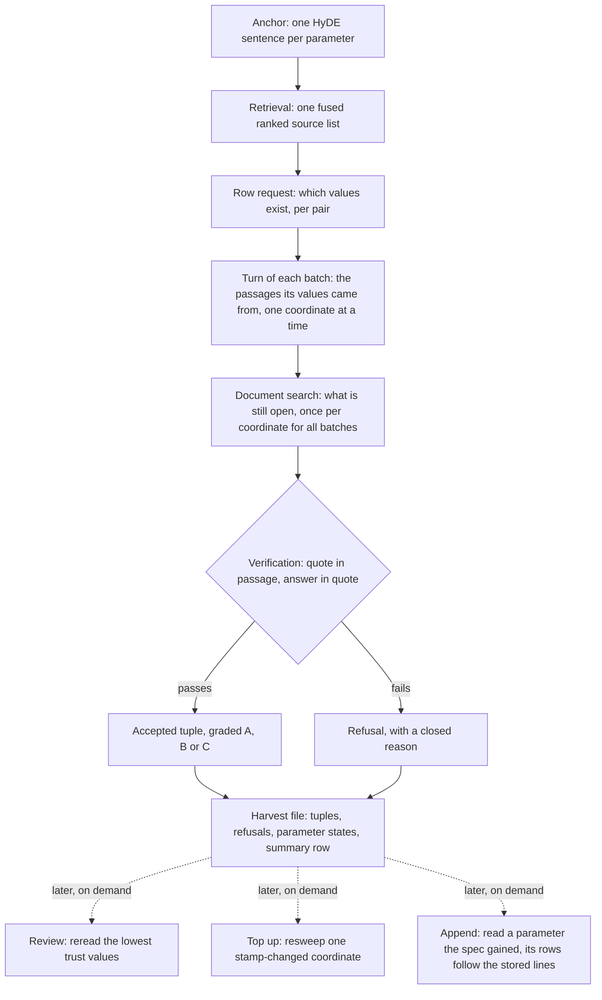
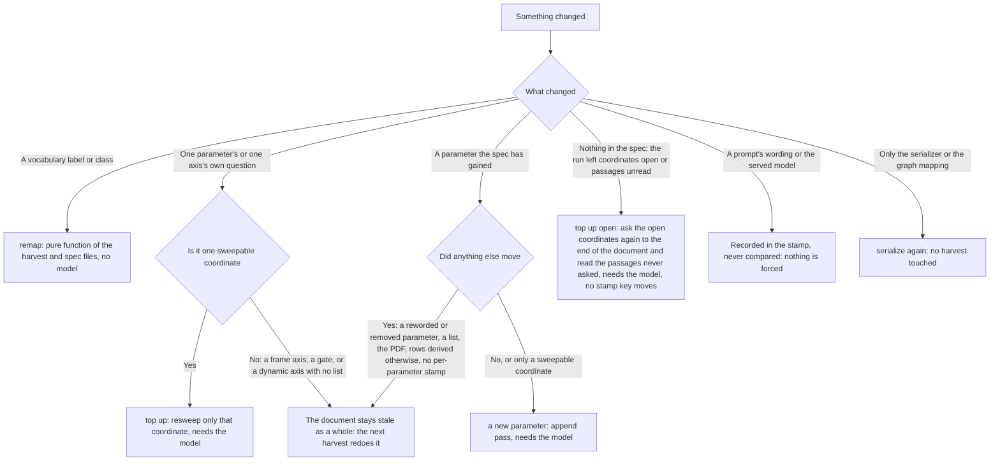

# 7. Reading the values out

## Purpose

`docpipe/extraction/` is the stage where a retrievable passage becomes a
typed value a knowledge graph can hold. Stages 1 through 6 turn a PDF into
sections, tables and figures a search can find; this stage reads those
passages against a profile's ontology contract and writes out value
tuples, a number, a class from a closed vocabulary, or a plain text
string, with its unit or vocabulary entry where the parameter has one,
and a handful of axes (which carrier, which sector, which year, which
scenario) that place it in the ontology's own terms.
`docpipe/extraction/__init__.py` names this ontology-based information
extraction, OBIE.

Nothing here is written on a model's word alone: every claim is checked
against the profile's closed vocabularies and the literal text of its
passage, and what survives carries that evidence, down to each
coordinate's own quote and source. A value the
run cannot back is refused rather than written with a gap where its
evidence should be. That is what separates this stage from a plain text
search: the question it answers is not only what the document says but
whether this run can support it with evidence, and the answer is recorded
next to the value, in a form later stages and the six passes that act on
a harvest already written can use without starting a document over.

## Position in the pipeline

| | |
|---|---|
| **In** | The corpus [chunking](chunking.md) built: the SQLite database's `Sections`, `Tables`, `Images`, `Embeddings`, `Documents` and `DocumentMeta` rows, and the FAISS index. No file under `results/` is read directly. Also a profile's validated `extraction_spec.json` (`spec.load`). |
| **Out** | One `<document>.jsonl` harvest and one `<document>.stamp.json` resume stamp per document, a per-document trace file under `trace/`, and, written once per run, `anchors.json` and `query_cache.db`, a `places/<document id>.json` per document whose map of places was asked (named by the numeric id of the `Documents` row) (see The field sweep), a `stats/<pass>-<run start>.json` and, for every file the run replaced, the copy it found under `archive/` (see Archive and stats). A `--serialize` call reads the harvest back and writes one Turtle file (a profile with a strict serializer, kwp, writes a second, `.strict.ttl`), feeding [the knowledge graph](graph.md) stage. |
| **Resumes on** | `<document>.stamp.json`, compared against what today's spec would produce, one key per parameter, value list, axis and slot; the whole-file spec sha stands in only for a stamp that carries none of those. The sha256 of the PDF the harvest was read from is compared too, where the stamp and the database both carry one. The model, the anchor set and every prompt are written into the stamp for a reader and are never compared. A document with no stamp is read as fully stale, never as finished, and a document one of whose requests ended on a 429 or a 5xx, or timed out, is not stamped, which the run counts as a failure and answers with exit code 1. |
| **Needs** | A served LLM reached over the network, the query embedder, the FAISS index, the corpus database, and, unless `EXTRACT_LOCATE=0`, the source PDF (`--pdf-root`) to place a quote's highlight rectangles. Unless `EXTRACT_ATTACH_IMAGES=0`, also the `images/` directory (`--image-root`) with the table and figure crops that ride along with every request. |

Extraction is the seventh of the pipeline's eight stages. [Chunking,
embedding, database](chunking.md) precedes it and is the last stage to
write anything under `results/`; from here on, a document's state lives
in the database and its stamp. [The knowledge graph](graph.md) follows,
reading only the tuples this stage accepted, never a refusal or the
spec itself.

One document, from its anchor to its summary row:



## Method

### Loading and validating the spec

`spec.load` parses a profile's `extraction_spec.json` into a `Spec` of
`Parameter` and `Axis` objects, refusing anything wrong: too short a
parameter description, a numeric parameter missing a unit factor, two
vocabulary labels folding to one spelling under two different classes,
or an axis naming more than one of vocabulary, enum, type or dynamic.
`SpecError` names the offending field, failing at load time rather than
partway through a batch. A
parameter carries one of four value types, `spec.VALUE_TYPES`: `float`
and `int` take a unit, `category` a closed vocabulary, and `text` a
plain string compared verbatim rather than mapped to a class; `text` is
the majority type in the scenarios profile, 11 of its 18 parameters
(`profiles/scenarios/extraction_spec.json`). Vocabulary labels are
compared after `fold_label`, not as raw strings. A unit is never
folded: it is read as its own coordinate, against the literal entries
of `units_accepted` (`fields.unit_slot`), and `Parameter.unit_factor`
is an exact lookup of the entry chosen, not a spelling match
(`spec.py`). A spelling table stood in for that reading once;
measured on 641 plans of corpus_m5, it let 3,324 tuples carry an entry
their wording contradicts. An entry of `units_accepted` is a factor onto
`unit_target` or an object, `{"factor": 1.0, "names_period": true}`. A
parameter that is an amount over a span (`integrated`, the default) has to
say it for every entry, whether the unit names a period ("MWh/a" does,
"MWh" does not): `spec.load` refuses an entry without a true or false
statement, a bare factor or a text among them, and an entry that is a rate
(`integrated: false`) may stay a bare factor. The statement is the spec's own
word on the entry and no pattern reads a spelling any more. It reaches no
request and no fingerprint, so changing one moves no stamp key and costs no
re-read. An axis that still sets
an evidence rule is refused at load time (`spec.py`): a
coordinate is checked for its quote and its answer, wherever the
passage stands.

### The retrieval plan

`pipeline.plan_document` builds one plan per document, not per parameter,
since which quantity a number belongs to is asked as a coordinate later.
Two rules used to feed it: every table and figure taken whole through the
`structure` callable, since over 65 documents 12,094 of 15,082 values
came from one of the two (`pipeline.py`); prose ranked and capped at
`prose_top` sections, the half a ranking retains. A newer
single cut (`top`, `EXTRACT_PLAN_TOP`) replaces both with one fused
ranking, keeping the structural floor only as a counter of what it would
have missed. There are no repeated rounds: retrieval is asked once per
document, not asked again with everything already found excluded. The
single call fuses every probe into one ranked
list rather than concatenating a ranking per probe: over 65 documents and
15,082 values, concatenation put a value's real source at median rank 77,
fusion at rank 26 (`runner.py`).

That single cut is not a plain slice of the ranking either.
`with_visual_share` (`pipeline.py`) holds a share of `top`'s room,
`VISUAL_SHARE` (env `EXTRACT_VISUAL_SHARE`, default `0.5`,
`pipeline.py`), for figures and tables before prose can fill it,
pulling the best-ranked ones up into that room when the head of the
ranking does not already hold its share and putting the result back into
rank order, so batching and every rank written into the report stay what
they were. The cap itself does not move and the taken sources stay in
ranking order; only which of them make the cut does. Measured on
corpus_m5: figures and tables carried 71% of every tuple in the harvest,
yet only 13 to 40% of a document's own figures and tables ever reached a
question at all. Emskirchen showed the model none of its 12 tables,
Bremen 13 of its 323 figures, Kassel none of its 23 figures, and on the
30 thinnest documents only 42% of tuples came from an image, against 71%
everywhere else.

What no search kept is read as well. `plan_batches` (`runner.py`)
takes the rest of the document from `make_rest_of_document`
(`runner.py`), every section with its tables and figures that neither
the document's search nor a pair's own search planned, and adds it behind
the planned passages with origin `rest`: under the pair it prints, or
without one, exactly as `pair_batches` places a planned passage. It is
counted in `owners_harvested`, which `not_happened` measures against, and
each passage gets a `plan` event in the trace. Before, the rest of a
document was read only when the model answered a rows request with
`partial` and a follow-up happened to walk it: Mainz gave 1,409 tuples in
the run of 2026-09-29, 682 of its 892 rows requests follow-ups, and 194 in
the run of 2026-10-14, which made none. A window `split_long_sources`
(`runner.py`) cuts from a long passage keeps the passage's rank and
origin. The stamp does not record the plan (owner decision 2026-09-10), so
a harvest already on disk stays current and only a document harvested
again is read to its end.

The parameters a profile names in `FRONT_PAGE_PARAMETERS` are asked once
more on their own. `plan_batches` takes the sections of the document's
first page from `make_front_page` (the lowest page any section stands on,
its sections in their order) and adds requests over them that offer those
parameters and nothing else, with origin `front`. Wherever else the
harvest reads them still counts, and the checks are the same. The scenarios
profile names its title: asked among forty other rows of one request, the
model left it out, and a publication with no title has no node in the
graph. A pass over a stored harvest's unread passages (`already_read`)
asks none of these.

### Anchors

The plan searches not with the spec's query templates but a sentence
written as a document would state the answer, a HyDE anchor; two
mechanisms produce them. `document_anchor` (`runner.py`) writes the
plan's own probe per document and parameter, from the parameter's
label, description, the document's name and an early caption; recorded,
never compared, in the stamp as `question_text/<key>`.
Dropping query templates for it was measured directly: with templates
included alongside the anchor, a value's real source sat at median rank
84; without them, rank 26 (`pipeline.py`). `plan_document` falls back to
`queries.expand`'s templates only when no anchor exists. `make_anchors` (`runner.py`) is the second,
corpus-wide mechanism: one set per question the field sweep asks, each
axis question and the parameter choice, written once per run and cached
per question. The value itself has no set: the plan searches with the
one short sentence `document_anchor` writes (`anchor_targets`,
`runner.py`). This set backs the retrieval stage of the field sweep only where
no open row has any context (see What a field request shows of a row), and is
fingerprinted as one `anchors` stamp key.

### The frame

Some coordinates belong to the document, not the row: a plan's scenario
containers and reference years stand in headings, captions and column
headers rather than varying cell by cell. `runner.find_frame` reads these
once, before any value, over up to `FRAME_ROUNDS` rounds of up to
`FRAME_SOURCES` passages, keeping only pairs with their own verbatim
quote (`frame_pairs`). A
deterministic cross-check, `years_in_sources`, scans the same passages
for year-shaped numbers the model did not name and offers them back once,
never adding a year on its own. Which coordinates form a frame is named
by the profile: kwp sets `FRAME = ("scenario", "year")`
(`profiles/kwp/extraction.py`); the scenarios profile sets none. A frame axis is built from the run's
spec, so a list closed per document is not supported on one. The frame
request puts the entries of a closed frame coordinate under a key of its body
that the profile names: `_frame_payload` says the phrase `frame_options` with
the coordinate's name as `slot`. `kwp` and `scenarios` say `"scenarios"`, one list
for every closed coordinate; the built-in profile says `"{slot}_options"`, one
list per coordinate. Its frame prompt names no key ("the list the request
gives for `scenario`"), and its `frame_not_an_option` phrase is handed the key
that was sent, as `{options}`, so a profile that extends it and words only
`frame_options` differently has moved the request, the correction and the
prompt together. The German frame template names the key through the fact
`frame_options`, so the frame prompts of `kwp` and `scenarios` say `"scenarios"`
as the profile's phrase does, and their `frame_not_an_option` phrase names
`"scenarios"` in its own words.
`pipeline.apply_frame` projects each pair onto its rows, state `read`,
before any field job is queued; a row that already answered better keeps
its own reading. A passage that prints several pairs, a table with a
column per year, is read under each of them, and each request takes its
own pair's column. A passage that prints none of a
request's pair used to give no row at all: its claims were refused as
`passage is not of this pair` (`rows_from_reply`, `pipeline.py`). Two
helpers get a look at the claim first now: `pair_of_claim`
(`pipeline.py`) asks the claim's own quote and `pair_of_source`
(`pipeline.py`) asks the whole passage whether exactly one OTHER pair
of the document is named there; if so the claim becomes a row carrying
that pair in its own `pair` and `pair_index` fields (`Row`,
`pipeline.py`), for `Turn.project` to stamp instead of
the request's own, drawn from `Batch.pairs` (`pipeline.py`), set by
`pair_batches` (`runner.py`). Exactly one, or the claim still stays
refused. Measured on corpus_m5: of 120,442 claims refused this way, 52.8%
came back later under the same quote, 17.8% as the same value under
another quote, and 29.4%, 35,407 values, were never read under any pair
at all; their units are the corpus's own, GWh/a (7,445), MWh/a (7,016),
t CO2eq/a (3,836), from tables (14,227), figures (11,869) and prose
(9,311). The gain from the frame itself was measured directly: before it
existed, the year axis alone produced 1,849 refusals against 0 readings,
since every window after the first excluded the row's own source
(`Turn.project`).

### Base years

A row's own table sometimes names no year at all, only the plan's word
for its own state: "Basisjahr", "Ist-Zustand", "Bilanzjahr". Which frame
pair is that state is named by the profile, kwp's `BASE_YEAR =
{"scenario": "status_quo"}` (`profiles/kwp/extraction.py`).
`state_years` (`pipeline.py`) reads the document's base year off that
pair, one entry per year with the frame's own quote and source, and every
batch of the document carries them as `Batch.bases`, framed or not, since
a passage naming only "Basisjahr" is exactly the one that needs them
(`named_years`, `pipeline.py`, joins the base and the target years;
`plan_batches`, `runner.py`).

A year answer whose quote carries this wording but not the number now
reads (`named_year`, `pipeline.py`) when the number given is one
of those base years (owner decision 2026-09-22): the model chooses among
the plan's own base years rather than the run guessing which one
"Basisjahr" means. `merge_field` (`pipeline.py`) then cites the
frame's passage for the number, window `["base_year", <pair index>]`, and
keeps the row's own passage as `<axis>_link_quote`/`<axis>_link_source`.
Before this reading existed, corpus_m5 dropped 127,233 year answers whose
wording stood in their quote and whose number did not, "Basisjahr" among
the most common (`profiles/kwp/extraction.py`). The year field's
own request is shown the plan's base years alongside the question,
`"base_years"` (`runner.py`), and the trace's `field` event
counts how many of a window's answers came this way, `via_base`
(`Sweeping.run`).

The plan's target works the same way (owner decision 2026-10-06, the same
rule as the base year). A profile names the frame pairs that are the target
with `TARGET_YEAR`, kwp's `{"scenario": "target"}`
(`profiles/kwp/extraction.py`), and `named_years` reads their years off
the frame as it does the base years. A year answer whose quote carries the
plan's word for its target ("Zieljahr") and not the number reads when the
number is one of those target years: the coordinate cites the frame's
passage, window `["target_year", <pair index>]`, keeps the row's passage as
`<axis>_link_quote`/`<axis>_link_source`, and the trace's `field` event
counts it as `via_target`. The year field's request is shown them under
`"target_years"` beside `"base_years"`, each list only in the request for
the field it dates (`runner.py`). Which state the word means, and
which of several target years, is the model's reading and is not checked:
the number only has to be one of the years shown, and a year the frame found
for both states is cited from the base state. The current kwp harvest
dropped about 14,500 year answers whose quote carried the plan's word for
its target and not the number, "Zieljahr" 12,369 of them
(`profiles/kwp/extraction.py`). A profile that sets no `TARGET_YEAR`
has no target years, and the scenarios field prompt leaves the
`target_years` block out.

### The row request

Which values exist at all is decided once, by the value request
(`make_harvester`, which sends the rows prompt and no other, called as
`find_rows` inside `make_fieldwise_harvester`). `pipeline.rows_from_reply` turns its claims
into `Row` objects through `route_claims`: the quote decides which source
a value belongs to, a label only breaks a tie, and a claim naming no real
source and quoting nothing findable is an orphan rather than filed under
the first source. Routing matches a quote to its source with the same
whitespace-collapsed test verification uses, `quote_in`, not a literal
substring test: a stricter test would refuse claims verification would
have accepted, since a table row retyped without its padding is the
normal case, not the exception, worth 276 of one pilot's refusals
(`pipeline.py`). A
wording not in its own quote is caught here too, before it becomes a
row (`pipeline.py`). Where a spec has no numeric parameter, as the
scenarios spec, every string is a wording and so is a bare year
(`fields.is_wording`), which is dropped here when its own quote does not
print it, with the reason `text value not in its quote`. A `Row` is
created only here, never later. The
request can turn to a code sandbox, bounded to `CODE_ROUNDS` rounds. A
reply that will not parse is asked again with the cause named,
`_reply_fault` (`runner.py`), rather than the same message twice, and
with the retried attempt's sampling temperature raised a step: on
corpus_m5, a field retry asked again at temperature 0
repeated its first reply byte for byte and lost all three tries. Every
retry loop of this stage (phrase, frame, anchors, rows, field, places and
review) raises the step, `retry_temperature` (`runner.py`, env
`EXTRACT_RETRY_TEMPERATURE_STEP`, default `0.1`), once per fault and
capped at `1.0`. One cut off at the token ceiling is asked again as two
halves instead of kept half-read, its labels renumbered onto the whole
batch, `_split_harvest` (`runner.py`). A single passage still too
long for that gets its own ceiling doubled, up to twice (so up to four
times the rows prompt's `max_tokens`), before it is written as a
`_why: cut_off` sentinel instead.

A profile may close a choice list per document (`document_axes`; the AR6
profile closes its scenarios and its regions). `runner.fill_dynamic_axes`
copies the spec with those lists filled in, parameter and unit questions
kept, and every batch of the document carries the copy (`Batch.spec`, read
through `runner.spec_of`): the value request, the field slots, the rows
handed to the next batch and `fold_batch` read it, not only the plan's
search. Stamps, fingerprints and the context budget stay on the run's own
spec.

### The field sweep: two halves, three window stages and a budget

Every coordinate a row still needs is asked for on its own. Asking per field
is why a request cannot quietly drop an unsure coordinate: on a 204-document
run, one request for every coordinate at once left the year missing on 63.5%
of values (`fields.py`). Every request asks one coordinate, not several at
once: five coordinates for every row of a batch in one request wanted up to
27,311 prompt tokens and came back refused or cut off (`make_field_asker`).
Its rows are chunked to at most `FIELD_ROWS` (32, env `EXTRACT_FIELD_ROWS`),
about 2,600 answer tokens at the measured p90, sized against the server's own
window before the request is sent rather than shrunk after a refusal,
`answer_room`, from a prompt counted with the served model's tokenizer
(see Counting the prompt); a chunk still too large for its room is halved before it is
sent.

A `Sweeper` (what `make_sweeper` returns) holds what a sweep needs and starts
one `Sweeping` for a coordinate over a `Scope`, the rows asked and the batches
they came from. A coordinate's sweep walks three stages, each with its own
allowance rather than a shared pool. **Own** reads the value's own sources
and the section its table stands in, for up to `FIELD_ATTEMPTS` (3) attempts,
each retry naming the reason. **Retrieval** follows, searching further out with
the probes of the open rows' own context (see What a field request shows of a row) in short, non-overlapping windows (`FIELD_WINDOW` 2)
for up to `FIELD_ROUNDS` (4) rounds, asking the search for at most as many
passages as the windows still left can show rather than the whole ranked
document, since handed over whole it marked every passage seen after one round
and left the rest stage nothing to read. What the model said it still needed
in the answers of the own stages goes to the retrieval as further probes.
**Rest** is the floor, its own windows still overlapping by `FIELD_OVERLAP`
(1): once retrieval has nothing new, `rest_of_document` reads the document's
own remaining sections in order, each followed by its own tables and figures
in page order, not sections alone, rotated to start near the open rows, until
the coordinate closes or the document runs out.

**The map of places** (`places.py`) replaces retrieval and rest for the axes it
knows. At a document's first search the model reads every passage of the
document, one section with its tables and figures per request (a section too
long to leave the reply its `max_tokens` is split), and names for each passage
the parameters whose numbers stand there and the axes it answers, the unit
among them, with a verbatim quote; it reads no value. A
place is taken only when its quote stands in its own passage and has the
minimum length. A reply that does not fit its limit is split, not rescued. The
map is complete only when every request was readable, and only a complete map
is used. The search for a coordinate then shows just the places of its axis,
nearest to the open rows' sections first, in windows of `FIELD_WINDOW` passages
that do not overlap. Its allowance is the coordinate's retrieval allowance plus
its rest allowance once for every batch that still has an open row of it, at
least once (stage `places` in traces and `<axis>_window`). When every place has
been shown the document counts as combed, so a row still open is `unstated`.
Without a complete map, or for a coordinate it does not know (the parameter,
or the unit of a spec without a unit question), the search runs as above. The
map is kept in `<harvest>/places/<document id>.json` under a key over prompt,
questions and model, and later passes read it again; a replaced file is
archived. A profile gets it by writing the prompt `extraction/places` (kwp and
scenarios do); `EXTRACT_PLACES=0` turns it off.

In the search stages a coordinate's windows go out several at once
(`Sweeping.run_ahead`): as many as the request limit has free places (limit,
minus requests in flight, minus requests waiting), at least one, so a full run
behaves as before and the last document of a run asks many at once. Replies are
folded in window order, so an earlier window's reading stands, and once no row
is open the windows still waiting are withdrawn and never sent (`withdrawn` on
the `sweep` event). Only while the adaptive limit is on: without it these windows, like the
requests of the map of places, go out one at a time. The own stage always asks
one window at a time.

A document is harvested in two halves, both on the callable
`make_fieldwise_harvester` returns. The coordinates of a row have an order,
because some decide the others: the unit, which settles the parameter where the
batch was planned without one; the parameter, which decides which axes the row
has; the gate axes of the profile's `SLICE`, one after another and first, since
a row they close is never asked the rest; and then the other axes.

The first half is a batch's turn (`harvest.turn`, class `Turn`). Each batch
asks only the own stage of its coordinates, in that order. A row whose
deciding coordinate is still open after it (the unit where the parameter is
open, the parameter, a gate axis) waits there, and nothing behind it is asked.
The axes that decide nothing are asked side by side. The unit decides only
where the parameter is open, a batch planned without one; for a batch planned
with its parameter fixed, its rows go on to their axes in the turn and the
unit is searched on its own.

The second half is the document's search (`harvest.search_document`, class
`DocumentSearch`). What the turns left open is searched once per document and
coordinate, with the open rows of all the batches together, in the order unit,
parameter, each gate axis, other axes. Searches that stand at one place in that
order run side by side: the gate searches of different parameters in one gate
position, and all the other axes together. When a search is over, whatever it
came to, the rows that waited at it go on from the coordinate behind it. Each
batch asks the own stages of the coordinates its rows reach only now one after
another, and the batches do so side by side. What those leave open is searched
in its turn, a coordinate once.

The allowance is counted per document and coordinate, not per batch. Retrieval
is allowed once for the coordinate: `FIELD_MAX_WINDOWS` (24) less the
`FIELD_ATTEMPTS` (3) of the own stage, so 21 windows by default, in at most
`FIELD_ROUNDS` rounds. The rest stage is allowed `REST_MAX_WINDOWS` (12)
windows for every batch that still has an open row of the coordinate when the
stage begins, and it is bounded in requests as well as in windows. A window of
the search is shown to every open row of all the batches, and the asker cuts
those rows into requests of `FIELD_ROWS`, so counted in windows alone a
document with many open rows would send more requests than its batches' own
sweeps did. The request bound is, for each of those batches, its windows times
the requests one of its windows takes. The stage ends on whichever bound is
reached first, or where the document ends, so in total a search costs at most
what its batches' own sweeps would have cost. For the rows of one batch the request
bound is never reached before the window bound, so a pass over a stored
harvest asks what it asked. A batch whose rows retrieval has read by then has
no open row, so it adds nothing to the rest allowance, as its own sweep would
have had no rest stage. A profile's `SEARCH_SHARE` scales a named coordinate's
retrieval and rest allowance by a fraction, at least one window staying; a key
may be `<parameter>.<axis>` and is read before the bare axis, and a share of 0
reads the value's own passage alone, with no retrieval and no rest stage (kwp
halves `sector` and `aggregation`, and sets 0 for `technology`,
`emission.carrier` and `emission.sector`, which the data schema leaves
optional; `profiles/kwp/extraction.py`).
The run's first log line about the sweep states the allowance of one
coordinate in windows (own, retrieval and rest, 36 by default) and how a
document's search counts it.

How a search ends decides the state of what it leaves open. A search that
reads the document to its end leaves its open rows as they stand, `unstated`
where the model answered that the passages do not state it: a finding about
the plan. A search its allowance cut off writes every row still open
`exhausted`, never `unstated`: a finding about the run. A batch's own stage
ends nothing, it leaves rows open for the search. So `unstated` is reachable
again after combing the document, and there is one verdict per document and
coordinate where there used to be one per batch.

The rows of a search keep the labels the rows request gave them. Where the
labels of rows from several batches would meet (two rows both called `R3`),
every row of the search is numbered `R1` to `Rn` over the search instead,
because an answer for the `R3` of one batch would otherwise land on the `R3` of
another; a search over the rows of one batch asks under the labels its rows
already have. A row is checked against the passages shown to it and the
passages of its own batch (`merge_field`), never against the union of the
document's, which is a pool its answer was not shown. Turns are searched in the
order of the plan (frame index, then the owner keys of the batch's items), not
in the order the replies came back, so the labels of a search do not depend on
which batch finished first. Rows under other base or target years or another spec are
searched in groups of their own; a real run has one group, because both belong
to the document. A search over one batch leaves out of its retrieval and rest
the passages its own stage asked and the sections they stand in, as the
batch's own sweep did. A search over several batches leaves nothing out: a
batch's passages were asked for its rows only, so none of them is already seen
for the rows of the others.

A stop (a signal) or the dead-server cut is seen between two requests, and
once more after the last request of a search or of the own stages behind it,
which has no request after it to be seen by. It ends the step, and the
document is left unwritten, like one with a batch never harvested, so a resume
harvests it again; it adds no failure of its own (`SweepStopped` is what ends
the step inside). What else a task of the step raises depends on whether rows
wait on it. Where they do (the search of the unit, of the parameter or of a
gate axis, and a batch going on behind one of them), the exception is raised: the document is not written and counts as a
failed document in the exit code, so a resume harvests it again. For an axis
nothing waits on it is a warning in the log, and the coordinate comes out
`unanswered`, as for a field job of a batch's turn. The tasks that run side by
side are all waited for before the first exception is raised, a stop first, so
none is left writing into rows the step has given up.

Passes over a stored harvest keep the three stages per batch. `--top-up` calls
the sweeper (what `make_sweeper` returns; `Sweeper` also has the two halves,
`own` and `search`) for each rebuilt batch, and the pass for a new parameter
calls `harvest_all`, whose harvester is the whole `harvest`, so every batch
walks all three stages of a coordinate in its own turn. `run_document`
and `pipeline.harvest_document`, the serial path, do the same.
Only the harvest of `runner.main` uses the two halves, and it uses them for
the batches of one document at a time.

The trace tells the halves apart. `field` and `drop` events carry the optional
key `batches`, how many batches the rows of the request came from: one for a
batch's own stage, the document's for its search, and a label in a `drop`
event of a search over several batches names no batch. `sweep` events carry
`batches` and `scope`: `own` for a batch's own stage alone, `document` for the
search of a document's open rows, `batch` for every stage walked for one batch,
which is what a pass over a stored harvest does. A trace written without the
keys is still valid, and the report reads it as it always did. The index in `<axis>_window`,
`[stage, index]`, of a coordinate read in retrieval or rest counts the windows
of the document's search from 1, not the windows since the batch's own stage;
nothing reads the index but the frame pair, and the schema's remark that a
coordinate read in window 1 and one in window 22 cost different amounts means
the search. `scripts/trace_report.py` keeps the distributions apart. In a trace
that has `batches`, the windows in which a coordinate closed are keyed
`<slot> (search)` for a read in retrieval or rest. The windows per sweep are
keyed by `scope`, `<slot> (own)` or `<slot> (document)`, and a sweep of scope
`batch` or without a scope prints under `<slot>` as before.

The log says what a search came to: when it begins, its rows, the batches they
come from and the retrieval windows allowed; when its rest stage begins, the
windows and the requests allowed and the number of batches they are counted
for; when it ends, the windows asked, how many of its rows were read, how many
are left open, and whether the document was read to its end or the allowance
was spent. A batch's turn closes with an `own stages:` line that counts only
its own stages, where a whole harvest keeps its `fields:` line. That per-batch
tally adds up per coordinate; it used to overwrite for a gate axis that two
parameters of one batch shared.

Counted on a stub, the document step sends fewer field requests than the
batches' own sweeps did, and the same where there is one batch. The stub has a
long document of 60 ranked and 60 further passages, reads the unit in the own
stage, answers "not stated" for each axis (carrier and year), and runs under
the default allowances. The numbers are field requests per stubbed
document, before the change to after it:

| Open rows per batch | 1 batch | 5 batches | 17 batches |
|---|---|---|---|
| 1 | 69 to 69 | 345 to 177 | 1,173 to 247 |
| 10 | 69 to 69 | 345 to 219 | 1,173 to 711 |
| 40 | 138 to 138 | 690 to 562 | 2,346 to 1,818 |

With 17 batches of one open row each, the document is read to its end after the
change, and 34 coordinates come out `unstated` where they had been
`exhausted`. These are worst cases of a stub in which no row is ever read, not
a forecast of a run, and nothing was run against a model.

### What a field request shows of a row, and the probes of the retrieval stage

Every row a field request lists carries, beside its id, source, value and
passage, two keys when it has them. `known` is the plan's own wording of every
coordinate the row has already been read for, the asked one and the unit left
out (`runner.row_context`); a coordinate that is only `derived` says nothing
about the number and is left out too. `title` is the title of the row's own
table or figure, else of its section (`runner.own_title`). "Which carrier?" is
then a question about "Mehrfamilienhaus, Endenergiebedarf" and not about the
plan. kwp's field prompt explains both in its part `rows_more`; the built-in
profile keeps the template's sentence. Neither key is checked: the owner's two
clauses are all `merge_field` holds an answer to.

**Probes of the retrieval stage.** A search over open rows used to ask with the
question's corpus-wide anchors, one set for every plan. It now asks with one
sentence per own passage of its open rows (`runner.context_probes`): the title
of that passage, the wording of what its rows have read, and the first sentence
of the question (`runner.question_head`). One per passage and not per row,
since the rows of one table share their context and differ only in the cell.
Only where no open row has any context do the anchors search, as before. The
probe list is no longer cut to four (`make_more_sources`). The ranking keeps
each passage's best match over the probes.

**One embedding call for all searches.** The searches of every document in
flight ask for probe vectors at the same time. `make_retrieve` embeds all
probes of a search together (`embed_many`: the query cache first, the misses in
one call), and `runner.Coalescer` (`COALESCED`) joins the calls of all threads:
one worker embeds everything that has queued up while the call before it ran,
and hands each caller its slice. A failure of the call reaches every caller in
the batch.

### The reply grammar

A field request now goes out with `response_format`, a JSON schema built
by `field_response_format` (`runner.py`) from the coordinate's own
contract: the asked field under its own name, `groups` and `answers`, and
a `value` that is one of the slot's options (`out:unstated` included) or,
for a number, an integer, nothing beyond that: `additionalProperties:
False` throughout. vLLM generates the reply inside that shape rather than
around it, sent on every attempt (`make_field_asker`). Nothing in the grammar is a check: every key stays as optional
as the field prompt leaves it, and what the reply says is still verified
by `merge_field` exactly as before. 70,395 field replies of corpus_m5
carried text beside the object and were asked again for it; under the
grammar none can.

### Requests the server did not serve

Every request loop of this stage reads the exception's HTTP status to tell
three ends apart. A request that never arrived has no status and is the
server's: `server_side` is true, and the loop waits on the long curve,
`retry_wait(attempt, transport=True)`, rather than the short one the model's
own mistakes get (`runner.py`). A 429, a 5xx or a
timeout is `unserved` (`runner.py`): the server was asked and did
not do the work, which says nothing about the request, so it is
`server_side` too,
waits on the long curve, and ends the request as unserved if the last
attempt still got it. Any other 4xx refuses the request itself, and every
retry would be refused alike: the row, coordinate, frame and review loops
stop at once, and a passage ends as `no_answer`.

What an unserved end means depends on the request. A passage's rows request
writes one sentinel per source with `_why: "unserved"` (the harvest
schema's `_why` has four values: `unreachable`, `unserved`, `no_answer`,
`cut_off`; `docpipe/extraction/schema.py`), and such a sentinel
counts towards the dead-server streak like an `unreachable` one
(`runner.py`). A coordinate request, the frame
request and a search-sentence request return nothing, as they do for any
failure; what marks the document is `UNSERVED.note(document_id)`, which
counts it in the registry `UNSERVED` (`runner.py`). The coordinate request's own streak counts it
too. The run's anchor requests belong to no document and
are counted under `None` (`runner.py`).

A timeout counts because a server whose engine stopped taking requests keeps
its connections open until every request times out; those documents used to be
stamped with coordinates that were never read. It is recognised by the client's
timeout error (`openai.APITimeoutError`, `providers.ProviderTimeout`). A
connection that never arrived has no status and no timeout and stays
`unreachable`, under the more-than-half rule.

### The adaptive request limit

A fixed thread pool bounds how many requests can be sent at once; how many the
server can usefully answer at once moves with what is asked and with its own
queue. `throttle.start` (`throttle.py`) reads vLLM's `/metrics` every
`EXTRACT_LIMIT_POLL` seconds and steers one `AdaptiveLimit` every client waits
in (`runner._client`, `runner.py`), additive increase / multiplicative
decrease: it grows while nothing is waiting, the KV cache stays under
`EXTRACT_LIMIT_KV_GROW` and the limit is actually being reached, and steps back
on two consecutive waiting samples, the KV cache at `EXTRACT_LIMIT_KV_HIGH`, or
a preemption (`throttle.Controller.decide`, `throttle.py`). With
`EXTRACT_LIMIT_TPOT_MAX` set, a sample whose mean seconds per output token lie
above it is a fourth reason; unset, the token time never steps the limit down,
since it grows with every sequence in the batch while the tokens per second of
the whole batch still rise. The limit starts at `EXTRACT_LIMIT_START`, moves in
steps of `EXTRACT_LIMIT_STEP` between `EXTRACT_LIMIT_MIN` and
`EXTRACT_LIMIT_MAX`, and is multiplied by `EXTRACT_LIMIT_BACKOFF` on a step
down.

A hosted API has no `/metrics` and no queue to read. There `throttle.start_hosted`
steers the limit with a `RateController` from what the API itself says, the 429
replies that close the provider's gate: it starts at the minimum, grows by one
step while every request is served and the limit is in use (not while the gate
is closed), and steps back by the back-off factor each time the API asks to
wait.

While the limit is on, the requests open at once are bounded by it, up to
`EXTRACT_LIMIT_MAX`, and not by the pools: `EXTRACT_FIELD_PARALLEL` bounds the
sweeps running at once and `EXTRACT_LLM_PARALLEL` the batches, while the search
windows a sweep asks ahead and the requests of the map of places run on a pool
the size of the limit's maximum. A server of one's own with no `/metrics` gets
no adaptive limit at all, the pools alone deciding as before.
`EXTRACT_LIMIT_ADAPTIVE=0` turns it off (`runner.start_limit`, `runner.py`).

While the limit is on, every model request of the run goes through one
dispatcher thread and one queue (`scheduler.py`), served oldest document first,
a document's rank being the order in which it first asked; a request that
belongs to no document, the run's anchors, goes before every document. The limit still
decides how many requests are open. A request's timeout starts when it is sent,
not while it waits, and a waiting request can be withdrawn (`Ticket`), after
which it is never sent.

The same limit decides how many documents are in flight. `runner.document_room`
lets one more document start, one per look and a look every second, while the
model requests in flight stay below the limit; `harvest_documents` and
`topup.run_open` take it as `room`. A fixed count did not follow the load: 64
documents read to their end each held one request open and the server ran at a
fifth of its cache with nothing waiting. Planning sends nothing, so a document
that is still planning does not hold the next one back. Without a steered limit
(no `/metrics`, or `EXTRACT_LIMIT_ADAPTIVE=0`) the ceiling `EXTRACT_BATCH_DOCS`
alone decides.

### Counting the prompt

A request is sized to the window before it is sent, so the prompt has to be
counted. For a self-hosted server `runner.start_counting`, called at the start
of a run next to `start_limit`, loads the served model's own tokenizer
(`transformers.AutoTokenizer.from_pretrained(LLM_MODEL)`, from the local model
cache, `HF_HOME`) and sets `runner.PROMPT_COUNTER`, a `PromptCounter`. It runs the
messages through the model's chat template with the `chat_template_kwargs`
every request carries and counts the tokens exactly; a crop still counts
`IMAGE_TOKENS`, the most one can take. A tokenizer that cannot be loaded ends
the run at that point, before the first request. A hosted API (its tokenizer is
its own) and a recorded run (nothing is sent) keep the old estimate, characters
divided by `PROMPT_CHARS_PER_TOKEN`, estimated high.

The estimate ran short on tables of figures, where every digit is a token of
its own: requests went out one token over the window and were refused. On
vLLM before 0.28 a refused request that carried a crop also broke the server's
multimodal cache (CVE-2026-105753), after which the engine took no more
requests, which is how requests came to time out in bulk (see the unserved
rule above). vLLM 0.28 and later recover: a request that hits a stale cache
entry fails once.

### Merging a coordinate

`pipeline.merge_field` folds each field's answers onto the open rows,
holding every answer to the two clauses the value's own quote is held to:
its cited passage sits verbatim in a shown source, and it contains the
answer, with a floor of `MIN_QUOTE_CHARS` so that a quote names a place.
Those are the check for a quote (`pipeline.py`). Without its own `value_raw`
wording, a closed-list answer's quote is checked against every spelling the
spec lists for the chosen option, not only its label: the real classes
carry the ontology's English names, which stand in no German plan, and
corpus_m5 had dropped 284,643 quantity answers on exactly that gap before
this widened (`answer_in_quote`, `pipeline.py`, owner's decision
2026-09-13); a wording that is given still has to stand in the quote
itself. A year counts only where its own four digits stand in the quote
in one run, so "2.022 MWh" no longer backs the year 2022 though a dated
"31.12.2022" still does; and a spelling counts only where no longer
entry of another option of the same list stands at that spot, so a bare
"MWh" is not backed by a passage's "MWh/a", though the chosen option's
own longer spelling still is (`stands_in`, `pipeline.py`, owner's
decision 2026-09-23). A closed-list coordinate answers a third clause
too: naming one of
the list's own entries, by label, spelling or URI, or it is never marked
read (`option_named`, `not_an_option`, `pipeline.py`, the owner's
rule of 2026-09-11). Which table the
passage belongs to, how far from the row it stands and which column of a
table it heads are the model's reading, not a rule. Failures are recorded
separately, `unquoted` against `unbacked`, so a retry can name what to fix. A
coordinate already read once is never overwritten by a later window
(`pipeline.py`). A wording naming no token of the option
it claims is counted `raw_foreign` rather than trusted silently.

### Folding and verification

`pipeline.fold_claims` hands every claim to `verify.verify_tuple`, the
last check against the spec's closed lists and the literal source text. A
number is compared digit for digit after `canonical_number` normalises
locale grouping and decimal marks; a category or text value is compared
case- and whitespace-folded against its own wording, through `verify.flat`
(`verify.py`). The set of numbers a quote is checked against,
`numbers_in` (`verify.py`), also credits the year of a dotted
German date, "09.12.2025" or "03.2030", since read as one token it is the
ungrouped number 09122025 and the year it plainly prints would otherwise
be missing from that set: 12 years were dropped so on the corpus_m5
canary. That fold now runs `unicodedata.normalize("NFKC", ...)`
first and maps the quotation-mark, dash and thin-space variants and the
soft hyphen onto one spelling each, before the existing whitespace
collapse: the passage comes out of the PDF and the quote out of the
model, through two different encoders, and a ligature, a decomposed
umlaut or „Bestand" against "Bestand" used to read as two different
sentences. Not a new check: the shape both sides of the one existing
comparison are brought into. Measured on corpus_m5, before this fold
existed: 1,458 claims were refused as `quote not found in the source it
cites` and 17,422 values were downgraded to `unbacked` for exactly this
gap between two encoders.

Where a quote is
not verbatim in its source but the value occurs there
exactly once, the quote is rebuilt around that occurrence rather than the
claim refused: on the 16-document pilot, 303 of 377 such refusals were
repaired this way, against 8 where the value truly was absent
(`verify.py`). A verified tuple's tier comes from its source
alone, not whether the quote could be placed on the page:
`text_located` for prose, `visual_source` for a table transcription or
figure description, an uncheckable model reading of a picture. A prose
quote that could not be placed on the PDF page still keeps the
`text_located` tier; it only gains a `not_located` flag (`verify.py`).
Non-fatal findings are carried as flags: `quote_repaired`, `computed`
(a sandbox result checked against its own printed output),
`not_located`, `unmapped:<axis>:<wording>`, and, for an amount over a
span, `period:unstated` when the spec says the entry chosen for the unit
names no period (`names_period: false`).

### Trust levels

`trust.trust` grades every accepted tuple deterministically, from what
the harvest already recorded, no further model call and no tuned
threshold. Level A: its own text states it, every coordinate read.
Level B: the same, from an image transcription or a model-transcribed
page. Level C: one of the following holds: a coordinate the sweep could
not back or gave up on, a repaired quote, a computed number, or a
contested identity decided at graph build time. Where a coordinate's
passage stands is no reason. A second
reading from `--review` can mark a tuple `corroborated`, described
under The passes that revisit a harvest, but never raises its level.
`trust.document_summary`
folds one document's tuples into a closing line, its level distribution
and reason counts. See [how much of a value the run can stand
behind](../contract/trust.md) for the full list.

### The harvest file, the stamp and the trace

Before any of that is computed, `runner.finish_document` calls
`pipeline.drop_repeats` (`pipeline.py`), which removes a row that
agrees with an earlier row of the same document in every field but
`provenance`: the same reading written twice by two different requests
is one reading, not two, and counting it twice would throw off the
parameter states and the summary computed next from it. `provenance` is
left out of the comparison because it is about the writing and not the
reading; the first of a repeated pair is kept, so the file stays in the
order the harvest produced. Measured on corpus_m5, which ran with no
such pass: 1,152 of 62,290 tuples were repeats, in 192 documents, up to
77 in one plan, and one office name written eleven times.

`pipeline.write_report` writes one document's tuples, refusals, parameter
states and closing summary to a temp file and only replaces the real
`.jsonl` once complete, so a killed process cannot leave a truncated
harvest; every rewrite in this stage follows the same rule, and none replaces
a file without first keeping the old one (see Archive and stats). The stamp is
withheld until `runner.finish_document` decides a harvest genuinely
happened, not merely that a file was written, and it removes an earlier
stamp before it writes the file (`runner.py`); see Failure modes
for when it withholds one. What the stamp records,
`_stamp_current`, is deliberately not one hash over the whole spec file:
`spec.fingerprints` computes one sha per question, so `runner.stale`
names exactly which one moved. The earlier whole-file design cost this
project directly: one new vocabulary spelling made all 1,082 documents
stale at once, about 93 GPU hours to re-read a corpus over one word
(`remap.py`). The coarse `spec` key is compared only while no finer
key exists; once fine keys exist, a changed value and a dropped
question are both checked. A parameter added to the spec is the one change
that leaves a stored stamp without a key altogether: `parameter/<uri>` is
absent from it, the document reads stale in that key, and a harvest would
read it again from its first passage for the sake of one parameter. A
resume that finds such a document says so beside the usual warning, naming
the parameters and `--top-up-parameters` (`already_done` in `runner.py`), and that pass appends them without reading the
document again where nothing else moved. The `value/<uri>` key of a category parameter
counts the classes of its list and their spellings, which is all the rows
request shows the model, and not their definitions. A stored scenarios stamp
written while the definitions were counted holds another digest, so it reports
that key stale once: `--remap` settles it with no model, and `--force-stale`
first would read the documents again for nothing.

The stamp also names the PDF. `document` holds the sha256 and the size of the
file as the database recorded them (`stamp_record`), and that sha256 is
compared (`document_moved`): where the stamp and this run both carry one and
the two differ, the document is stale as if an ontology key had moved. The run
names it in a warning ("another PDF than the one it was read from"), skips it,
and reads it again only under `--force-stale`, which stamps it anew. A stamp
without the key is not compared, and neither is a document whose database row
holds no checksum, so no existing corpus turns stale by this. The checksum is
the one the database took when it first met the file (`Documents.sha256`,
filled by ingest, or once for a row from before the record). Ingest does not
refresh it when a file is replaced under the same name: it only warns when the
size differs. So the comparison can fire when the `Documents` row is made anew,
after a rebuild of the database from a changed PDF, and not for a file edited
in place. A top-up and a remap never read a PDF, so they neither earn nor lose
the key; the pass that appends a parameter holds the stamp against it, leaves a
document whose PDF moved stale as a whole, and never writes it. `docpipe
estimate` counts such a document as stale the way the run does. Beside every harvest sits
`trace/<document>.trace.jsonl`, on by default and disabled with
`EXTRACT_TRACE=0`.

Every tuple, refusal, parameter state and summary line is checked
against the published schema before it is written:
`_harvest_validators` builds one `jsonschema` validator per branch from
`schema.build(spec)["harvest"]`, run by `check_against_schema` inside
`finish_document` on every call carrying a spec (`runner.py`), and
by the pass that appends a parameter before it writes. A
row the schema refuses is counted
and logged as an `invalid` trace event, never withheld, since blocking on
a schema mismatch would turn a documentation defect into a data loss.
The preflight (`docpipe preflight`, see The check before a run) calls
`schema.build` directly, ahead of any run, to confirm a profile's published
schema file is current (`preflight.audit`, the checks `schema present` and
`schema current`). `python -m docpipe.extraction.schema <name> --write` writes
that file into the profile's directory, from the spec the profile names
(`extraction.SPEC_PATH`), wherever it lies.

### The passes that revisit a harvest

Six passes act on a harvest already written, without starting a
document over from its first passage, and they differ in what they cost
and what they may touch. What changed decides which one applies:



| Pass | Needs | May touch | Leaves the stamp |
|---|---|---|---|
| `--recheck` | No model, no GPU, no index; the corpus database, read-only, where the profile closes lists per document | Every tuple's coordinates | Clears every stamp in the directory (unless `--keep-stamps`), except a document left alone |
| `--remap` | Nothing: no model, no GPU, no index | A category coordinate's mapped class | Writes forward only the answer spaces it fully settled |
| `--top-up` | The model, the FAISS index, the embedder, the database | One named coordinate of every row that has it | Writes forward only the exact stamp keys it could settle, and none when one of its requests ended on a 429 or a 5xx, or timed out |
| `--top-up-parameters` | The model, the FAISS index, the embedder, the database | Nothing that is stored: it appends the rows, refusals and state line of each parameter the spec gained, and builds the summary line again | Writes forward the keys of the parameters it appended and of the questions the addition alone moved, and none for a document it did not read completely |
| `--top-up-open` | The model, the FAISS index, the embedder, the database and the harvest's traces; a document without a trace is skipped | The coordinates a stored row left `exhausted`, `unanswered` or `unbacked` (an answer replaces the block, a coordinate still open keeps its old one), and it appends the rows of the passages the harvest never asked | Moves no key; enters `top-up-open` and `rest` in `producers`, and a document whose list holds `rest` is not read again |
| `--review` | The model, and the crops for image-attached prompts | Only a row's `flags` | Adds `review/prompt` and `review/model`, compared by nothing |

`--recheck` (`recheck.py`) reapplies the answer-in-quote rule to the
wording and quote already on disk: a coordinate whose quote does not
contain its claimed answer is stripped back to `unanswered`; on a
corpus written before the rule existed, 27.6% of years cited a passage
with no year at all (`recheck.py`). A stripped
coordinate can only be repaired by a real harvest, so `recheck.run`
deletes every stamp by default; `--keep-stamps` keeps one that no longer
matches the file. Where the profile closes lists per document, each file
is read against its own document's lists, so the pass then opens the corpus
database read-only; a document whose lists cannot be closed is left alone,
stamp included, and counted under `fields.LISTS_UNREADABLE`. `--remap` (`remap.py`) re-resolves a coordinate's
recorded wording against today's vocabulary instead, a pure function of
the harvest and spec files: a newly listed wording is rewritten and its
stale flags dropped, one in neither list or with none recorded is left
as it stands, and a refusal a grown list might now place keeps its axis
stale, since only a real harvest turns a refusal into a tuple.
`stamp_forward` writes forward only the answer spaces a file fully
settled. A category value is written as the class name in `value` and the
class in `value_uri`, which the graph reads: the remap takes the wording from
`value_raw`, or from the answered name where none was kept, compares
`value_uri` and moves that one. A row whose wording is in no list is counted
`not listed`, so its document stays stale in that key after the remap, and is
what `--force-stale` is left for.

`--top-up` (`topup.py`) is the one pass that is not free: it costs a
model call, but only for the coordinate a stamp says moved, over the
harvest's own sweep, all three stages of it for each rebuilt batch, as the
sweeper walks them (see The field sweep). `actionable` blocks the whole document the
moment a changed key names anything other than one sweepable
coordinate: a key naming no coordinate the spec still asks blocks
outright, and so does one naming a frame axis, since the frame decides
how many passes a document gets, or, unless allowed, a dynamic axis
with no per-document list, since sweeping it empty would demote a class
to a wording (`topup.py`). A parameter the spec has gained is not
a coordinate and does not block: the keys that only the addition moved
are taken out of the list before `actionable` sees it, so this pass
neither blocks on them nor writes them
(`topup_parameter.explained_keys`, `topup.py`). A document in
which every moved key is of that kind is counted `left to
--top-up-parameters` and left as it is; one with a moved coordinate
besides is swept for that coordinate, and the keys of the addition stay
stale in its stamp for the pass that appends the parameter.
`--top-up-key` names one axis
coordinate, `axis/<uri>/<name>`, or `slot/unit`, the unit of every
numeric parameter, swept parameter by parameter since a stored row
already knows its own (`targets_of`, `topup.py`); nothing
sweeps every asked coordinate of every row at once any more. `reopen` strips one coordinate's keys before
the sweep runs; `restore` puts the old block back unless the fresh
sweep genuinely improves on it. A top-up whose own requests ended on a
429 or a 5xx leaves the file's stamp as it was, so the next top-up asks
again; the stat lines count it as `stamps left, a request ended on 429 or
5xx` (`topup.py`). A row whose passage no longer carries
its stored quote is left untouched, and top-up traces land under their
own `trace-topup/` directory, `open_trace` first closing any file an
earlier directory left open. A re-swept `year` carries base years and
target years too: `named_years_of` (`topup.py`) rebuilds the document's
base-year and target-year pairs
from the frame's own readings already sitting in the harvest file and
hands them to every batch, the same as the main harvest, so a re-swept
year that names only "Basisjahr" or "Zieljahr" still reads.

`--top-up-parameters` (`topup_parameter.py`) is the pass for a parameter
added to the spec after documents were harvested. Such a parameter leaves
every stored stamp without its `parameter/<uri>` key, and the resume can
answer that only by harvesting the whole document again, every parameter
and every coordinate sweep of it. The pass asks for the new parameter
alone: per stored document it plans the search for that parameter only,
asks the frame over the passages the plan found, asks the rows requests,
each of which offers the new parameter and nothing else, and then the
coordinates of the rows those requests produced. It asks nothing again for a stored parameter, for a
coordinate of a stored row or for a refusal of the first pass. Like
`--top-up` it needs the model, the index, the embedder and the database.
It runs in the harvest's own loop and not beside it: `main` binds
`plan_batches` once as `plan_for` and `harvest_batches` once as
`harvest_all`, the harvest's `harvest_document` and the pass's `DocumentPass`
both call them, and so the pools, the stop, the dead-server cut and the exit
code are the harvest's. What differs is the harvester each hands to
`harvest_all`: the harvest hands the batch's turn (`harvest.turn`) and follows
it with the document's search, the pass leaves the default, the whole `harvest`,
so each of its batches walks all three stages of its coordinates in its own
turn and no document step follows (see The field sweep). It is refused
together with `--top-up` (the parser ends with exit 2 and nothing runs);
`--top-up-key` belongs to `--top-up` and this pass does not read it.
`--document` restricts it as it restricts the harvest, `--force` and
`--force-stale` change nothing for it, and a document with no harvest file
in `--out` is left to the harvest, the log saying how many
(`topup_parameter.with_harvest`). Its traces go to `trace-topup/` and
never into the harvest's `trace/`, which the run does not open
(`TOPUP_TRACE_DIR`).

Whether a document may be taken is decided by its stamp alone
(`topup_parameter.addition`, `classify`). A parameter is new when its
`parameter/<uri>` key is absent from the stored stamp, and reworded when
the key is there and differs; the stored `axis/<uri>/..` and `value/<uri>`
keys are not asked for that, because `--remap` writes them for every
parameter of the spec, read or not. What the run would stamp for the spec
as it was before the addition is then held against the stored stamp, and
every key that still differs is something other than the addition. The
document stays stale as a whole, which is not a failure and nothing is
asked about it, when it has no stamp, an unreadable one or one without
per-parameter keys; when a parameter was reworded, renamed or removed;
when a key moved that names no sweepable coordinate (`topup.actionable`:
the question for the parameter, a value list, a frame axis, a dynamic list
with no per-document list) or the PDF moved (`document`); or when the
new parameter would change which parameter a stored row derives to
(`derivation_moved`: a new numeric parameter that shares a unit with a
stored one leaves a unit two parameters accept, a second text parameter
leaves a wording two parameters could hold, `fields.derive_parameter`).
A moved coordinate of a stored parameter does not block: it is left to
`--top-up` and this pass never writes it. A document with a new parameter
whose lists cannot be closed is a failure and not left stale.

What the pass writes is kept apart from what was there. The file becomes
every stored line as the same bytes in the same order (a line that is no
JSON stays as it is and is counted), then the new tuples, the new refusals,
one `parameter_state` line for each new parameter, and the summary last,
built again over every tuple and refusal the file now holds
(`topup_parameter.appended_lines`); the old summary is the one line
replaced. The refusals of the first pass are not revisited: a value
refused then for want of the parameter stays a refusal, the summary counts
it and the log says so once. The rows go through the harvest's own fold,
`runner.fold_answers`, so the checks are the harvest's own and the pass
has none and no reason of its own. A new row equal in everything but its
provenance and its `<axis>_producer` pointers to a new row before it
(`drop_repeats`) or to a stored tuple (`drop_stored_repeats`) is not
written again, and no stored tuple is ever removed.

The request is narrowed to the new parameter. Every request is built from
the spec its batch carries (`runner.spec_of`), and the pass hands its
batches `runner.narrow_spec(spec, uris)`, the spec with the new parameters
only: the quantities the rows request offers, the units, the parameter
question and the grammar of the reply then offer the new parameter and its
units alone, so no row of a stored parameter can arise and no filter on
rows is needed. `fields.is_wording` is asked of that narrowed spec too,
which is where it differs from a harvest: a digit string is a number only
in a spec with a numeric parameter, so for a new text parameter in a spec
that has numeric ones, the narrowed spec has none and a digit string the
model answers for it is a wording there, held to the rule that a wording
stands in its own quote. The frame is asked over the new passages with the
pairs the stored rows carry as its start (`plan_batches` with
`stored_pairs`, `find_frame` with `start`; `topup.pairs_of` takes them off
the `["frame", i]` windows of the stored rows). They stand first, under
the index they were stored with and never renumbered, the model is shown
them as known, a pair it names again is not added a second time, and a new
pair is numbered after the highest stored index, so `["frame", i]` means
the same pair everywhere in the file; an index no stored row carries stays
a gap and names no passage. The frame is asked for a parameter with none
of the frame's axes too: the profile's `FRAME` decides, not the parameter.

What the stamp gets is what the pass answered for and nothing else
(`stamp_forward`): `parameter/<uri>`, `value/<uri>` (where the parameter has
a list) and `axis/<uri>/*` of each new parameter, `slot/parameter` and
`slot/unit` where the addition alone moved them, and the sentences the
document was searched with as `question_text/` keys. Every other key stays as it was, so a key the pass
did not answer stays stale for the pass that can, and the whole-file `spec`
sha moves only when nothing else is stale. The pass also enters itself into
`producers` as `{pass: "top-up-parameter", parameters: [uris], frame}`
beside the version, time, model, provider and prompts that `runner.producer`
records; `frame` is `none` for a profile without a frame, else `stored rows,
then asked over the new passages`. Every coordinate of an appended row carries
`<axis>_producer`, the position of that entry. The entry and the pointers
are written before the keys, as the coordinate pass does.

A document is written only when the new parameters were read completely.
A request of any kind that ended on a 429 or a 5xx, or timed out, more than half the
sources never reaching the server, not one batch answering
(`runner.not_happened`, which `finish_document` asks too), or a frame or
the plan of a pair that raised leave the file and the stamp as they were
and count the document as failed; the run then ends with exit 1. So does a
document whose lists cannot be closed, one whose file holds the state line
of only some of its new parameters, and one whose stamp could not be
written after its file was. A document left with batches never harvested,
by a stop or a dead server, is written nowhere and adds no failure of its
own. As in the harvest, the stop (143) or the dead server (1) decides the
exit code, a replay that asked something its cassette does not hold ends
with 1, and so do the run's own anchor requests when one ended on a 429 or
a 5xx, before any document. The
`parameter_state` line is the marker of the one window the pass has,
between the file and the stamp: a file that already holds the state line of
every new parameter and a stamp that lacks the key is completed with no
request, and a file from before state lines existed holds none, which says
the parameter was never read there and the pass runs. After a pass the
stored stamp has the key, so a second run finds no new parameter in it,
sends no request about the document and changes no byte. The run ends with
one line per count, each saying what it counts, such as `documents
appended (documents)`, `tuples appended (tuples)`, `refusals appended
(refusals)`, `tuples identical to a stored tuple, not appended (tuples)`,
`stored refusals not revisited (refusals)`, `parameters read (parameters x
documents)`, `documents left stale as a whole (documents)` and `documents
not read completely (documents)`.

Who wrote what is recorded, and compared by nothing. The stamp's `producers`
list names every pass that wrote into the harvest, in order, the harvest
first (`runner.producer`); entries are only added, so a position stays valid.
A top-up enters itself in every document it touched that has a readable stamp,
whether or not it earned a stamp key and also when some of its requests ended
on a 429 or a 5xx, and writes `<axis>_producer` on each coordinate whose new
reading stands: the position of its entry. That includes a derived coordinate
and one the spec gained since the harvest; where the old reading is restored,
the old block comes back with its old pointer. The pass that appends a parameter
enters itself only in a document it read completely, and writes the pointer on
every coordinate of the rows it appended; its entry names `parameters` and
`frame` besides. A `--review` enters itself for a
document where it flagged a row and a `--remap` for one where it carried a key
forward; neither writes a pointer, because neither reads a coordinate again.
A coordinate with no `<axis>_producer` was read by the harvest. A position
the stamp has no entry for, which happens once `--recheck` has deleted the
stamps, reads as unknown and never as the harvest (`fields.reader_of`). The
PROV-O file of a graph gives a coordinate with a pointer an activity of its own
(see [the knowledge graph](graph.md)).

`--review` (`review.py`) differs from the other five: it writes only
`review/prompt` and `review/model`, recorded and never compared, so it
never makes a document look stale. It rereads a harvest's lowest-trust
values once more, over a window narrowed to the value's own two legal
passages, a self-consistency check rather than an independent opinion.
Only a disagreement counts as a trust reason; an agreement is marked
`corroborated` without raising the level. The second reading goes to
`review.csv`, never onto the tuple itself. A value is read against its
document's own lists, and a document whose lists cannot be closed is left
alone, as in `--recheck`.

Three further scripts, `curation_list.py`, `harvest_compare.py` and
`trace_report.py`, read a harvest and print or write a report, described
under Modules; none writes back into one.

### Open coordinates and unread passages (`--top-up-open`)

A harvest ends a coordinate `exhausted` where its budget ran out before the
document did, and reads values only from the passages its searches kept.
`--top-up-open` revisits a harvest for both, without harvesting it again and
without moving a stamp key, since no question changed.

First every coordinate a stored row left `exhausted`, `unanswered` or
`unbacked` (`topup.OPEN`, chosen by `topup.open_coordinates`) is asked again
through the harvest's own sweep, `topup._sweep_one`, with the rest stage
reading the document to its end (`runner.read_to_end`, `REST_TO_END`). An
answer replaces the open block, `unstated` after the whole document
included; a coordinate still open keeps its old block, so a cut-short run
leaves the file as it was. Documents are swept side by side, as many as the
server has room for and at most `EXTRACT_BATCH_DOCS` (`topup.run_open`, with
`runner.document_room`), since one document's sweeps to its end are many
requests one after the other. Its trace goes to `trace-open`. Every file it
replaces is archived first, under the pass name `top-up-open`.

Then `topup_rest` reads the passages the harvest never asked for values.
Which ones were asked is in the harvest's trace (`trace/<name>.trace.jsonl`,
every `rows` event's sources, `topup_rest.owners_in`); `plan_batches` is
given them as `already_read`, finds the frame over every planned passage
with the stored pairs as its start, so the pairs keep their indices, and
reads only the rest, the document's unplanned passages included. The rows
it finds are asked every coordinate to the end and appended behind the
stored lines, a row equal to a stored tuple left out
(`topup_parameter.drop_stored_repeats`). A document without a trace is
skipped and counted. Each pass enters the stamp's list of producers
(`top-up-open`, `rest`); a document whose list holds `rest` was read to its
end and is not read again. This pass's trace goes to `trace-rest`, because
a trace is truncated by the next pass that writes it.

### Archive and stats

**Nothing is replaced unkept.** Before a run replaces a harvest `.jsonl`, a
stamp or a trace file, `archive.keep` copies the file as it was to
`<its directory>/archive/<pass>-<run start>/<name>`, once per run: a pass that
rewrites a stamp three times keeps the stamp it found. The pass is `harvest`,
`top-up`, `top-up-open` or `top-up-parameters` (named by `runner.main` through
`archive.begin` once it knows which documents it will touch); `--remap`,
`--recheck` and `--review`, which run before that point, and the identity pass
keep under `write`. The hooks stand in `pipeline.write_report`, the stamp write
in `runner`, `topup`, `remap` (`enter_producer`, `stamp_forward`, the rewrite),
`review`, `recheck`, `identity`, `topup_parameter` and `trace`. The archive sits
beside the harvest and not in it, so a reader that lists `*.jsonl` or
`*.stamp.json` in the harvest directory never sees it. A pass that went wrong is
undone by copying its folder back. Nothing deletes an archive.

**Where a harvest is hard.** After every harvest or top-up run,
`runner.write_stats` writes `<harvest dir>/stats/<pass>-<run start>.json`
(`stats.py`) from the harvest files and the trace directories of the run, and
logs one line with the open coordinates per axis. A failure to count is logged
and never fails the run. Each count says what it counts:

| Key | Counts |
|---|---|
| `documents` | harvest files counted, documents |
| `tuples` | tuple lines in them, tuples |
| `coordinates_by_parameter_axis_state` | coordinates, per parameter, axis and state |
| `documents_by_open_share` | documents, with their open coordinates (`exhausted`, `unanswered`, `unbacked`) and asked coordinates, the hardest first; `derived` and `out_of_slice` are not asked |
| `read_with_wording_off_the_list` | coordinates read as an entry although the wording is none of its spellings (`<axis>_raw_foreign`), per axis, entry and wording |
| `read_as_total` | coordinates read as `out:total`, per axis and wording, including numbers a plan does not split by that axis at all |
| `requests_and_fills_by_axis_stage` | requests of the trace's `field` events and the coordinates they filled, per axis and search stage |
| `dropped_answers_by_axis_reason` | answers dropped, per axis and reason |
| `answers_outside_the_list` | `not_an_option` drops, per entry given and wording |
| `places_maps` | maps of places, one per document: `documents` mapped, `complete` of them, `passages` read, `windows` (requests) asked, `places` taken, `dropped` and `unread` requests, and `places_by_axis`, places per axis |
| `windows_withdrawn_unsent` | search windows asked ahead and withdrawn before they were sent |

The same file can be made for any harvest by hand with `python -m
docpipe.extraction.stats HARVEST_DIR [--trace DIR ...]`, trace directories
relative to the harvest (default `trace`), under the pass name `stats`. It
checks nothing and decides nothing; the wordings it lists are candidates for a
spelling or a class the vocabulary lacks.

### A column of one's own

A profile asks what its spec asks, and a spec comes from an ontology. A
question of one's own, put to a few documents to see what the plans say, has
no place there. `docpipe column NAME DESCRIPTION [--dir FOLDER]` writes the
spec of one such question into a folder of its own, and the rest is commands
that exist, each given the folder's names:

```bash
docpipe column "Renovation rate" "How many percent of the buildings are renovated each year"
docpipe compile examples scratch/renovation_rate/draft.json --profile P
docpipe compile apply scratch/renovation_rate/draft.json --out scratch/renovation_rate/spec.json --profile P
docpipe extract DB INDEX scratch/renovation_rate/harvest --spec scratch/renovation_rate/spec.json --document ID --profile P
docpipe export scratch/renovation_rate/harvest --out scratch/renovation_rate/values.csv --profile P
```

`column` writes `draft.json` with one text parameter: the label as typed, an
identifier made from it (lower-case letters and digits and `_`; umlauts lose
their dots and a sharp s is dropped, so "Größe" gives `gro_e`), the description
as given (at least as many words as the spec loader asks of any description)
and no axes and no example. The folder is `scratch/<identifier>` unless
`--dir` names one. It lists what the draft still lacks, prints the next
commands, and writes a `.gitignore` of `*` beside the draft, since the folder
will hold passages of the corpus; an existing `.gitignore` is left alone. A
draft that exists already or a name with no letter or digit ends the command
with exit 1 and nothing written. `compile examples` proposes the one example a
spec needs from the corpus and needs the profile (its prompt), a processed
corpus and a model; the proposals go to a review file beside the draft, and
`compile apply` writes the spec only from one a person set `"accept": true` on.
The folder then holds `draft.json`, the review file, `spec.json`, `harvest/` and
`values.csv`.

`extract --spec FILE` reads FILE instead of the profile's spec, for the harvest
and for `--review`, `--top-up`, `--top-up-parameters`, `--recheck` and `--remap`. The harvest has its
own folder, stamps, anchors and query cache: OUT has to lie strictly below the
folder FILE lies in, or the run ends with exit 2 before anything is written, so
it cannot land beside a profile's harvest, nor overwrite one under `--force`.
That is a convention and not a guarantee: a spec file kept high up, in the
working directory itself say, allows any OUT below it. The harvest checks the
column as it checks every value, that the quote stands in a shown passage and
the answer in the quote, and nothing more; a text column's answer has to stand
in the quote as the document writes it.

The folder is not meant for the graph, and that is an agreement of the workflow
and not a lock. Nothing hands it to the serializer; given to `--serialize` it
would not be read, since the graph is written from the profile's own spec (kwp's
writer fails on a parameter it does not know), and `--serialize` with `--spec`
says so in a warning and goes on. Other limits of a column:

- Under kwp the profile's `FRAME` and `SLICE` do nothing to it: no parameter of
  a one-parameter spec has both frame axes, so no frame pair is asked, and the
  `quantity` gate drops rows whose parameter has a quantity axis, which a column
  has not. The run still logs `slice gate on quantity`. The prompts are the
  profile's, German for kwp. A column that is given axes named `scenario`,
  `year` or `quantity` does get the frame and the gate.
- Under scenarios the `document_axes` hook asks the corpus database's scenario
  tables for every document, so the run needs the database layout that profile
  expects.
- `docpipe export` has no `--spec`. The values table is right, with the
  identifier in `parameter` and an empty `label`; `export --what states` under
  kwp lists every kwp parameter as `never_asked` for each document and the
  column with an empty label, and `--parameter` names the column by its
  identifier, not its label.
- A model answer whose quote is in no passage is refused before its parameter is
  known, so the document's state for the column reads `unstated`, not
  `unbacked`, with no refusal counted.
- `--spec` is offered by `extract` alone, not by `estimate`, `preflight`,
  `doctor`, `serve` or the chat. A `--spec` file that does not exist ends in a
  traceback.

### What names a row, and who words the stage's own sentences

A row points at its passage with the database's own ids (`provenance`:
`owner_kind`, `owner_id`), and those are counters: build the chunks of a
document again and every section, table and figure gets new ones. What does
not move is what the row says. `identity.tuple_id` names a row from the
document, the quote and the value as it was written. It survives a re-chunk,
and a re-harvest that reads the same thing gives the same name, so a
decision, an export and a provenance record can hold on to it. After a
rebuilt database, `docpipe reanchor DB HARVEST_DIR` (`--dry-run` to look
first) finds each row's passage again: the one passage of its kind in the
document that carries the quote. Neither adds a key to a row or judges one,
and a row whose passage is not found again is left as it is and counted.

The sentences the stage writes itself outside its prompts (why an answer was
not taken, what was wrong with a reply that could not be read, how the closed
list names a meaning) go back to the model in the next request, so they are
in the language of the prompts and belong to the profile: its
`extraction.PHRASES`, where a profile that extends another one writes only
the ones it words differently (`wording.py`). One of them, `frame_options`,
is not a sentence but the key of the frame request's list of a closed
coordinate (see The frame). Two more are keys and no prose either:
`option_means` and `option_spellings` are the keys under which an entry of a
closed list goes to the model, `means` and `spellings` in every shipped profile
(the built-in one, kwp and scenarios; kwp and scenarios used to say them in
German). An entry with a definition goes out as `{"<label>": {"means":
<definition>, "spellings": [...]}}`, one without as `{"spellings": [...]}`, the
entry for "not stated" carries `means` alone, and a list none of whose entries
has a definition is a plain label to spellings. The field request, the second
reading, the frame request (under `frame_options`) and the chat's coordinate
question all take the list from the same place (`Slot.answerable`), so all four
carry the two keys. Nothing else in a request of kwp or scenarios changed, the
stamp does not carry the keys, and so a changed word is neither a `--remap` nor
a re-harvest. The field prompt of kwp names the two keys in the rule that
decides by meaning, which is rule 7 of its composed text, in German prose; the
scenarios field prompt leaves that rule out and names none (see The prompts).
Whether the model reads the options the same under the English keys shows in
the next run's summary line.

### The prompts: the core's contract text and a profile's parts

Five prompts of the stage, `rows`, `field`, `frame`, `review` and `example` (the
last is read by `docpipe compile examples`), are written in two halves.
`docpipe/extraction/contract.py` is the core's half. Its templates lie in
`docpipe/extraction/contract/<language>/<name>.md`, one for each of the five
prompts in German and in English, and each says what that request has to say of
every corpus: the shape of the reply, that the quote stands in a shown passage,
that the answer stands in the quote, what "not stated" is, what to do with a
closed list. `languages()` and `template_names()` list what is there, `read()`
reads one template and checks it as a template, and `language_of()` gives the
language a profile's parts files are in, from `extraction.CONTRACT_LANGUAGE` of
the profile that holds them (`Profile.own`, so it is not inherited). `facts()`
gives the values a template names and does not type: the least length of a quote
(`verify.MIN_QUOTE_CHARS`), the word for "not stated" (`fields.UNSTATED`) and,
from the profile's `extraction.PHRASES`, the two keys of an option, the gloss and
the spelling of the closed list's entry for "not stated" and the key the frame's
list goes under. Only the facts a prompt names are read, so a profile whose
phrases are incomplete is told so by the prompt that needs them and by no other.
A phrase that is worded differently changes the sha256 of the prompt that names
it, which the stamp records and never compares.

A profile's half is its parts file: the role of the model for this corpus, its
examples (those of kwp's field prompt describe a passage between `<<` and `>>`
and never print one, see [kwp](../profiles/kwp.md)), the sentences about its
own tables, and, for a sentence of the
template that fits it less well, a part of its own in place of that block. A
profile leaves out the blocks of a template it never had with `without` in the
front matter, and only blocks the template lists as omittable. What a parts file
holds and what the loader refuses is on [profiles](../profiles.md) (The
extraction prompts) and the mechanism is on [the core's modules](core.md)
(Composing a prompt). The loader composes a prompt when it is loaded, so each
request builder sends the composed text, and a prompt that cannot be composed
stops the run before the first request.

What each shipped profile words itself and what it leaves out is in its parts
files and is listed by `scripts/render_prompts.py` (see [Running the
pipeline](../running.md)). The built-in profile, in English, takes the
template's sentences for every block of the five prompts except three it leaves
out of the field prompt (`no_guessing`, `closed_out` and `found_next`). Scenarios
words `invent_figures` and `source_kinds` of the rows prompt, `rows_carry` and
`unstated_when` of the field prompt, and `row_note` and `field_unit` of the
review prompt, and leaves out the blocks of rows, field and review that it never
had. Kwp words `value_text` of the rows prompt and `rows_more` and `closed_out_text` of the
field prompt, and leaves out the blocks of rows, field and review that it never
had. The frame and the example prompt are the template and the profile's own
parts in all three, with no block left out or worded. The two German profiles
keep their own noun in what is about their corpus (the role, the examples), and
the contract sentences of the German templates call a document "Dokument". See
[kwp](../profiles/kwp.md) and [scenarios](../profiles/scenarios.md).

The rules of a template are numbered when the prompt is loaded, without a gap,
so a number is a position in the prompt of one profile. The rows template has the
rules `value`, `unit_raw`, `source`, `quote`, `per_value`, `citations`,
`choice`, `status`, `sandbox` and `invent`, and "source" and "quote" are two
numbered rules in every profile. The field template has `value`,
`value_raw`, `quote`, `domain_1`, `domain_2`, `every_row`, `closed_out`,
`by_meaning`, `need_more` and `corrections`; in kwp and scenarios `value`,
`value_raw` and `quote` are rules 1, 2 and 3, and the rule that decides by
meaning is rule 7 in kwp and absent in scenarios. A comment in the code that
names "rule 2" or "rule 3" of the field prompt means the number in the composed
text of those two profiles. The German and the English template of a name list
the same parts, blocks and rules, apart from the blocks only the English
template has (`images` and `quantities_number` of the rows template,
`options_explained` of the field template)
lists those in `EN_ONLY` and holds the list in both directions.

Two places of the field template say that what is found comes as the next
request: the end of `by_similarity` and the block `found_next`. A profile keeps
the place where it says the sentence and leaves the other out, so each profile
says it once. The front matter of the German and the English field template says
so in a comment.

### The check before a run

`docpipe preflight [PROFILE ...]` (`preflight.audit`) holds a profile to what a
corpus run rests on before a GPU is spent. It prints one line per check, takes
the profile in effect when none is named, and ends 1 when a check fails, which
a line marked as a warning does not. A profile may be named by its directory,
as for `--profile`. A name that is no profile is one failed line
(`profile found`); a profile the audit cannot get through is one failed line
(`the audit ran to its end`), the tables of the other profiles are still
printed, and the command still ends 1. It reads what the run reads: the spec
the profile names (`extraction.SPEC_PATH`, and no other: a profile that names
none fails on `spec present`, as the built-in profile does, also when an
`extraction_spec.json` lies beside it, and the line says so), the extraction
prompts (one that cannot be loaded fails its own line and every line about
what it has to hold; a parts file that cannot be composed with its template is
such a prompt, and its line carries the error that names the part, the profile
and both files), the writer of the graph (the profile's own
`kg.make_serializer`, else the generic writer, built as the run builds it by
`graph.make_serializer` from the `graph` block of the spec; a block it refuses,
such as the placeholder base that `docpipe compile spec` drafts, fails
`serializer present`) and, for a profile that has a `vocabulary` module, its
ontology pin; a module that has `check` but not `load` or `foreign_labels`
fails `vocabulary module is whole`.
The keys of a request and of a reply belong to the stage and are checked by
name. A passage a prompt has to hold belongs to the profile, in the language
of its prompts, and is declared in `extraction.PROMPT_CHECKS` as entries
`(what is checked, prompt id, passage, has to be there)`; a profile that
extends another one inherits the checks until it declares its own. An entry of
any other shape is named as a failure and not run (`preflight.prompt_checks`).
`scripts/preflight_profiles.py` runs the same checks for the two profiles kept
in this repository, `kwp` and `scenarios`: 48 lines each, 96 in all.
`scripts/render_prompts.py` is the other look at a profile's prompts before a
run: it renders them before and after a change and sets the text, the window
and the passages per request of the two sides next to each other (see
[Running the pipeline](../running.md)).

Three lines read more than the keys. `every shape property is asked or left out
on purpose` holds the shapes of the profile's graph against its spec, the way
`docpipe compile diff` does: the properties no parameter asks, and no `kg`
block or link names, are warned about unless the profile has recorded them in
`extraction.NOT_EXTRACTED`, a mapping from `(shape, property)` to a sentence of
reason (scenarios declares 21; kwp none). Where the shapes are is the profile's
own too, `extraction.shapes_files`, a callable that returns the files of its
last refresh (scenarios finds them there; kwp names none, so its line says
"skipped"). The line only warns. It is skipped, and says so, without a shapes
file or without `rdflib`; a hook that raises, a file that does not parse, an
entry that is no pair with a reason and a record that is no mapping at all
(which covers nothing and is named once) are warnings of their own. An entry
that is stale, for a property no shape has any more, is warned about nowhere.
`definitions agree with the pin` names, as a warning, the classes whose
definition in the spec is not the pin's (the same notes `vocabulary --check`
prints, see [the knowledge graph](graph.md)); a spec's own words are never a
difference, and the line is skipped for a pin that lists no terms. The third,
`field prompt's own example reads back`, fails. Every line of the field prompt
that opens `{"fields"` is an example reply, and it goes through the reader of
the run: `_loads_object`, then `merge_field` against passages that are the
example's own quotes, in the spec's coordinate of that name (free text where
the spec has none, which the line says). Every row has to come out read, apart
from one the example answers `out:unstated`; then a copy of the reply with each
quote replaced by an invented sentence has to leave every row unbacked, or the
first half would hold of any reply. So a prompt cannot teach the model an
example the run would refuse. A prompt with no one-line example is a warning,
a missing field prompt a failure, and an example the reader cannot walk (a
`groups` that is no list) is a failed line that names the fault and not a
traceback.

How precision and recall are counted and how a recorded run is made again
without a model is on [measuring a harvest](evaluation.md); how the values
are handed on is on [handing the values on](serve.md).

## Data model

A harvest line is one of four kinds, named by its `kind` field.

| Kind | Carries | Written by |
|---|---|---|
| `tuple` | A resolved value, every filled coordinate (`_state`, `_raw`, `_quote`, `_source`, `_window` each), an evidence tier, non-fatal flags, and provenance | `verify.verify_tuple`, folded by `pipeline.fold_claims` |
| `refusal` | The raw claim plus a reason from a closed family | `verify.verify_tuple`, or `pipeline.route_claims` if unroutable |
| `parameter_state` | One line per spec parameter, whatever it came to: its state (`read`, `unbacked`, `exhausted` or `unstated`) and its tuple and refusal counts. The pass for a new parameter writes one for each parameter it appended and takes it as the proof that the parameter was read | `trust.parameter_states` |
| `summary` | The document's trust-level distribution and reason counts, the last line | `trust.document_summary` |

A refusal whose claim carries `_harvest_failed` is a sentinel: a passage the
run never got an answer for. Its `_why` is one of `unreachable` (the request
never arrived), `unserved` (the server answered 429 or a 5xx, or the request timed out), `no_answer`
(the model answered nothing, or the server refused the request with another
4xx) and `cut_off` (the reply did not fit and there was nothing left to
split); a trace `error` event with `kind: gave_up` carries the same value as
`why`. `scripts/harvest_report.py` counts the sentinels of a harvest by these
four causes (`SENTINEL_WHY`, `scripts/harvest_report.py`) and marks any
other value as unknown.

A coordinate's own `<name>_state` is one of seven values, each a
different kind of finding.

| State | What it says |
|---|---|
| `read` | Answered; the cited passage carries the answer |
| `derived` | Not asked: the spec decided it from the row itself |
| `unstated` | Answered: the shown passages do not state it. Final once the document's search for the coordinate read the document to its end |
| `unanswered` | The field reply never mentioned it |
| `exhausted` | Still open when the allowance of the document's search for the coordinate ran out, in windows or in requests, document unread to the end |
| `unbacked` | Answered, but no shown passage carried it, it was another row's, or (a closed list) it named none of the list's entries |
| `out_of_slice` | Never asked: a gate coordinate put the row outside what this run serializes, or no parameter of the spec could hold it |

The resume stamp, `<document>.stamp.json`, is a flat dict: `spec` (the
whole file's sha; see Method for how it is compared), `slot/parameter`
(the value question itself), `slot/unit` (the unit question and its
entries, only where a spec has a numeric parameter), `parameter/<uri>`
and, where it has one, `value/<uri>` per parameter, `axis/<uri>/<name>`
per axis; these are the keys `stale` compares, with `document`, the sha256 and
size of the PDF (absent for a database that records none), of which it compares
the sha256 alone. `value/<uri>` counts the classes and their spellings and not
their definitions. `model`, `anchors`, one entry per
`PROMPT_IDS` prompt, `question_text/<key>`, `review/*`, `docpipe` (the version)
and `producers` (every pass that wrote into the harvest, in order) are written
into the stamp too, so a reader can place a harvest, and are never
compared. A stamp of an older release also carries `extraction/harvest`; it
stays valid and stays as it is. A coordinate a top-up read again, and every
coordinate of a row the pass for a new parameter appended, carries `<name>_producer`, the position of
that pass in `producers`; the harvest writes none. An entry of the second
pass also carries `parameters` (their uris) and `frame`. A trace event is one JSON
line, `{"t": kind, "doc": document_id, ...}`, of one of twelve kinds
(`schema.py`'s `trace_schema`): `plan`, `anchor`, `frame`, `rows`,
`field`, `sweep`, `drop` and `error` from the harvest loop, `places` once for
every document whose map of places was built (`passages`, `windows`, `places`,
`dropped`, `unread`, `complete`, `by_axis` and `by_parameter`), `coord` and
`refusal` per folded tuple or refusal, and `invalid` from the schema
self-check described under Method. `field`, `sweep` and `drop` carry the
optional key `batches`, and `sweep` the optional key `scope`, which tell a
batch's own stage from a document's search (see The field sweep).
`review.csv` carries one line per
field a review asked about, named by `review.COLUMNS`.

A harvest directory (`out`) holds, per document,
`<name>.jsonl`, `<name>.stamp.json` and `trace/<name>.trace.jsonl`, and, where
the map of places was asked, `places/<document id>.json`; per run,
`anchors.json` and `query_cache.db`; and, only after a pass over a stored
harvest, a trace directory of its own beside `trace/`: `trace-topup/` after
`--top-up` or `--top-up-parameters`, `trace-open/` and `trace-rest/` after
`--top-up-open`, each holding `<name>.trace.jsonl`. `--review` also writes
`review.csv` at the top. Every run adds `stats/<pass>-<run start>.json`, and
every run that replaces a harvest, stamp or trace file keeps the old one under
`archive/<pass>-<run start>/` (see Archive and stats). Neither directory holds
a `*.jsonl` or `*.stamp.json` that a reader of the harvest would list.

## Configuration

| Name | Kind | Default | Effect | Where read |
|---|---|---|---|---|
| `EXTRACT_FIELD_WINDOW` / `EXTRACT_FIELD_OVERLAP` | env var | `2` / `1` | `WINDOW`: sources per retrieval- or rest-stage window. `OVERLAP`: how many of a rest-stage window repeat in the next one; a retrieval-stage window never repeats one | `runner.main`, `runner.Sweeping` |
| `EXTRACT_MAX_RETRIES` / `EXTRACT_RETRY_TIMEOUT` | env var | `3` / `600` | `MAX_RETRIES`: attempts every retry loop of this stage gets per request. `RETRY_TIMEOUT`: client timeout (seconds) a row- or field-request retry gets after a request timed out; one refused at once keeps the client's own timeout instead | `runner.py`, `runner.make_harvester`, `runner.make_field_asker` |
| `LLM_BASE_URL` / `LLM_API_KEY` / `LLM_MODEL` / `LLM_TIMEOUT` | env var | `http://localhost:8000/v1` / `EMPTY` / `Qwen/Qwen3.5-122B-A10B-FP8` / `180` | The address, the key and the model name every request of the stage goes out with (the model name is written into the stamp), and the client timeout in seconds, which starts when a request is sent and not while it waits; a retry after a timeout gets `EXTRACT_RETRY_TIMEOUT` instead | `runner.py`, `runner._client` |
| `EXTRACT_RETRY_WAIT` / `_MAX` / `EXTRACT_TRANSPORT_WAIT` / `_MAX` | env var | `2` / `6` / `15` / `120` | Seconds before the next attempt. The short curve, `RETRY_WAIT` times the attempt up to `RETRY_WAIT_MAX`, follows the model's own mistake. The long curve, `TRANSPORT_WAIT` doubling per attempt up to `TRANSPORT_WAIT_MAX`, follows a request that never arrived or ended on a 429, a 5xx or a timeout | `runner.retry_wait` |
| `EXTRACT_SPLIT_DEPTH` | env var | `3` | Most times a request cut off at its token ceiling is halved again: a rows request over its passages, a frame request over its sources. Three halvings are eight parts | `runner._split_harvest`, `runner.make_frame_asker` |
| `EXTRACT_FIELD_ROWS` | env var | `32` | Rows one field request answers at once; a coordinate's open rows are chunked to this many per request, halved again if the chunk still leaves too little room for its answer. It is also the unit the rest stage of a document's search counts its requests in | `runner.make_field_asker`, `runner.Sweeping.requests_of` |
| `EXTRACT_FIELD_ROUNDS` / `EXTRACT_FIELD_ATTEMPTS` | env var | `4` / `3` | Retrieval rounds before falling to the rest stage; retries of the own-stage window when unbackable | `runner.Sweeping` |
| `EXTRACT_FIELD_MAX_WINDOWS` / `EXTRACT_REST_MAX_WINDOWS` | env var | `24` / `12` | `MAX_WINDOWS`: the own and retrieval windows of a coordinate; a document's search has them once per document and coordinate. `REST_MAX_WINDOWS`: the rest stage's separate allowance, per coordinate for one batch's sweep and, for a document's search, for every batch that still has an open row of the coordinate when the stage begins, with the requests of those windows bounded as well. A coordinate whose allowance ends before the document does is `exhausted` | `runner.window_budget`, `runner.Sweeping` |
| `EXTRACT_PLAN_TOP` / `EXTRACT_PROSE_TOP` | env var | `100` / `200` | `PLAN_TOP`: the fused top-N cut replacing the older structural-floor plan; raised from 50 once that cut was measured holding only 40% of a document's tables and 15% of its figures. `PROSE_TOP`: ceiling on prose sections drawn from, always overriding `plan_document`'s own default of `50` | `runner.main` |
| `EXTRACT_VISUAL_SHARE` | env var | `0.5` | Share of the `PLAN_TOP` cut held for figures and tables before prose fills what is left, so the cap does not fall entirely to whichever ranks higher | `pipeline.with_visual_share` |
| `EXTRACT_BATCH_SOURCES` / `EXTRACT_BATCH_CHARS` | env var | `6` / `14000` | Passages and characters of passage text one rows request carries at most, also for the batches that follow a pair; a profile whose tuples are long reads fewer passages (see below the table) | `runner.fit_batch_sources`, `runner.batch_sources_for`, `runner.pair_batches` |
| `EXTRACT_PRIOR_MAX` / `EXTRACT_FOLLOWUP_ROUNDS` | env var | `24` / `1` | `PRIOR_MAX`: the newest this many rows already read that a rows request is told it has, so it does not hand them back from a neighbouring passage. `FOLLOWUP_ROUNDS`: how often a chain of rows requests, per document, parameter and frame pair, may answer that there is more and get fresh passages for it | `runner._prior_payload`, `runner.harvest_batches` |
| `EXTRACT_MAX_SOURCE_CHARS` / `EXTRACT_PARENT_CHARS` | env var | `16000` / `4000` | `MAX_SOURCE_CHARS`: the longest stretch of passage text one request carries; a longer passage is cut into windows that overlap by 400 characters, each keeping the passage's rank and origin. `PARENT_CHARS`: how much of a table's parent section rides along with it; a longer one is cut around the table's placeholder | `runner.split_long_sources`, `runner.make_parents` |
| `EXTRACT_FRAME_ROUNDS` / `_SOURCES` / `EXTRACT_FRAME_YEAR_MIN` / `_MAX` | env var | `3` / `12` / `1990` / `2100` | Rounds and passages per round the frame request may spend; bounds of a calendar year for `years_in_sources`, its deterministic cross-check | `runner.find_frame`, `runner.years_in_sources` |
| `EXTRACT_FRAME_CHARS` | env var | `14000` (the value of `EXTRACT_BATCH_CHARS`) | Characters of passage text one frame request holds; the frame reads all of the plan's passages in as many windows as that takes | `runner.frame_windows` |
| `EXTRACT_CODE_ROUNDS` / `EXTRACT_FIELD_RE_ENTRY` | env var | `2` / `3` | Sandbox rounds the row request may spend on a self-checked value; already-shown passages carried into a coordinate's next field window | `runner.make_harvester`, `runner.Sweeping.re_entry` |
| `EXTRACT_LLM_PARALLEL` / `EXTRACT_PLAN_PARALLEL` / `EXTRACT_FIELD_PARALLEL` | env var | `128` / `8` / `192` | Pool sizes: rows-request batches in flight for the whole run, planning threads (retrieval, SQL and the document's phrase requests, which run in parallel per parameter), and field-sweep threads beneath row-request batches, which a document's search runs on as well. Without the adaptive limit they bound the requests. With it on, `FIELD_PARALLEL` bounds the sweeps running at once, the limit (`EXTRACT_LIMIT_MAX` at most) bounds the requests, and the search windows a sweep asks ahead and the requests of the map of places run on a pool sized to the limit's maximum (see The adaptive request limit) | `runner.harvest_batches`, `runner.main`, `runner.make_fieldwise_harvester` |
| `EXTRACT_ATTACH_IMAGES` / `EXTRACT_LOCATE` | env var | `1` / `1` | Off, respectively: no crop attaches to a row, field, frame or review request (no `images/` dir needed), or `make_locate` returns `None`, no quote placed on the page | `runner.py` askers, `runner.make_locate` |
| `EXTRACT_IMAGE_MAX_SIDE` | env var | `1280` | Longest side, in pixels, of a crop that rides along with a request; a larger one is shrunk to it, and the tokens counted for a crop follow from it | `runner._image_data_url`, `runner.IMAGE_TOKENS` |
| `EXTRACT_LOCATE_MAX_PAGES` | env var | `3` | Pages of the PDF tried, the section's first page first, to place a quote's highlight rectangles before the quote gets the flag `not_located` | `runner.make_locate` |
| `EXTRACT_LOCATE_CACHE_PAGES` | env var | `512` | Pages of words `make_locate` keeps across documents; a cache hit is a dict lookup and takes no lock, only a miss enters MuPDF under one | `runner.make_locate` |
| `EXTRACT_CONTENT_CACHE_OWNERS` | env var | `300000` | Passages whose text a run keeps in the one store every thread shares (the rest of the document, parents, owner sources, more passages); each is read once, past the bound the oldest goes, `0` keeps all | `runner.make_shared_content`, `runner.main` |
| `EXTRACT_BATCH_DOCS` | env var | `256` | Most documents in flight at once under rolling admission, largest first by section count, filename breaking a tie; within that ceiling, which only guards the runner's memory, a document starts while the model requests in flight stay below the adaptive limit (`document_room`). A finished one is written at once and the next starts, so no document waits on a group | `runner.main`, `runner.harvest_documents`, `runner._documents` |
| `EXTRACT_PLACES` | env var | `1` | `0` turns off the map of places even for a profile that writes the `extraction/places` prompt; the search then retrieves and reads the rest as before | `runner.make_places` |
| `EXTRACT_MAX_MODEL_LEN` | env var | `32768` | Fallback context window a request's answer room is sized against; overwritten by `set_model_len` from the server's own preflight report where it gives one | `runner.set_model_len`, `runner.answer_room` |
| `EXTRACT_RETRY_TEMPERATURE_STEP` | env var | `0.1` | Sampling temperature of a retried attempt raised by this step, once per unreadable reply, capped at `1.0`; every retry loop of this stage applies it (phrase, frame, anchors, rows, field, places, review) | `runner.retry_temperature` |
| `EXTRACT_TRACE` | env var | `1` | Off, every trace call returns immediately and no trace file is written | `trace.py` (`ENABLED`) |
| `EXTRACT_ANCHORS` | env var | `1` | `0` writes none of the corpus-wide anchor sets (`make_anchors`); the field sweep's searches then run without them | `runner.main` |
| `EXTRACT_SERVER_DEAD_AFTER` | env var | `180` | Seconds the model server may stay silent to the health probe (`GET /models`, every 15 seconds; not run for a hosted API or a replay) before the run ends as for a dead server: what is harvested is written, the rest is not, exit 1 | `runner.watch_server` |
| `EXTRACT_SHOW_UNPARSABLE` | env var | `20` | How many unreadable replies of a run the log shows with their start and finish reason; the cause is logged for every one | `runner._unparsable` |
| `EXTRACT_LIMIT_ADAPTIVE` | env var | `1` | `0` turns off the adaptive request limit, the scheduler and the windows asked ahead; the pools alone then bound the requests | `runner.start_limit` |
| `EXTRACT_LIMIT_START` / `_MIN` / `_MAX` / `_STEP` / `_BACKOFF` / `_POLL` | env var | `128` / `16` / `512` / `8` / `0.8` / `5` | The adaptive limit (see The adaptive request limit): where it starts, its floor and its ceiling in requests, the requests it grows by, the factor it is multiplied by on a step down, and the seconds between two looks at the server. A hosted API starts at the floor | `throttle.py` |
| `EXTRACT_LIMIT_KV_GROW` / `_KV_HIGH` / `_TPOT_MAX` | env var | `0.80` / `0.92` / unset | KV cache fractions: the limit grows only below the first and steps down at the second. `TPOT_MAX`: seconds per output token above which a sample steps the limit down too; unset, the token time never does | `throttle.Controller.decide` |
| `EXTRACT_PROVENANCE` | env var | `1` | `0`, `false`, `no` or `off` writes no provenance file (`<graph>.prov.ttl`) beside the graph | `provenance.enabled` |
| `--document ID` / `--force` / `--force-stale` | CLI flag (ID repeatable) | none / off / off | `--document` restricts a run to named ids; `--force` redoes every document, `--force-stale` only those `stale` | `runner.main`, `runner.stale` |
| `--image-root` / `--pdf-root` | CLI flag | profile's processed dir / none | `--image-root`: crop directory for `EXTRACT_ATTACH_IMAGES`. `--pdf-root`: the PDF directory the `Documents` table names. A quote of a section's text is looked up on its page there, the highlight rectangles go into the row, and a quote not found on the page gets the flag `not_located`; without the option no quote is looked up, and tables and figures are never compared with the PDF. It also names `ROOT/processed` as the crop directory unless `--image-root` is given | `runner.main`, `resolve_image_root`, `make_locate` |
| `--spec FILE` | CLI flag | none (the profile's `SPEC_PATH`) | The spec of a column of one's own, read instead of the profile's, for the harvest, `--review`, `--top-up`, `--top-up-parameters`, `--recheck` and `--remap`. `OUT` has to lie below the folder of FILE (exit 2 before anything is written), so the harvest has its own stamps. With `--serialize` it is not read: a warning says so (see A column of one's own) | `runner.main`, `runner.run_spec_path`, `scratch.folder_problem` |
| `--recheck` / `--remap` / `--keep-stamps` | CLI flag | off | Runs `recheck.run` / `remap.run` over `--out`, no model needed, though `--recheck` opens the database read-only where a profile closes lists per document; `--keep-stamps` (recheck only) leaves stamps instead of clearing them | `runner.main`, `recheck.run` |
| `--top-up` / `--top-up-key KEY` | CLI flag (KEY repeatable) | off / none named | Runs `topup.run`, needing the model and index; `--top-up-key` restricts the changed keys swept to the named coordinates | `runner.main`, `topup.actionable` |
| `--top-up-parameters` | CLI flag | off | Appends the parameters the spec has gained since a document was harvested to the harvest in `--out`, per document, with the harvest's own loop, instead of harvesting it again; needs the model and index. Refused together with `--top-up` (exit 2); `--top-up-key`, `--force` and `--force-stale` change nothing for it; its traces go to `trace-topup/`. Exit 1 when a document was not read completely, and nothing is written for it | `runner.main`, `topup_parameter.append_document` |
| `--review` / `--review-limit N` | CLI flag | off / `0` | Runs `review.run`, one request per level-C value, up to N total | `review.run` |
| `--profile NAME` | CLI flag | `$DOCPIPE_PROFILE` | names the profile whose spec, prompts and hooks the run reads; the stage refuses to run without one, in a line naming the available profiles, and `__main__.py` binds the flag before `runner` is imported | `runner.main`, `docpipe/profile.py` |
| `--serialize TTL` / `--print-context-budget` | CLI flag | none / off | `--serialize`: no harvest, hands `--out` to `serialize.run`, which calls the profile's `kg.make_serializer`. `--print-context-budget`: prints the tokens, per request, that the largest request of a harvest needs, then exits | `serialize.run`, `runner.main` |
| `--no-provenance` | CLI flag | off (the file is written) | With `--serialize`: no provenance file beside the graph, as `EXTRACT_PROVENANCE=0` | `runner.main`, `provenance.enabled` |
| `SLICE` / `FRAME` | profile hook | none / none (every coordinate per row) | `SLICE`: gate coordinate(s) asked first, a row that fails them never asked its others. `FRAME`: document-level coordinates found once and projected onto every row | `runner.main`, `topup.actionable` |
| `SEARCH_SHARE` | profile hook | none (every coordinate gets the whole budget) | Fraction of the retrieval and rest allowance a named coordinate (`<axis>` or `<parameter>.<axis>`, the latter first) gets, in a batch's sweep and in a document's search alike; kwp halves `sector` and `aggregation`. At least one window stays per stage, except at 0, which reads the own passage only | `runner.make_sweeper` |
| `PROMPT_CHECKS` | profile hook | the extended profile's, else none | Entries `(what is checked, prompt id, passage, has to be there)`: passages the profile's prompts have to hold or must not. Read by `docpipe preflight` and by nothing in a run | `preflight.audit`, `preflight.prompt_checks` |
| `NOT_EXTRACTED` | profile hook | none | A mapping `(shape, property)` to one sentence of reason: the properties of the profile's shapes it leaves out on purpose, so that `docpipe preflight` does not warn about them. Scenarios declares 21 | `preflight.not_extracted`, `preflight.shapes_verdict` |
| `shapes_files` | profile hook | none (the check is skipped) | A callable that returns the SHACL files the profile's graph is held against, those of its last refresh. Scenarios finds its own there; kwp names none | `preflight.shapes_verdict` |
| `ALT_LABEL_LANGUAGE` | profile hook | required by the profile's `vocabulary` module | The language tag of the alternative labels a vocabulary snapshot keeps: `de` for kwp, `en` for scenarios and the built-in profile. The core fixes none | `profiles/*/vocabulary.py`, `ontology.build` |
| `BASE_YEAR` / `TARGET_YEAR` | profile hook | none (the state has no years) | Which frame pairs are the plan's own state and which are its target: a mapping from a frame coordinate to its entry, kwp's `{"scenario": "status_quo"}` and `{"scenario": "target"}`. Their years date a row that names the state by its word and prints no year (see Base years) | `runner.year_states_of`, `pipeline.state_years` |
| `FRONT_PAGE_PARAMETERS` | profile hook | none | The uris of the parameters asked once more on their own over the sections of the document's first page, with origin `front`; scenarios names its title | `runner.make_front_page`, `runner.plan_batches` |
| `DECIMAL_MARK` | profile hook | `,` | `,` or `.`: how the profile's documents write the decimal, which decides what the digits alone leave open ("3,251" is 3.251 or 3251); any other value is an error | `verify.decimal_mark` |
| `document_axes` | profile hook | none | A callable `(connection, document_id)` that returns `{axis name: {uri: [labels]}}`, the closed lists of the spec's dynamic axes for that document (AR6 closes its scenarios and regions); every batch of the document carries the spec with them | `runner.fill_dynamic_axes`, `runner.make_document_spec` |
| `document_context` | profile hook | none | A callable `(connection, document_id)` that returns `{"name": ...}`, what the document itself contributes to its own search anchor (the municipality); the caption of the first passage found is added to it | `runner.document_anchor` |

The context budget (`runner.context_budget`) is the tokens one request of
one prompt needs at worst. Its payload term is the larger of the widest
single parameter, which a request planned for one parameter carries whole,
and all parameters' class lists together, which a request planned for no
parameter carries at once. A run needs the largest of these budgets over
the prompts it sends (`runner.request_budget`): the rows, field, phrase
and anchors prompts, and the frame prompt only where the profile names
frame axes (`runner.sent_prompt_ids`). The queries prompt is a list of
search templates no request carries, and the review prompt has a line of
its own in the doctor, so neither counts. That number, in tokens per
request, is what `--print-context-budget` prints, what the doctor's extract
line shows and what the check of the served window before the first
document holds the server to: it is what the model server's
`--max-model-len` has to cover. For kwp it is 28,511 tokens per request,
set by the field prompt; for scenarios 37,426 tokens per request, set by the
rows prompt. Both numbers are those of the composed prompts. A
profile with several long lists, as scenarios has, can therefore need a
window above the 32768 that `EXTRACT_MAX_MODEL_LEN` falls back to.

How many passages one rows request reads comes from the rows prompt alone
(`runner.batch_sources_for`): its `max_tokens` bounds the reply, and the
profile's own example tuple says what a passage costs, so a profile whose
tuples are long reads fewer than `EXTRACT_BATCH_SOURCES` (6) at a time. kwp
reads 6 passages per rows request, scenarios 3. The field prompt reads
`EXTRACT_FIELD_WINDOW` passages and answers a row at a time, so its
ceiling does not enter.

## Failure modes

A claim is refused, not silently dropped, whenever `verify.verify_tuple`
finds a fixed problem: the value is not a number where required, its
unit is not one entry of `units_accepted` (named by the document's own
wording, `_check_value`), a required axis is missing or outside its own
list, the quote is missing, too short, or not found in its source even
after repair, or the value does not occur in its own quote. `pipeline.route_claims` refuses a
claim before verification when it names no real source and quotes
nothing found in any of them. A category or axis value the model chose
that is outside the spec's vocabulary is not refused outright, unless
the axis is required: it is kept with its wording and flagged
`unmapped:<axis>:<wording>`, since refusing every unforeseen spelling
would shrink the harvest on exactly the wordings a vocabulary review
most needs.

Inside the field sweep, an unbacked or unquoted answer does not end a
row's chance of being read: it stays open (`unbacked`, never final)
until a later window, stage or round closes it, or the allowance of the
document's search runs out with the document unread, turning it `exhausted`.
A reply that does not parse, is empty, or arrives as a non-dict is coerced to
an empty one at every fold point, so a bad batch yields zero claims and the
loop moves on.

At the document level, `finish_document` writes the JSONL file every time
and withholds the stamp entirely, forcing a full redo on the next run, in
three cases, which `not_happened` tells apart and the pass that appends a
parameter asks as well: more than half a document's planned sources came back
from a server it could not reach (`UNREACHABLE_LIMIT`, `0.5`), not one batch
answered at all, or any one of its requests ended on a 429 or a 5xx, or timed out. The last
count adds the `unserved` sentinels to the document's entry in `UNSERVED`,
which the callers pass as `lost`; one is enough, because such a request was
never answered and nothing says it cannot be.
Only a resume, not a byte count, tells these cases apart from a genuinely
finished document. In all three cases an earlier stamp is removed before the
file is written: it vouched for the file this one replaces, and left in place
it would have a resume skip a document whose stamp was just withheld. The
removed stamp, like the replaced file, is kept under `archive/` first.

`finish_document` returns whether the document is stamped, and a document
written but left unstamped is a failed document. `verify`, the step in `main`
that folds a document's answers and calls `finish_document`, hands the value
on, `harvest_document` returns `(stamped, failures)` with one failure added
when the document is not stamped, `harvest_documents` adds the failures up,
and `main` returns 1 when there are any. The exit code is 1 for a document
written and left unstamped as it is for a server that stopped answering. The
run's own anchor requests are the other case: if any ended on a 429 or a 5xx, or timed out,
`main` returns 1 before anything is harvested, and the anchors already written
stay in `anchors.json`, so the next start asks only for the rest.

`harvest_document` harvests a document in two steps, the turns of its batches
(`harvest_all` with `harvest.turn`) and then the document's search
(`harvest.search_document`). A document left with batches never harvested is
not written at all and adds no failure of its own; the dead server or the
SIGTERM that left it decides the exit code. A document whose search was ended
by a stop or the dead-server cut is left the same way, a stop that comes with
the last request of the search included. A document whose search raised where
rows wait on the task is a failed document: the exception ends
`harvest_document`, `harvest_documents` counts the failure and logs it, nothing
is written, and a resume harvests the document again (see The field sweep).
`run_document`, the one-document path for a caller outside the run's own loop,
withholds the stamp the same way and returns what `finish_document` returned;
it walks each batch with the whole `harvest` and has no document step. The
pass that appends a parameter takes the place of `harvest_document` in this
loop (`parameter_pass`) and returns `(written, failures)` the same way, so
`harvest_documents` and `main` count it by these rules.

A time limit ends a run the same careful way. `install_stop_handler` puts a
SIGTERM handler in place, so that a time-limit trap or a manual kill sets
`STOP` instead of letting the interpreter die where it stood. Documents run
under rolling admission, `harvest_documents`, as many in flight as the server has
room for (`document_room`) and at most `EXTRACT_BATCH_DOCS`, their batches sharing one `batch_pool` and one `DeadStreak`
across every document in flight and across the field sweep's own requests too,
rather than a separate dead-server count per document or per pool: the run
gives up once `max(64, EXTRACT_LLM_PARALLEL)` requests in a row were not
served by the server (not reached, a 429, a 5xx or a timeout). The rows pool and the
field pool log it as "requests in a row the server did not serve". Once `STOP`
or a dead server sets `Halted`, no new document starts, a document already in
flight leaves its own `harvest_batches` call at once instead of waiting out its
open requests, and a document in its search is cut at its next request. Such a
document is not written, so a resume harvests it whole instead of the run
stamping it as though every batch had come back. Once `STOP` is set the run
logs, closes the trace and exits hard with `STOPPED_EXIT` (`143`) rather than
waiting on the field-sweep threads still open, which are not daemons and could
hold the process for minutes.

Among the six maintenance passes, `--recheck` and `--remap` never call a
model, so their only failure mode is a coordinate they cannot settle,
left open rather than guessed at; `--recheck` and `--review` also leave
alone, stamp included, a document whose lists cannot be closed. `--top-up` blocks an entire document
the moment a changed stamp key names anything it cannot sweep, and a
re-swept claim the verifier refuses keeps its prior reading.
`--top-up-parameters` leaves a document stale as a whole, with no failure,
when anything but the addition moved, and writes neither file nor stamp for a
document whose new parameters were not read completely, which ends the run
with exit 1 (see The passes that revisit a harvest). `--top-up-open` keeps the
old block of a coordinate it could not settle, skips a document with no trace
of what was read, and writes nothing for a document whose unread passages it
could not read completely, which ends the run with exit 1 as well. `--review`
never overwrites a value; a row
already flagged `review:` is never asked twice, and a reply the model
never sends leaves no trace, so the row is offered again later.

## Measured behaviour

- Planning per parameter instead of per document once turned one
  document's owner set into three documents' worth of requests: 804
  planned sources against 234 real owners (`fields.py`).
- The kwp spec's numeric units, nine for energy and forty-two for
  emissions, share not one spelling; on Kassel not one of 559 accepted
  tuples contradicted its own unit, yet asking the model to choose the
  parameter anyway cost 322 of 1,043 field windows, 30.9%, and 18.0 of
  187.5 field minutes per plan, before the unit was used to derive it
  instead: the sweep now asks the unit first, as its own coordinate,
  and `derive_parameter` settles the parameter from the entry chosen, or,
  for a wording, from the spec's one text parameter
  (`fields.py`).
- Letting the passage a coordinate was last read in drop out of the
  window after one use, rather than remaining in the window, cost one
  batch 520 dropped readings against 31 kept (`Sweeping.run`).
- On the 20-plan draft where the slice gate was measured, of 6,763
  harvested tuples the serializer dropped 1,554 for a quantity the graph
  does not hold and, while the scenario axis still gated a row, 2,510
  more for not being the target scenario (`profiles/kwp/extraction.py`).

## Modules

`spec.py` loads and validates a profile's contract into `Spec`,
`Parameter` and `Axis`, and computes the per-question fingerprints the
stamp is built from; every other module imports it. `fields.py`
computes a tuple's deterministic skeleton, its slots, from the spec
alone, and defines the seven coordinate states. `queries.py` expands a
profile's query templates into retrieval probes, a fallback used only
when no anchor could be written.

`pipeline.py` holds the harvest loop itself: the retrieval plan, batching,
routing a claim to its real source, `merge_field`, and the `Sweep` object
sharing verified answers across a document's batches regardless of
order. `verify.py` is the last
check a claimed tuple passes, value against the spec's closed lists and
units, quote against the literal source text, returning a `Verified`
tuple or a `Refusal`. `trust.py` grades an accepted tuple's evidence, A, B
or C, from what the harvest already recorded, and folds a whole
document's tuples into the closing summary line; every maintenance pass
calls it to recompute a rewritten file's summary.

`places.py` reads a document's map of where each axis is answered, and
`scheduler.py` is the one request queue of a run, oldest document first (both
described under The field sweep and The adaptive request limit).
`archive.py` copies a harvest, stamp or trace file aside before any pass
replaces it, and `stats.py` counts where a run's harvest is hard; both are
described under Archive and stats. `trace.py` writes the per-event trace files this stage, `--top-up`,
`--top-up-parameters` and `--top-up-open` produce, never aggregating anything itself; `schema.py` generates the
published JSON Schema for a harvest line, a stamp and a trace event from
the spec and from `trust.py`'s own constants, so the two cannot drift
apart. Called by its own CLI entry point, `runner.py`'s
schema self-check, and `preflight.py`. `serialize.py`
walks a harvest
directory, keeps only the rows a run accepted (`collect`), and hands
each document's rows to the profile's own `kg.make_serializer`; `run`
refuses to write when no document produced anything, so an empty or
unreadable directory cannot overwrite a valid graph from an earlier
run. Called only by `runner.py`'s `--serialize` branch.

`runner.py` is the harvest CLI and by far the largest module of the stage: the
retrieval, anchor and frame machinery described above, the field sweep (`Sweeper`, `Sweeping` and
`Scope`), a batch's turn (`Turn`) and the document's search
(`DocumentSearch`), the resume-stamp
comparison, and the argparse branches dispatching `--recheck`,
`--remap`, `--top-up`, `--review` and `--serialize` to their own
modules. `--top-up-parameters` is no branch of its own: it runs the
harvest's loop with `topup_parameter.DocumentPass` as the step for one
document, and `plan_batches`, `fold_answers` and `not_happened`, lifted out
of the harvest's own code, are what the two share.

`topup.py`, `topup_parameter.py` and `topup_rest.py` are the passes that ask the
model about a harvest already on disk: the first re-reads one coordinate of the
rows that have it (and, as `--top-up-open`, the coordinates a harvest left
open), the second appends the rows of a parameter the spec gained, the third
reads the passages nobody asked for values. `topup.read_harvest` reads a file down to its bytes for both.

`throttle.py` reads the server's own queue and steers the adaptive
request limit every client `runner.py` makes waits in; see The
adaptive request limit under Method. `scratch.py` is where a column of
one's own lives and why its harvest stays there: the names of the folder's
files and `folder_problem`, the one rule that keeps a run with `--spec` out of
a profile's harvest (see A column of one's own); `docpipe/column.py` is the
command that writes the column's draft.

`contract.py` is the core's half of the five prompts that a profile writes as
parts files: where the templates lie, the languages they come in, the language a
profile's parts files are in and the facts the code fills into them (see The
prompts); `docpipe/prompts.py` puts a template and the parts together. The
templates themselves are the files under `docpipe/extraction/contract/`.

`identity.py` names a harvested row from what it says and finds its passage
again after a rebuild; `wording.py` is where the stage's own sentences come
from, per profile; `preflight.py` is the check a profile passes before a
corpus run (see The check before a run), started by `docpipe preflight`;
`replies.py` holds the reply schemas of the stage's
requests, for an API that generates inside one (see [the provider
layer](providers.md)). `gold.py`, `evaluate.py` and `benchmark.py` are
[measuring a harvest](evaluation.md).

`scripts/curation_list.py`, `scripts/harvest_compare.py` and
`scripts/trace_report.py` are read-only reporting tools over a harvest
directory: a sorted list of untrustworthy values, a profile's own
acceptance numbers, and a trace's event distributions, with the windows of a
batch's own stage and of a document's search counted apart (see The field
sweep), called only by a person from the shell.

See [the harvest contract for kwp](../contract/kwp.md) and [the harvest
contract for scenarios](../contract/scenarios.md) for what a profile's
parameters and vocabularies publish, [what a coordinate's state
means](../contract/states.md) for the seven states in full, [how much of
a value the run can stand behind](../contract/trust.md) for the trust
levels and reasons, and [the knowledge graph](graph.md) for how only
an accepted tuple becomes a triple.

## Module reference

The docstring of each module of this stage, verbatim from the code and generated by `scripts/build_docs.py`. The chapter above is the account; this is the reference. Edit the docstring, not this page.

<details>
<summary><code>docpipe/extraction/__init__.py</code></summary>

__init__.py: Marks the extraction package as the OBIE stage.

OBIE (ontology-based information extraction) turns passages a document's index
already found into typed value tuples for a knowledge graph, using a profile's
ontology as the contract. This file carries no code besides the docstring;
`pipeline.py` holds the harvest loop, `runner.py` wires it to a live corpus and
model, `spec.py` loads the contract, and `queries.py` builds the retrieval
probes the loop searches with.

Author: Felix Vossel

</details>

<details>
<summary><code>docpipe/extraction/pipeline.py</code></summary>

pipeline.py: The harvest loop that turns a document's retrieved passages into
verified value tuples.

`plan_document` builds one retrieval plan per document rather than per
parameter: every table and every figure, taken whole because being a table or a
figure predicts a value better than any similarity ranking does, plus the best
ranked prose sections. `group_items` folds the plan into batches read in one
request each. A batch stays inside one document and one parameter, or the whole
document when the plan is not split by parameter, so it never mixes what a
different parameter's choice list would need. Every claimed tuple, whichever
request produced it, passes `verify_tuple`; refusals are kept alongside the
accepted tuples, because a harvest that cannot say what it threw away reads as
complete when it is not.

`Sweep` and `build_sweeps` carry the tuples a document's batches have already
verified forward as a hint to later batches, and grant a bounded follow-up
budget when a reply says more passages are needed (`follow_up`).
`fold_claims` and `fold_batch` verify a reply's claims into a
`DocumentReport`; `write_report` writes that report's tuples, refusals,
per-parameter states and one summary line to one JSONL file, atomically.

A coordinate is checked for two things and no third: its quote stands in a
passage that was shown, and the quote carries the answer (`merge_field`).

The three expensive dependencies, retrieval, the harvesting LLM call, and
locating a quote on its PDF page, are injected callables. The module's own
correctness is a pure-code property and is tested without a GPU; the wiring to
the live inference stack lives in `runner.py`.

Author: Felix Vossel

</details>

<details>
<summary><code>docpipe/extraction/runner.py</code></summary>

runner.py: Wires the pure harvest loop of `pipeline.py` to the live stack.

This module supplies the loop's expensive dependencies from the real world:
FAISS retrieval with owner exclusion, the harvesting LLM call, and locating a
quote on its page in the source PDF, plus resume stamps and the CLI. Heavy
imports (faiss, torch-backed embedders, fitz) happen inside functions, so
importing this module stays cheap and a test that only touches the package pays
for no GPU stack it does not use.

`make_retrieve` fuses every probe handed to it into one FAISS search per
document and ranks each owner by the best score any probe gave it; measured
over 65 documents and 15,082 values, the fused ranking put the source a value
was really read from at median rank 26, against 77 for the old per-probe
concatenation. A probe is either one
of the spec's query templates (`queries.expand`), stable across the whole
corpus so `prime_probe_cache`'s embeddings hit for every document, or a
HyDE-style anchor sentence a model writes: `make_anchors` writes one set per
question the field sweep asks, cached under `anchors.json` and reusable across
documents, and `document_anchor` writes the one short sentence per parameter
the document being planned is searched with, which is a cache miss by
construction.

`make_harvester` and `make_fieldwise_harvester` build the request to the model
and parse its reply strictly: one JSON object and nothing else. A reply that is
not that is asked again with the cause named (`_reply_fault`), and one cut off
at the token ceiling is asked again over half the passages (`_split_harvest`)
rather than half-read. `make_sweeper` drives the field-wise
sweep: a coordinate the value's own passage does not answer is asked for again
over short overlapping windows of the rest of the document (`window_sources`),
bounded per axis. A document's batches ask their own passages in their turn
(`Turn`), and what is still open after them is searched once per document and
coordinate with the open rows of all the batches together (`DocumentSearch`).
`find_frame` and `make_frame_asker` read a document's frame,
its scenario and year pairs, once before any value, so a value request states
the pair rather than deciding it. `harvest_batches` runs every batch of a whole
run in flight at once, not as ordered per-document chains.

`make_locate` finds where a quote sits on its page in the source PDF, through
the same alignment the app highlights with. Resume stamps (`_stamp_current`,
`stale`) record a fingerprint per question a spec asks (`spec.fingerprints`),
so an ontology edit restales only the documents asked through the coordinate it
touched, not the whole corpus. `main` is the CLI: a normal harvest, and the
`--recheck`, `--remap`, `--serialize`, `--review`, `--top-up` and
`--top-up-parameters` maintenance passes over a harvest already written.

Author: Felix Vossel

</details>

<details>
<summary><code>docpipe/extraction/spec.py</code></summary>

spec.py: The contract between a profile's ontology knowledge and the core.

The core never reads OWL or TTL. A profile distils its ontology into this
declarative form: which parameters to extract, along which axes, with which
closed vocabularies, and one real example per parameter. Everything the
extraction stage does downstream (prompt building, verification, refusal of
out-of-vocabulary answers) leans on this file being right, so loading is
strict. `load` fails loudly here, naming the field, rather than three hours
into a batch.

The module also computes a fingerprint per question a spec asks: one sha256 per
parameter, per category answer space and per axis (`fingerprints`), plus one
for the coordinate that names which parameter a value belongs to
(`parameter_slot_fingerprint`). `runner.stale` compares a document's stamp
against these keys rather than against the whole file's hash, so an edit that
touches no question a document was asked through, such as a graph block or a
comment, costs nothing on the next run.

Author: Felix Vossel

</details>

<details>
<summary><code>docpipe/extraction/fields.py</code></summary>

fields.py: Computes the deterministic skeleton of a tuple from the spec.

A tuple's shape is not something a model decides. The spec already
states which coordinates a parameter has, which of them are a choice
from a closed list, and which are a number or a wording, and that
shape is identical for every value in the corpus. So the shape is
computed here, from the spec, and the model is never asked for it. It
is asked, one field at a time, to fill the shape in.

Asking per field is the point. One request for every coordinate lets a
model quietly drop one it is unsure of, and dropping is
free: the field stays nullable, nothing refuses it, nothing counts
it. Measured on the 204 document corpus run, the year was missing on
63.5 percent of all values, and on 13 percent of those it stood in
the very quote the model had itself cited. A request that asks for
one field and shows the choices has no such exit: it names the entry
and the passage it was read in, or it states that the passage does
not say.

Author: Felix Vossel

</details>

<details>
<summary><code>docpipe/extraction/queries.py</code></summary>

queries.py: Expands a profile's query templates into retrieval probes drawn
from the spec.

One broad question per parameter under-harvests. Retrieval ranks, a rank has a
cap, and the tenth-most-similar table wins over the eleventh for no reason a
corpus cares about. So the profile supplies query templates and the spec
supplies the material, a parameter's label and its axis vocabularies, and every
combination becomes its own retrieval probe. The templates live with the
profile because their wording is corpus language (German for kwp's plans); this
module only expands placeholders.

Placeholders:
    {label}        the parameter's label
    {axis:NAME}    one query per vocabulary entry of that axis, using the
                   entry's first (primary) corpus label

Author: Felix Vossel

</details>

<details>
<summary><code>docpipe/extraction/verify.py</code></summary>

verify.py: Checks a claimed tuple against the spec and the source text before
it is written to the harvest.

An extraction reply states a value and cites the passage that supports it.
Before anything is written, the claim is checked against what the model does
not control: the spec's closed vocabularies, and the source text the quote has
to sit in verbatim.

A claim that passes carries an evidence tier stating how well it is backed.
`TIER_TEXT` applies when the quote sits in the document's refined section text
and the passage was located in the source PDF; the value can then be shown
highlighted on its page, the strongest evidence available. `TIER_VISUAL`
applies when the quote sits in a table transcription, a caption, or a figure
description, or the model read it off the image itself; the evidence is then
the page and that image. A `TIER_VISUAL` claim cannot be confirmed
automatically, because the transcription is itself a model output, so checking
the claim against it would compare one model output to another; confirmation is
left to a person who looks at the picture. A claim backed by neither tier is
refused: it is recorded with a reason and never reaches the output.

Values are not only numbers. An ontology asks for categories and for plain
statements as often as for numbers, and each is evidenced the same way, by the
passage it stands in. Only the comparison between a value and its quote
differs: digits for a number, text for anything else.

Author: Felix Vossel

</details>

<details>
<summary><code>docpipe/extraction/trust.py</code></summary>

trust.py: Grades every harvested value by how far the run can stand
behind it.

Every accepted tuple is verified: its number is in its quote, its
quote is in a shown source, and every coordinate names the passage it
was read in, and that passage carries its answer. That is a floor, not
a grade. Two values that both clear it can still differ: one was read
out of the document's own text with every coordinate read, the other
out of a picture, with a coordinate the run gave up on.

The module computes a deterministic level per value, from what the
harvest already records: no model call, no second opinion, no
threshold anybody tuned.

  A  the document's own text states it, every coordinate read
  B  the same, but read out of a table transcription or a figure
     description (a model's reading of a picture), or out of a
     document whose pages had no text layer and were transcribed page
     by page
  C  something is off: a coordinate the run gave up on or could not
     back, a repaired quote, a computed number, a contested identity

The reasons form a closed list, because a reason nobody can enumerate
is a reason nobody can count. What makes a value a C is what a curator
should examine.

Where in the document a coordinate's passage stands is not a reason.
The harvest takes a reading whose quote stands in a shown passage and
carries the answer, and grading it again by that passage's distance
from the row would be a check the harvest does not make.

A value can be read a second time (`review.py`), and what that reading
came to is recorded here as a mark. It never raises a level: the
second reading uses the same model over a narrower window, so an
agreement states that the reading is self-consistent, not that it is
right.

Measured on Kassel's 559 tuples, 527 came out of a table or figure
image, so image origin alone separates nothing and is not by itself a
warning.

Author: Felix Vossel

</details>

<details>
<summary><code>docpipe/extraction/schema.py</code></summary>

schema.py: Builds a JSON Schema for the harvest, the stamp and the trace.

The harvest is the durable artifact, and the graph is a function of
it. Until this module existed, every later question about a key (what
it means, which OEO predicate it becomes, whether it may be null,
what the closed list is) was answered by reading `runner.py`. That is
not an answer anyone outside this repository can use, and it is not
one this repository can check.

So the schema is generated from the spec, not written beside it. The
parameters, their axes, the closed lists, the questions and the `kg`
blocks all come from `profiles/<name>/extraction_spec.json`, so a
spec change that is not reflected in the schema is a failing test
rather than a stale document. Three schemas come out:

  harvest  one line of <name>.jsonl: an accepted tuple or a refused
           claim
  stamp    <name>.stamp.json, what produced that harvest
  trace    one line of <name>.trace.jsonl, one event of the run

Every property carries a `description`, and every coordinate
additionally carries `x-question` (the German question the model was
asked), `x-options` (the closed list with the corpus spellings) and
`x-kg` (what it becomes in the graph). `x-kg` is the spec's own `kg`
block, the same one the serializer reads, so what a reader is told
and what is written cannot drift apart.

    python -m docpipe.extraction.schema kwp            # print
    python -m docpipe.extraction.schema kwp --write    # write into the profile

Author: Felix Vossel

</details>

<details>
<summary><code>docpipe/extraction/trace.py</code></summary>

trace.py: Records what the harvest did as one JSON event per line, so it can be
counted after the run.

A text log tells a human reading it live what happened. It cannot answer
questions about a distribution over many requests, such as at which rank a
value was found, in which window a coordinate closed, or whether a retry
helped. Every setting this stage has, including `top_k`, the window budget, and
the batch thread count, was chosen at least once without such a distribution,
and every one of those choices was wrong.

Each document therefore gets a second file next to its harvest, with one JSON
object per event and nothing aggregated. Aggregation is left to the report
script, which can be rewritten when the question changes; the trace itself
cannot be rewritten after the fact.

The cost is a few hundred bytes per model request, about half a megabyte per
document. Setting `EXTRACT_TRACE=0` turns tracing off, and every call to record
an event then returns immediately.

Author: Felix Vossel

</details>

<details>
<summary><code>docpipe/extraction/recheck.py</code></summary>

recheck.py: Reapplies the answer-in-quote rule to a harvest written before
the rule existed.

A coordinate is only as good as the passage cited for it. For one corpus run,
that passage was checked against the wrong thing: `merge_field` held it to
sitting verbatim in the source, never to containing the answer. In that run,
27.6% of the years cite a passage that contains no year at all; one of them is
a table caption listing existing heat networks and heating plants, offered as
evidence for the year 1990.

Both halves of a coordinate are already in the harvest file, the wording in
`<axis>_raw` and the passage in `<axis>_quote`, so the rule can be applied to
what is written without asking a model anything. Keeping the evidence next to
the claim is what makes this possible: a rule that tightens later can still be
enforced on an earlier harvest.

The pass cannot fill a coordinate it drops. A dropped coordinate is one the
next run has to read again, and it is marked so that the difference between the
plan not stating a value and the last run not having checked it stays visible
instead of collapsing into an empty cell.

Author: Felix Vossel

</details>

<details>
<summary><code>docpipe/extraction/remap.py</code></summary>

remap.py: Re-resolves a moved or grown vocabulary against a harvest already on
disk.

The resume stamp used to hold one hash over the whole spec file, so a single
new spelling of a term made all 1,082 documents stale at once, about 93 GPU
hours to re-read a corpus over one word. The ontology a spec is written against
keeps moving, so that cost would recur.

None of those hours actually re-read anything. The harvest keeps both halves of
every coordinate, the class in `<axis>` and the document's own wording in
`<axis>_raw`, so that mapping one onto the other is a pure function of the
files on disk. A new alias, a renamed label, or an option moved to another
class is answered by running that function again, with no model, no GPU, and no
index.

Four cases stop the pass from settling a coordinate, and each is counted rather
than silently dropped. No wording: the model never sent `<axis>_raw`, so there
is nothing to map from and only the stored URI survives; the coordinate stays
open for a targeted top-up. Not listed: the wording is in neither the old list
nor the new one, so the model's own reading stands rather than being
overwritten with an empty cell. A refusal: a claim refused on this axis may map
once the list has grown, but only a re-harvest can turn it into a tuple. No
parameter: a row names a parameter the spec no longer has, so the pass leaves
it untouched and does not vouch for the document.

The stamp is carried forward only for what the pass could account for. An
answer space fully re-mapped in a document, `axis/<uri>/<name>` or
`value/<uri>` for a category parameter's own list, is written forward; every
other key keeps what the stamp already said. A document whose carrier list
moved and whose carrier wordings all resolved therefore comes out current,
while one with a wording nobody listed stays stale in that one key and nothing
else.

Author: Felix Vossel

</details>

<details>
<summary><code>docpipe/extraction/review.py</code></summary>

review.py: Reads again, under a narrower window, the values at the lowest trust
level.

The record this pass writes is read as more than it is, so what it is comes
first: the same model, over the same document, shown a window that is a strict
subset of the one the sweep already walked, the row's own passage and the
section that passage stands in. It is a self-consistency check under a narrowed
window, not an independent second reading.

What it can catch is a reading that does not hold up when the model looks
again at the two passages a row's labels, header and caption stand in. It
cannot catch the same picture misread the same way twice. An independent
second opinion would need a different model or a different window, the page
image rather than the transcription, and this pass is neither.

An agreement between the two readings never raises the trust level; it is
recorded as a mark and nothing else. A disagreement is treated as a reason,
because two readings of the same passage that do not match is a fact about the
value.

What the pass writes is one flag per reviewed row, appended to `flags`, and one
line per reviewed row in `review.csv` beside the harvest. It adds neither a new
record kind nor a new key on a tuple: the tuple branch of the published schema
stays closed, and the second reading's own content is a curation artifact
rather than evidence.

Author: Felix Vossel

</details>

<details>
<summary><code>docpipe/extraction/topup.py</code></summary>

topup.py: Re-reads the one coordinate a stamp names as moved, instead of the
whole document.

A question is reworded, or an option list gains a class the model can now
choose. The stamp knows exactly which key moved, and a
resume then does the only thing it can: it reports the document stale, and the
next run harvests it again from the first passage. For one axis of one
parameter, that is a full corpus run spent answering a question nothing else
asked.

This module instead takes the coordinate off the rows that carry it, walks the
same sweep the harvest walks (`runner.make_sweeper`, so there is one sweep and
one set of numbers), and writes the answer back. It then carries that one stamp
key forward and leaves every other key exactly as it was, so a later run still
sees what it has to redo. Who read is recorded apart from that: the pass enters
the stamp's `producers` list whether or not it earned a key, and each
coordinate it re-read points at its entry (`<axis>_producer`), so a file with
two readings of one coordinate's rows says which is which.

What the module refuses to touch matters more than what it does. A key that
decided which rows exist, which passages were planned, or which model read them
does not name a coordinate: the rows are then not this run's product at all,
and the document is skipped whole rather than half repaired. The frame is
refused for the same reason one level up, because it decides how many passes a
document gets.

A parameter the spec has gained is not a coordinate. Its keys are taken out
of the list before anything is asked (`topup_parameter.explained_keys`), so
they neither block the document nor are written by this pass, and the pass
that appends the parameter answers for them.

The old reading is restored whenever the re-sweep fails to improve on it. No
coordinate is required in either profile, so an emptied one would otherwise
pass verification in silence, with the reading gone and nothing recording the
loss. Unlike `--recheck` and `--remap`, the pass is neither model-free nor
index-free: it needs the database, the index, the embedder, and a served model,
and what it saves is the plan, the row requests, and the frame.

Author: Felix Vossel

</details>

<details>
<summary><code>docpipe/extraction/topup_parameter.py</code></summary>

topup_parameter.py: Appends the rows of a parameter the spec has gained to a
harvest that is already on disk, instead of harvesting the document again.

A parameter added to the spec leaves every stored document without that
parameter's key in its stamp, and the resume can only answer that by reading
the whole document again. What the new parameter needs is smaller: the
document searched for it, one rows request that offers it and nothing else,
and the coordinates of the rows that request produced. The old parameters'
rows, and the coordinate sweeps that took most of the first run, are not
asked again.

The stamp is what says the pass may be taken: the key `parameter/<uri>` is
absent for the new parameter and nothing else moved but what the addition
moves (`addition`). A reworded, renamed or removed parameter, a grown value
list or a moved question is not an addition and the document stays stale as a
whole, as it does for every such change; so does a document whose stored rows
were decided under another derivation of their parameter because of the new
one (`derivation_moved`).

What the pass writes is kept apart from what was there. Every stored line goes
back as the same bytes in the same order, and the new tuples, refusals and one
`parameter_state` line per new parameter follow, with a summary that describes
the file as it now stands. The summary says nothing new about the refusals of
the first pass: they are not revisited, and the pass says so in its log.
Nothing stored ever becomes a `Row`, so no request can touch it.

A pass that did not read the parameter completely writes nothing, neither the
file nor the stamp, and its document counts as failed: an appended half
reading and its state line would be indistinguishable from a finished one, and
the stamp would then vouch for it. The one window the pass has is between the
file and the stamp; a file that already holds the state line of every new
parameter gets its stamp and no request (`applied`).

The checks are the harvest's own, because the rows go through the harvest's
own fold (`runner.fold_answers`): the quote stands in a shown passage, the
answer stands in the quote, and the quote has its minimum length. This module
decides no value and refuses none.

Author: Felix Vossel

</details>

<details>
<summary><code>docpipe/extraction/scratch.py</code></summary>

scratch.py: Where a column of one's own lives, and why its harvest stays there.

A column of one's own is a spec of one parameter that no profile holds,
harvested over a few documents to see what the plans say. Its harvest is
written like every other: a JSONL per document with a stamp beside it, the
anchors, a query cache. A stamp is compared with the spec the run reads, so a
folder that holds the harvests of two specs reads as stale for one of them,
and a forced run of the one overwrites the files of the other. So the folder
is the column's own: a run that takes its spec from a file writes only below
the folder that file lies in, and never into the harvest of a profile.

The folder holds, under these names, what the commands in turn leave there:

    draft.json   `docpipe column` writes it, `docpipe compile examples`
                 proposes its example, `docpipe compile apply` carries the
                 accepted one over
    spec.json    what `compile apply --out` writes once nothing is open
    harvest/     `docpipe extract --spec spec.json`, its stamps and anchors
    values.csv   `docpipe export harvest`, if one asks for the table there

Nothing in the folder is meant for the graph. Nothing here hands it to the
serializer, and no run that reads its spec from a file serializes.

Author: Felix Vossel

</details>

<details>
<summary><code>docpipe/extraction/throttle.py</code></summary>

throttle.py: How many model requests the harvest keeps open, steered by the
server's own queue.

A fixed number of client threads left the server idle: at 140 requests in
flight vLLM reported nothing waiting and 58 percent of its KV cache in use,
so the harvest, not the four GPUs, set the pace. The right number is not a
constant either. It moves with what is being asked (a field request over two
passages is a fraction of a rows request over a table) and with how much of
each prompt the server already holds in its prefix cache.

So the limit is steered while the run goes (additive increase, multiplicative
decrease). Every few seconds the controller reads the server's /metrics:

  up    nothing waiting, the KV cache below KV_GROW, and the client actually
        using the limit it has
  down  requests waiting (twice in a row), the KV cache at KV_HIGH, or a
        preemption

The time per output token is not a reason to step down: it grows with every
sequence in the batch while the tokens per second of the whole batch still
rise, and those are what the harvest waits for. EXTRACT_LIMIT_TPOT_MAX makes
it one for a server shared with interactive users.

After a step down it holds for a few samples, so the server can drain before
it is pushed again. A server without /metrics gets no limit at all, and one
that stops answering them leaves the limit where it is. The limit decides only
when a request is sent, never what it asks or what is accepted from its answer.

A hosted API shows no queue. What it does say is "not now": a 429, which
closes the endpoint's gate (docpipe/providers/governor.py). The limit of a
hosted run is steered by that alone: it starts at the minimum, grows while
every request is served and the limit is in use, and steps down each time the
API asks to wait.

</details>

<details>
<summary><code>docpipe/extraction/identity.py</code></summary>

identity.py: Which value a harvested row is, and where its passage is now.

A row points at its passage with the database's own ids (`provenance`:
owner_kind, owner_id). Those are counters. Build the chunks of a document
again and every section, table and figure of it gets new ones, and a harvest
that was read from the old ones points at nothing. What does not move is
what the row says: the document and the words it quotes.

    tuple_id    a name for a row made from the document, the quote and the
                value as it was written. It survives a re-chunk, and a
                re-harvest that reads the same thing gives the same name, so
                a label, an export and a provenance record can hold on to it.
    reanchor    the passage of a row found again after the database was
                rebuilt: the one passage of its kind in the document that
                carries the quote. Run as a pass of its own
                (`python -m docpipe.extraction.identity DB HARVEST_DIR`); no
                other pass moves a row's address.

Neither adds a key to a row and neither judges one: a row whose passage is
not found again is left exactly as it is and counted.

Author: Felix Vossel

</details>

<details>
<summary><code>docpipe/extraction/wording.py</code></summary>

wording.py: What the extraction stage says to the model outside its prompts.

The prompts belong to the profile, and so does every sentence the stage
writes itself: why an answer was not taken, what was wrong with a reply
that could not be read, what stands beside an image, how the closed list
names a meaning. These go back to the model in the next request, so they
are in the language of the prompts, and the core does not know which that
is. They stood in the core as German sentences, which nobody saw until a
profile wrote its prompts in another language. The two keys of an entry of
a closed list are the exception: they are keys of the request, English in
every profile.

A profile contributes them in `profiles/<name>/extraction.py: PHRASES`. A
profile that extends another one writes only the ones it words differently.
A phrase is a template for `str.format`: the names in braces are filled by
the stage, `!r` shows a value the way the model wrote it, and a brace that
is meant as a brace is doubled.

Author: Felix Vossel

</details>

<details>
<summary><code>docpipe/extraction/contract.py</code></summary>

contract.py: The core's half of the extraction prompts: where its templates
are, which languages they come in and the facts the code fills into them.

A prompt of the extraction stage says what the answer has to look like (the
keys, the quote that stands in a source, the answer that stands in the quote,
"not stated", what to do with a closed list) and it says what the corpus is
(the role, the examples, how its tables are written). The first is the same
for every corpus and was copied into every profile's prompts, with the
sentences drifting apart. It is written in `contract/<language>/<name>.md`,
and a profile's prompt that names it (`template: rows`) holds its own half:
its parts, and its own words for a sentence of the template that fits it
less well. docpipe/prompts.py puts them together.

The language of a prompt is a fact about the profile that owns the parts
file, declared there as `extraction.CONTRACT_LANGUAGE` and not inherited: a
profile that extends another and keeps its parts files gets the language
those are in. A profile with no declaration, or one the core has no templates
for, is refused at load and told which languages there are.

A fact is a value the code decides and a prompt only repeats, so the prompt
and the request agree by construction: the least length of a quote
(`verify.MIN_QUOTE_CHARS`), the word for "not stated" (`fields.UNSTATED`),
and the words the closed list is shown in and the key of the frame's list from
the profile's PHRASES. No template carries any of them as a typed number or
word.

Author: Felix Vossel

</details>

<details>
<summary><code>docpipe/extraction/preflight.py</code></summary>

preflight.py: A profile, everything a corpus run rests on.

Not a smoke test. Every line here failed at least once in a way that cost a
GPU run or a night: a prompt whose max_tokens was sized for a contract two
versions old, a vocabulary entry that means "I do not know" sitting where a
class belongs, an axis with no question so the field request carried no
rule.

Prints a table and exits non-zero on a hard failure, so it can stand before
a GPU run:

    docpipe preflight                   the profile in effect
    docpipe preflight kwp scenarios     these

It holds for any profile, wherever it lives. What it reads of a profile is
what the run reads: the spec the profile names (`extraction.SPEC_PATH`),
its prompts, the writer of its graph (its own `kg.make_serializer`, else
the `graph` block of the spec), its `vocabulary` module where it has one.
The keys of a request and a reply are the stage's and are checked here by
name. A wording the run depends on is the profile's, in the language of its
prompts, so the profile says which passages its prompts have to hold
(`extraction.PROMPT_CHECKS`). The shapes of its graph are the profile's as
well: it says where they are (`extraction.shapes_files`) and which of their
properties it leaves out on purpose (`extraction.NOT_EXTRACTED`).

Two lines only say what they find and never fail: the properties of the
shapes that nobody asks and the definitions of the spec that are not the
pin's. A third fails when it must: the example reply of the field prompt has
to read back through the reader of the run, and the same reply with an
invented quote has to be refused.

Author: Felix Vossel

</details>

<details>
<summary><code>docpipe/extraction/replies.py</code></summary>

replies.py: The reply each extraction request asks for, as a JSON schema.

The prompts state these shapes in words. Here they are once more as schemas,
for an API that generates inside one: a hosted model is asked for JSON in no
other way, and a server of one's own can be (LLM_SCHEMA=all). The field
request has had its schema since the grammar was introduced for it
(`runner.field_response_format`); these are the other five.

Nothing here is a check. A schema says which keys a reply can have and what
kind of thing stands under each, as the prompt does. Every key the prompt
leaves optional is optional, a closed list is not turned into an enum, and
what a reply says is verified afterwards exactly as before.

Author: Felix Vossel

</details>

[Back to the index](../README.md)
